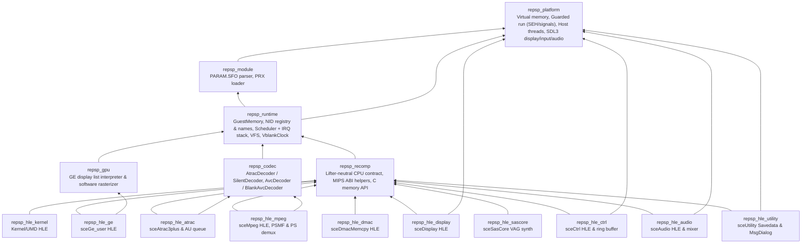

# 아키텍처 및 소비자 계약

repsp는 여러 PSP 타이틀 정적 재컴파일 프로젝트가 공유하는 공용 런타임 라이브러리입니다. 특정 타이틀의 식별자나 주소를 포함하지 않습니다.

---

## 1. 계층 구조 (Layer Architecture)

레이어는 아래에서 위로 단방향으로만 의존합니다:



| 타깃 | 별칭 | 공개 헤더 경로 | 주요 책임 |
|---|---|---|---|
| `repsp_platform` | `repsp::platform` | `include/repsp/platform/` | 가상 메모리 예약/commit/보호, 보호 실행(`GuardedRun`), 호스트 스레드 생성/CPU 시간, 파일 경로, SDL3 창/RGBA8 출력, UI 스레드 키보드·게임패드 스냅샷(`InputBackend`) |
| `repsp_module` | `repsp::module` | `include/repsp/module/` | `PARAM.SFO` 바이너리 파서, PRX 로더 및 재배치 (`ParsePrx`, `RelocateToBuffer`) |
| `repsp_runtime` | `repsp::runtime` | `include/repsp/runtime/` | 게스트 물리 메모리, 미러 접기, NID 레지스트리·SHA-1 이름표(`nid_names.h`), 커널 객체 표, `Clock`, `Vfs`, `UserPartition`, 단일 코어 `Scheduler`·인터럽트 큐·게스트 함수 호출, 공유 `VblankClock` |
| `repsp_codec` | `repsp::codec` | `include/repsp/codec/` | 코덱 디코더 계약 (`AtracDecoder`/`SilentDecoder`, `AvcDecoder`/`BlankAvcDecoder`) |
| `repsp_gpu` | `repsp::gpu` | `include/repsp/gpu/` | GE 디스플레이 리스트 해석기(`GeInterpreter`) 및 소프트웨어 래스터라이저(`RenderBackend`) |
| `repsp_recomp` | `repsp::recomp` | `include/repsp/recomp/` | lifter 중립 CPU 콜백 계약(`repsp_guest_cpu_ops`), 인자/반환 도우미(GPR/FPR), C 메모리 접근 함수, 안전점 `repsp_recomp_poll` |
| `repsp_hle_kernel` | `repsp::hle_kernel` | `include/repsp/hle/` | `KernelConfig` 기반 커널/UMD HLE 65개 함수 등록(`repsp::hle::kernel::Register`), 오류 코드 정의(`kernel_errors.h`) |
| `repsp_hle_ge` | `repsp::hle_ge` | `include/repsp/hle/ge.h` | `sceGe_user` 7개 NID 등록(`repsp::hle::ge::Register`), `SIGNAL`/`FINISH` 인터럽트 콜백 전달 |
| `repsp_hle_display` | `repsp::hle_display` | `include/repsp/hle/display.h` | `sceDisplay` 6개 NID 등록(`repsp::hle::display::Register`), `VblankClock` 구독, RGBA8 변환 및 BMP 프레임 덤프 |
| `repsp_hle_ctrl` | `repsp::hle_ctrl` | `include/repsp/hle/ctrl.h` | `sceCtrl` 3개 NID 등록(`repsp::hle::ctrl::Register`), `VblankClock` 기반 64항목 입력 링 버퍼, 테스트/스크립트용 `SetInputSource` 주입 |
| `repsp_hle_dmac` | `repsp::hle_dmac` | `include/repsp/hle/dmac.h` | `sceDmac` `sceDmacMemcpy` NID 등록(`repsp::hle::dmac::Register`) |
| `repsp_hle_audio` | `repsp::hle_audio` | `include/repsp/hle/audio.h` | `sceAudio` 6개 NID 등록, 8채널 이중 버퍼 대기, 끌어가기(pull) 믹서 및 더미 단조 시계 동기 |
| `repsp_hle_sascore` | `repsp::hle_sascore` | `include/repsp/hle/sascore.h` | `sceSasCore` 13개 NID 등록, Sony VAG ADPCM/ADSR 32-보이스 믹서(드라이 전용 리버브) |
| `repsp_hle_atrac` | `repsp::hle_atrac` | `include/repsp/hle/atrac.h` | `sceAtrac3plus` 11개 NID 등록, RIFF 파서·스트림 상태 머신 (`repsp::codec::AtracDecoder` 사용) |
| `repsp_hle_mpeg` | `repsp::hle_mpeg` | `include/repsp/hle/mpeg.h` | `sceMpeg` 24개 NID 등록, PSMF 파서, MPEG-2 PS/PES 디먹서, 링 버퍼 게스트 콜백, AVC/ATRAC AU 큐 (`repsp::codec` 디코더 사용) |
| `repsp_hle_utility` | `repsp::hle_utility` | `include/repsp/hle/utility.h` | `sceUtility` 8개 NID 등록(Savedata·MsgDialog), 단일 다이얼로그 상태 머신, 호스트 평문 슬롯/`PARAM.SFO` 입출력, `DialogPolicy` |

---

## 2. 소비자 계약 (Consumer Contract)

### 2.1. CMake 연동

소비자 프로젝트는 repsp를 서브모듈로 추가한 후 최상위 `add_subdirectory`로 포함하고 공개 별칭 타깃(`repsp::*`)만 링크합니다:

```cmake
add_subdirectory(third_party/repsp)

target_link_libraries(my_game PRIVATE
    repsp::platform
    repsp::module
    repsp::runtime
    repsp::recomp
    repsp::hle_kernel
)
```

repsp가 제공하는 컴파일 플래그 도우미 `repsp_apply_host_flags(<target>)`를 사용하여 C11/C++20 표준 및 경고 설정을 동일하게 맞출 수 있습니다.

### 2.2. CPU 레지스터 계약 (`guest_cpu.h`)

repsp는 레지스터 파일을 직접 소유하지 않으며, 특정 lifter의 내부 구조에 의존하지 않습니다. 소비자의 lifter 어댑터는 시작 시 `repsp_guest_cpu_ops` 콜백 표를 등록합니다:

```c
typedef struct repsp_guest_cpu_ops
{
    uint32_t context_size;                        /* bytes of one saved context */
    void (*save)(void* context);                  /* live register file -> context */
    void (*restore)(const void* context);         /* context -> live register file */
    uint32_t (*get_gpr)(int index);               /* MIPS GPR 0..31 */
    void (*set_gpr)(int index, uint32_t value);
    void (*call_guest)(uint32_t address);         /* run a guest function until it returns */
    uint32_t (*get_fpr)(int index);               /* MIPS COP1 FPR 0..31 bit pattern */
    void (*set_fpr)(int index, uint32_t value);
} repsp_guest_cpu_ops;

void repsp_recomp_register_cpu(const repsp_guest_cpu_ops* ops);
```

### 2.3. MIPS 호출 규약 도우미 (`recomp_helpers.h`)

PSP 펌웨어 호출 규약에 따라 인자와 반환값을 읽고 쓰는 C++ 인라인 도우미를 제공합니다:

* `repsp::recomp::Arg<T>(size_t index)`:
  * 0..3: `$a0..$a3` (GPR 4..7)
  * 4..7: `$t0..$t3` (GPR 8..11)
  * 8 이상: 스택 `$sp + (index - 8) * 4`에서 읽기
  * 포인터 타입 `T*`인 경우 게스트 주소를 호스트 포인터로 자동 변환 (0은 `nullptr`)
* `repsp::recomp::Return(uint32_t value)`: `$v0` (GPR 2)에 설정
* `repsp::recomp::Return(uint64_t value)`: `$v0` (GPR 2)와 `$v1` (GPR 3)에 분할 설정

### 2.4. C 메모리 접근 인터페이스

재컴파일된 C 코드나 어댑터의 빠른 경로 생성을 위해 C linkage 메모리 함수를 제공합니다:

```c
uint8_t* repsp_guest_base(void);
uint32_t repsp_guest_mask(void);                 /* 0x1FFFFFFF */
uint8_t* repsp_guest_translate(uint32_t addr);

uint8_t repsp_guest_read8(uint32_t addr);
uint16_t repsp_guest_read16(uint32_t addr);
uint32_t repsp_guest_read32(uint32_t addr);
uint64_t repsp_guest_read64(uint32_t addr);

void repsp_guest_write8(uint32_t addr, uint8_t val);
void repsp_guest_write16(uint32_t addr, uint16_t val);
void repsp_guest_write32(uint32_t addr, uint32_t val);
void repsp_guest_write64(uint32_t addr, uint64_t val);
```

### 2.5. NID 호출 규칙

재컴파일 코드의 임포트 스텁은 `repsp_recomp_hle_call(uint32_t nid)`을 호출합니다.
1. 등록된 NID인 경우 등록된 핸들러가 실행됩니다.
2. 미구현 NID인 경우 최초 호출 시 경고 로그를 기록하고, 호출 횟수를 통계에 누적하며, `$v0` (GPR 2)에 `0x80020002` (`SCE_KERNEL_ERROR_NOTIMPLEMENTED`)를 설정합니다.
3. 환경 변수 `REPSP_STOP_ON_UNIMPLEMENTED=1`이 설정되거나 레지스트리에 설정된 경우 미구현 NID 호출 시 `repsp::platform::RaiseStop`을 통해 가장 가까운 `GuardedRun`을 즉시 정지합니다.

### 2.6. PRX 로더 계약 (`prx.h`, `prx_loader.h`)

PSP 실행 모듈(PRX, `0xFFA0`)을 검증하고 호출자가 지정한 기준 주소(`base`)에 맞추어 `SHT_PRXRELOC` 재배치를 적용합니다:
* `repsp::module::ParsePrx`: 메모리 쓰기 없이 ELF 헤더, 세그먼트, 모듈 정보, 임포트/익스포트 표를 파싱하고 `LoadedPrx` 정보를 반환합니다.
* `repsp::module::RelocateToBuffer`: PRX 세그먼트를 메모리 레이아웃 버퍼로 펼치고 재배치를 적용한 바이트 벡터를 반환합니다. 독립 구현(lifter의 재배치)과의 바이트 단위 비교 교차 검증에 사용됩니다.
* `repsp::runtime::LoadPrx`: `RelocateToBuffer` 결과를 `GuestMemory`의 `base` 위치에 복사하고 BSS를 0으로 초기화하며, 대상 범위가 유효한 커밋 범위 내인지 검증합니다.

### 2.7. 보호 실행 및 정지 계약 (`guarded_run.h`)

하드웨어 결함(fault) 및 제어된 실행 정지(디스패치 미스, 미구현 NID/명령 등)를 감지하고 보고하기 위한 보호 실행 메커니즘을 제공합니다:
* `GuardedRun(fn)`: 함수를 보호 컨텍스트 내에서 실행합니다. 결함 또는 정지가 발생하면 `GuardedRunResult`를 반환합니다 (`succeeded`, `stopped`, `stop_reason`).
* `repsp::platform::RaiseStop(reason)` 및 C API `repsp_raise_stop(reason)`: 현재 실행 중인 가장 안쪽 `GuardedRun`을 정지시키고 `stop_reason`을 전달합니다. Win32에서는 전용 SEH 예외 코드(`0xE0000001`)를 사용하고 Linux에서는 스레드별 `siglongjmp`를 사용합니다.
* **제약사항**: 정지를 유발한 C 프레임과 이를 감싸는 `GuardedRun` 호출 사이에는 **소멸자(destructor)를 가진 C++ 스택 프레임이 존재하지 않아야 합니다**. SEH 및 `siglongjmp` 언와인딩 과정에서 C++ 스택 소멸자가 호출되지 않으므로, 게스트 실행 스택은 순수 C 호출 규약으로 구성되어야 합니다.

### 2.8. 커널 설정 및 스케줄러 계약 (`kernel.h`, `scheduler.h`)

* 소비자는 `repsp::hle::kernel::Register(const KernelConfig&)`를 통해 장치 마운트(`disc0:`, `umd0:`, `ms0:` 등), 로드된 메인 모듈 이미지 범위(`module_image_base`, `module_image_size`)를 등록하고 65개 커널·UMD HLE 함수를 활성화합니다.
* `repsp::runtime::GetScheduler()`는 `CreateThread`로 첫 `module_start` 스레드를 만들고 `Run(entry_thread_uid)`로 단일 코어 바톤 스케줄러를 구동합니다. 게스트 워커 스레드 내부의 `RaiseStop`이나 하드웨어 결함은 각 워커의 `GuardedRun`이 포착한 뒤, 모든 워커를 join하고 호출자 스레드의 바깥 `GuardedRun`으로 전파합니다. 교착 시에는 모든 스레드와 대기 대상을 담아 `RaiseStop`으로 멈춥니다.
* **인터럽트 전달 계약**: `Scheduler::QueueInterrupt`로 적재된 인터럽트(예: GE `SIGNAL`/`FINISH`)는 `repsp_recomp_hle_call` 종료 시점, `repsp_recomp_poll()`, 유휴 루프 등 안전점에서 16 KiB 커널 인터럽트 스택(`0x08010000`)을 사용해 전달됩니다. 인터럽트 핸들러 안에서는 블로킹 대기·명시적 양보(`WaitCurrent`/`YieldCurrent`)가 금지되며 위반 시 즉시 `RaiseStop`으로 정지합니다.
* **스레드 문맥 게스트 함수 호출**: `Scheduler::CallGuestFunction(entry, a0, a1, a2, a3)`는 현재 실행 중인 게스트 스레드 컨텍스트 위에서 레지스터(특히 호출자 보존 `$s0..$s7`, `$fp`, `$sp`, `$ra`)를 저장·복원한 뒤 게스트 함수(예: `sceMpegRingbufferPut` 읽기 콜백)를 호출하고 `$v0`를 반환합니다. 인터럽트 스택으로 전환하지 않으므로 콜백 내부에서 블로킹 커널 대기(`sceIoRead`, `sceKernelDelayThread` 등)가 정상 동작합니다.
* 환경 변수 `REPSP_HLE_TRACE=1` 및 `REPSP_HLE_TRACE_LIMIT=<N>`으로 HLE 호출 추적을 제어하고 `PrintKernelSummary()`로 호출 횟수, 스레드, 열린 파일, 할당 블록을 요약할 수 있습니다.
* **정지·대기 시 스택·잠금 계약**: `NidRegistry::Invoke`는 핸들러 실행 중 스택에 소유 객체(`std::function`, `std::string`)를 두지 않으며, `RaiseStop`/`WaitCurrent`/`YieldIfPreempted` 경로의 바깥 프레임은 뮤텍스 잠금을 유지하지 않습니다(대기 중 강제 종료되는 스레드의 안쪽 대기 핸들러 프레임 지역 객체만 누수 범위에 남습니다).

### 2.9. GE·디스플레이 및 프레임 덤프 계약 (`ge.h`, `display.h`)

* 소비자는 `repsp::hle::ge::Register()`와 `repsp::hle::display::Register(const DisplayHleConfig&)`로 `sceGe_user`와 `sceDisplay` HLE를 등록하고, 종료 시 `repsp::hle::display::Shutdown()`으로 VBlank·SDL 스레드를 정리합니다.
* `DisplayHleConfig::headless`가 `true`이면 SDL 더미 비디오 드라이버로 창 없이 실행하며, `frame_dump_dir`·`frame_dump_limit`(또는 소비자 환경 변수 `REPSP_FRAME_DUMP`·`REPSP_FRAME_DUMP_LIMIT`)로 `frame_NNNN.bmp`를 기록할 수 있습니다.
* `repsp::hle::ge::FormatStats()`와 `repsp::hle::display::FormatStats()`로 디스플레이 리스트·명령·프리미티브·FBP/FBW/PSM·VBlank 통계를 조회합니다.
* 소프트웨어 래스터화기(`SwTri`)는 `kPrimTriangles`를 픽셀 중심 `(x + 0.5, y + 0.5)` 표본과 와인딩 정규화(음수 면적 시 정점 스왑) 기반 top-left fill rule로 평가해 아래쪽/오른쪽 배타 경계 1픽셀 넘침을 방지하며, `ge_probe`가 이를 검증합니다.
* `GeInterpreter`와 `Fragment`는 Color Test(`CTE` `0x27`, `CTEST` `0xD8`, `CREF` `0xD9`, `CMSK` `0xDA`)를 지원해 컬러키 마스킹(`NEVER`/`ALWAYS`/`EQUAL`/`NOTEQUAL`)을 처리합니다.

### 2.10. 컨트롤러 입력 및 DMAC 계약 (`ctrl.h`, `dmac.h`)

* 소비자는 `repsp::hle::ctrl::Register()`와 `repsp::hle::dmac::Register()`로 `sceCtrl`(3개 NID)과 `sceDmac`(1개 NID) HLE를 등록하고, 종료 시 `Shutdown()`으로 정리합니다.
* `repsp::hle::ctrl::SetInputSource(fn)`을 호출하면 기본 `platform::InputBackend` 폴링 대신 합성/스크립트 입력 공급자 `fn(vcount) -> ControllerState`를 사용할 수 있으며, `nullptr`로 복원할 수 있습니다.
* `repsp::hle::ctrl::GetStats()` / `FormatStats()`로 샘플링 주기·모드·생성/읽기 통계를 조회할 수 있습니다.

### 2.11. 오디오·SAS·ATRAC 계약 (`audio.h`, `sascore.h`, `atrac.h`)

* 소비자는 `repsp::hle::audio::Register()`, `repsp::hle::sascore::Register()`, `repsp::hle::atrac::Register()`로 30개 오디오 NID(`sceAudio` 6, `sceSasCore` 13, `sceAtrac3plus` 11)를 등록하고 종료 시 각각 `Shutdown()`으로 정리합니다.
* `repsp::platform::AudioBackend::SetPullCallback`은 끌어가기(pull) 모델을 사용합니다. 실제 장치가 열리면 `SDL_OpenAudioDeviceStream` 콜백이, `audio.dummy = true`인 헤드리스 모드에서는 호스트 단조 시계 스레드가 44.1 kHz 속도로 `MixPull()`을 구동하며 `WaitType::kAudio`와 `AddExternalWaitSource`/`RemoveExternalWaitSource`를 통해 `VblankClock`과 외부 대기 원천을 안전하게 합성합니다.
* `repsp::hle::atrac::SetDecoder(AtracDecoder*)`로 코덱 디코더를 교체할 수 있으며, 기본값은 `SilentDecoder`(PCM 0 출력)입니다. `FormatStats()`는 항상 `"ATRAC decode: silent"`(또는 활성 디코더 이름)와 SAS의 `"reverb=dry only (not mixed)"` 상태를 명시합니다.
* `ModuleMgr` HLE 화이트리스트는 HLE가 제공하는 Sony AV PRX(`sc_sascore.prx`, `audiocodec.prx`, `libatrac3plus.prx`, `videocodec.prx`, `mpegbase.prx`, `mpeg.prx`)만 성공 핸들을 돌려주고 알 수 없는 PRX는 `kSceKernelErrorPrxTypeUnsupported`(`0x80020148`)로 거부합니다.

### 2.12. 코덱 및 `sceMpeg` 계약 (`codec/`, `mpeg.h`)

* `repsp_codec`은 HLE 모듈 간 직접 링크 없이 공유하는 디코더 계약(`repsp::codec::AtracDecoder`/`SilentDecoder`, `repsp::codec::AvcDecoder`/`BlankAvcDecoder`), 순수 C 플러그인 ABI(`include/repsp/codec/plugin.h`), 그리고 동적 로더(`include/repsp/codec/loader.h`)를 제공합니다. `repsp::hle::atrac::` 이름공간은 하위 호환성을 위해 `using` 별칭으로 `AtracDecoder`/`SilentDecoder`를 유지합니다.
* 선택 옵션 `REPSP_CODEC_FFMPEG=ON`을 켜면 별도 공유 라이브러리 `repsp_codec_ffmpeg`가 빌드되며(`OFF`가 기본값), `libavcodec` ≥ 60(LGPL 공유 빌드)에 동적으로 링크하여 ATRAC3/ATRAC3plus와 H.264를 디코딩합니다. `repsp_platform`은 `DynamicLibrary`(`dynlib.h`)와 오디오 WAV 덤프(`REPSP_AUDIO_DUMP`)를 제공합니다.
* 소비자는 `repsp::hle::mpeg::Register()`로 24개 `sceMpeg` NID를 등록하고 종료 시 `repsp::hle::mpeg::Shutdown()`으로 정리합니다.
* `repsp::hle::mpeg::SetAvcDecoder(AvcDecoder*)` 및 `SetAtracDecoder(AtracDecoder*)`로 디코더를 교체할 수 있으며, 기본값은 불투명 검은 프레임(`BlankAvcDecoder`)과 무음(`SilentDecoder`)입니다. `FormatStats()`는 `"AVC decode: blank"`와 `"ATRAC decode: silent"` 및 디코딩·분리 통계를 보고합니다.

### 2.13. `sceUtility` 세이브 데이터 및 메시지 다이얼로그 계약 (`utility.h`)

* 소비자는 `repsp::hle::utility::Register(const Config&)`로 `sceUtility` 8개 NID(`SavedataInitStart/GetStatus/Update/ShutdownStart`, `MsgDialogInitStart/GetStatus/Update/ShutdownStart`)를 등록하고 종료 시 `Shutdown()`으로 정리합니다.
* `Config::save_root`가 비어 있으면 `platform::GetUserDataDirectory("repsp") / "savedata"` 아래에 `<gameName><saveName>/` 슬롯 디렉터리를 두고 평문 세이브 데이터, `ParamSfo::Parse` 호환 `PARAM.SFO`, 보조 자산(`ICON0.PNG`, `ICON1.PMF`, `PIC1.PNG`, `SND0.AT3`)을 임시 파일 교체 방식으로 기록/로드합니다. 구현되지 않은 savedata 모드는 `platform::RaiseStop`으로 멈춥니다.
* 다이얼로그 UI는 직접 그리지 않으며(`FormatStats()`에 `"dialog UI: not drawn"` 명시), `SetDialogPolicy(DialogPolicy)`로 `Yes/No`/확인 응답을 주입하고 모든 다이얼로그 텍스트·선택지를 `Stats::dialog_records`에 남깁니다. `utility_probe`로 상태 전이, 세이브/로드 왕복, 오류 코드, 미구현 모드 정지, 정책 응답을 검증합니다.

---

# Architecture and Consumer Contract (English)

repsp is a title-agnostic shared runtime library for PSP static recompilation projects. It does not contain any title-specific names, addresses, or logic.

## 1. Layer Architecture

Layers depend strictly downward as shown in the diagram and table above.

## 2. Consumer Contract

### 2.1. CMake Integration
Consumers add repsp via `add_subdirectory(third_party/repsp)` and link against public alias targets (`repsp::platform`, `repsp::module`, `repsp::runtime`, `repsp::codec`, `repsp::gpu`, `repsp::recomp`, `repsp::hle_kernel`, `repsp::hle_ge`, `repsp::hle_display`, `repsp::hle_ctrl`, `repsp::hle_dmac`, `repsp::hle_audio`, `repsp::hle_sascore`, `repsp::hle_atrac`, `repsp::hle_mpeg`, `repsp::hle_utility`).

### 2.2. CPU Register Contract (`guest_cpu.h`)
repsp owns no register file. Consumers register the `repsp_guest_cpu_ops` callback table (including `get_fpr`/`set_fpr` for COP1 float returns) at startup.

### 2.3. Calling Convention Helpers (`recomp_helpers.h`)
`Arg<T>(n)` reads MIPS arguments (0..3 in `$a0..$a3`, 4..7 in `$t0..$t3`, 8+ from stack `$sp`). `Return(v)` writes `$v0` (or `$v0:$v1` for 64-bit values).

### 2.4. C Memory Access
Fast-path and inline memory operations (`repsp_guest_base()`, `repsp_guest_mask()`, `repsp_guest_read*`, `repsp_guest_write*`) are exposed with C linkage.

### 2.5. NID Calling Rules
`repsp_recomp_hle_call(nid)` dispatches to registered handlers, or sets `$v0` to `0x80020002` (`SCE_KERNEL_ERROR_NOTIMPLEMENTED`) and tracks call counts. If `REPSP_STOP_ON_UNIMPLEMENTED=1` or configured on the registry, it invokes `repsp::platform::RaiseStop` to stop the innermost `GuardedRun`.

### 2.6. PRX Loader Contract (`prx.h`, `prx_loader.h`)
Validates PSP PRX (`0xFFA0`) executables and applies `SHT_PRXRELOC` relocations to a caller-specified `base` address:
* `repsp::module::ParsePrx`: Parses ELF headers, segments, module info, import/export tables without modifying memory and returns `LoadedPrx`.
* `repsp::module::RelocateToBuffer`: Lays out PRX segments into a buffer and applies relocations, returning a relocated byte vector for cross-checking against independent implementations.
* `repsp::runtime::LoadPrx`: Copies relocated buffer into `GuestMemory` at `base`, zeroes BSS, and verifies the range is inside committed guest memory.

### 2.7. Guarded Run and Stop Contract (`guarded_run.h`)
Provides guarded execution for catching hardware faults and explicit stop requests (dispatch misses, unimplemented NIDs/instructions):
* `GuardedRun(fn)`: Executes function within guarded context, returning `GuardedRunResult` (`succeeded`, `stopped`, `stop_reason`).
* `repsp::platform::RaiseStop(reason)` and C API `repsp_raise_stop(reason)`: Stops the innermost active `GuardedRun` and records `stop_reason`. Implemented via custom SEH exception (`0xE0000001`) on Win32 and per-thread `siglongjmp` on Linux.
* **Constraint**: No C++ frames with destructors may reside between the caller of `RaiseStop` and the enclosing `GuardedRun` frame, as SEH/`siglongjmp` unwinding does not run non-trivial C++ destructors. Guest execution stacks must consist of pure C calling conventions.

### 2.8. Kernel Configuration and Scheduler Contract (`kernel.h`, `scheduler.h`)

Consumers configure VFS mounts and reserve the loaded module image range via `repsp::hle::kernel::Register(const KernelConfig&)`, then create the initial entry thread and run the single-core baton scheduler via `repsp::runtime::GetScheduler().Run(entry_uid)`. Worker-thread `RaiseStop` or hardware faults are caught per-worker, joined cleanly, and re-raised on the caller's outer `GuardedRun`. `REPSP_HLE_TRACE=1` and `REPSP_HLE_TRACE_LIMIT` control call tracing, and `PrintKernelSummary()` prints call counts, threads, open files, and partition blocks.
* **Stop/wait stack & lock contract**: `NidRegistry::Invoke` keeps no owning objects (`std::function`, `std::string`) on the stack while calling `handler()`, and all outer frames across `RaiseStop`/`WaitCurrent`/`YieldIfPreempted` hold no mutex locks (only local objects inside an inner waiting handler frame may be leaked if a blocked thread is force-terminated).
* **Interrupt delivery contract**: Queued interrupts (`Scheduler::QueueInterrupt`) are delivered at safe points using the dedicated 16 KiB kernel interrupt stack (`0x08010000`). Blocking waits or explicit yields inside an interrupt handler trigger `RaiseStop`.
* **Thread-context guest calls**: `Scheduler::CallGuestFunction(entry, a0, a1, a2, a3)` saves/restores registers on the running guest thread, invokes a guest function (such as the `sceMpegRingbufferPut` callback) in normal thread context so blocking waits work normally, and returns `$v0`.

### 2.9. GE, Display, and Frame Dump Contract (`ge.h`, `display.h`)

Consumers register `repsp::hle::ge::Register()` and `repsp::hle::display::Register(const DisplayHleConfig&)` and call `repsp::hle::display::Shutdown()` on exit (`display` subscribes to the shared runtime `VblankClock`). `headless = true` runs with the SDL dummy video driver; `frame_dump_dir` / `frame_dump_limit` write `frame_NNNN.bmp` dumps; `FormatStats()` exposes GE and Display counters. The `kPrimTriangles` software rasterizer (`SwTri`) samples pixel centers `(x + 0.5, y + 0.5)` with winding-normalized top-left fill rule evaluation to prevent 1-pixel spills past exclusive bottom/right quad edges, and `GeInterpreter`/`Fragment` evaluate Color Test (`CTE` `0x27`, `CTEST` `0xD8`, `CREF` `0xD9`, `CMSK` `0xDA`), both verified by `ge_probe`.

### 2.10. Controller Input and DMAC Contract (`ctrl.h`, `dmac.h`)

Consumers register `repsp::hle::ctrl::Register()` and `repsp::hle::dmac::Register()` for `sceCtrl` (3 NIDs) and `sceDmac` (`sceDmacMemcpy`), and call `Shutdown()` on exit. `repsp::hle::ctrl::SetInputSource(fn)` injects a custom `fn(vcount) -> ControllerState` source instead of polling `platform::InputBackend` (pass `nullptr` to restore). `repsp::hle::ctrl::GetStats()` / `FormatStats()` expose sampling cycle/mode and sample counters.

### 2.11. Audio, SAS Synthesizer, and ATRAC Contract (`audio.h`, `sascore.h`, `atrac.h`)

Consumers register `repsp::hle::audio::Register()`, `repsp::hle::sascore::Register()`, and `repsp::hle::atrac::Register()` for 30 audio NIDs (`sceAudio` 6, `sceSasCore` 13, `sceAtrac3plus` 11) and call `Shutdown()` on exit. `platform::AudioBackend::SetPullCallback` drives synchronous mixing via SDL3 pull stream or a 44.1 kHz steady-clock dummy thread, composing `WaitType::kAudio` with `VblankClock` via `AddExternalWaitSource`/`RemoveExternalWaitSource`. `repsp::hle::atrac::SetDecoder(AtracDecoder*)` swaps the codec decoder (defaulting to `SilentDecoder`), and `FormatStats()` explicitly reports `"ATRAC decode: silent"` and SAS `"reverb=dry only (not mixed)"`. `ModuleMgr` whitelists HLE-backed Sony AV PRXs and rejects unknown PRXs with `kSceKernelErrorPrxTypeUnsupported` (`0x80020148`).

### 2.12. Codec and `sceMpeg` Contract (`codec/`, `mpeg.h`)

`repsp_codec` holds shared decoder contracts (`repsp::codec::AtracDecoder`/`SilentDecoder`, `repsp::codec::AvcDecoder`/`BlankAvcDecoder`), the pure-C plugin ABI (`include/repsp/codec/plugin.h`), and the dynamic loader (`include/repsp/codec/loader.h`) so HLE modules never link each other (`repsp::hle::atrac::` exposes `using` aliases for compatibility). When `REPSP_CODEC_FFMPEG=ON` (default `OFF`), the optional shared library `repsp_codec_ffmpeg` links dynamically against an LGPL `libavcodec` >= 60 build. `repsp_platform` provides `DynamicLibrary` (`dynlib.h`) and optional WAV capture (`REPSP_AUDIO_DUMP`). Consumers register the 24 `sceMpeg` NIDs with `repsp::hle::mpeg::Register()` and tear down with `Shutdown()`. `SetAvcDecoder`/`SetAtracDecoder` swap decoders (defaulting to `BlankAvcDecoder` opaque black frames and `SilentDecoder` silence); `FormatStats()` reports `"AVC decode: blank"`, `"ATRAC decode: silent"`, and demux/decode counts.

### 2.13. `sceUtility` Savedata and MsgDialog Contract (`utility.h`)

Consumers register the 8 `sceUtility` NIDs (`Savedata*` and `MsgDialog*`) via `repsp::hle::utility::Register(const Config&)` and tear down with `Shutdown()`. Slots are stored under `Config::save_root` (defaulting to `GetUserDataDirectory("repsp") / "savedata"`) using unencrypted payloads, `ParamSfo::Parse`-compatible `PARAM.SFO`, auxiliary media files, and atomic `.tmp` renames; unimplemented modes stop via `RaiseStop`. Dialog UI is not drawn (`FormatStats()` reports `"dialog UI: not drawn"`); `SetDialogPolicy(DialogPolicy)` handles prompt answers while recording every dialog in `Stats::dialog_records`. `utility_probe` verifies transitions, round-trip I/O, errors, unimplemented mode stops, and policy callbacks.
