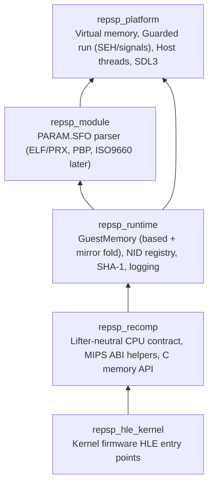

# 아키텍처 및 소비자 계약

repsp는 여러 PSP 타이틀 정적 재컴파일 프로젝트가 공유하는 공용 런타임 라이브러리입니다. 특정 타이틀의 식별자나 주소를 포함하지 않습니다.

---

## 1. 계층 구조 (Layer Architecture)

레이어는 아래에서 위로 단방향으로만 의존합니다:



| 타깃 | 별칭 | 공개 헤더 경로 | 주요 책임 |
|---|---|---|---|
| `repsp_platform` | `repsp::platform` | `include/repsp/platform/` | 가상 메모리 예약/commit/보호, 보호 실행(`GuardedRun`), 호스트 스레드 생성/CPU 시간, 파일 경로, SDL3 연동 |
| `repsp_module` | `repsp::module` | `include/repsp/module/` | `PARAM.SFO` 바이너리 파서, PRX 로더 및 재배치 (`ParsePrx`, `RelocateToBuffer`) |
| `repsp_runtime` | `repsp::runtime` | `include/repsp/runtime/` | 게스트 물리 메모리, 미러 접기, NID 레지스트리 및 `REPSP_HLE_TRACE`, 커널 객체 표(`KernelObjectTable`), 단조 시계(`Clock`), `Vfs`, `UserPartition`, 단일 코어 `Scheduler`, PRX 메모리 로드 |
| `repsp_recomp` | `repsp::recomp` | `include/repsp/recomp/` | lifter 중립 CPU 콜백 계약(`repsp_guest_cpu_ops`), 인자/반환 도우미, C 메모리 접근 함수, 안전점 `repsp_recomp_poll` |
| `repsp_hle_kernel` | `repsp::hle_kernel` | `include/repsp/hle/` | `KernelConfig` 기반 커널/UMD HLE 65개 함수 등록(`repsp::hle::kernel::Register`), 오류 코드 정의(`kernel_errors.h`) |

---

## 2. 소비자 계약 (Consumer Contract)

### 2.1. CMake 연동

소비자 프로젝트는 repsp를 서브모듈로 추가한 후 최상위 `add_subdirectory`로 포함하고 공개 별칭 타깃(`repsp::*`)만 링크합니다:

```cmake
add_subdirectory(third_party/repsp)

target_link_libraries(my_game PRIVATE
    repsp::platform
    repsp::module
    repsp::runtime
    repsp::recomp
    repsp::hle_kernel
)
```

repsp가 제공하는 컴파일 플래그 도우미 `repsp_apply_host_flags(<target>)`를 사용하여 C11/C++20 표준 및 경고 설정을 동일하게 맞출 수 있습니다.

### 2.2. CPU 레지스터 계약 (`guest_cpu.h`)

repsp는 레지스터 파일을 직접 소유하지 않으며, 특정 lifter의 내부 구조에 의존하지 않습니다. 소비자의 lifter 어댑터는 시작 시 `repsp_guest_cpu_ops` 콜백 표를 등록합니다:

```c
typedef struct repsp_guest_cpu_ops
{
    uint32_t context_size;                        /* bytes of one saved context */
    void (*save)(void* context);                  /* live register file -> context */
    void (*restore)(const void* context);         /* context -> live register file */
    uint32_t (*get_gpr)(int index);               /* MIPS GPR 0..31 */
    void (*set_gpr)(int index, uint32_t value);
    void (*call_guest)(uint32_t address);         /* run a guest function until it returns */
} repsp_guest_cpu_ops;

void repsp_recomp_register_cpu(const repsp_guest_cpu_ops* ops);
```

### 2.3. MIPS 호출 규약 도우미 (`recomp_helpers.h`)

PSP 펌웨어 호출 규약에 따라 인자와 반환값을 읽고 쓰는 C++ 인라인 도우미를 제공합니다:

* `repsp::recomp::Arg<T>(size_t index)`:
  * 0..3: `$a0..$a3` (GPR 4..7)
  * 4..7: `$t0..$t3` (GPR 8..11)
  * 8 이상: 스택 `$sp + (index - 8) * 4`에서 읽기
  * 포인터 타입 `T*`인 경우 게스트 주소를 호스트 포인터로 자동 변환 (0은 `nullptr`)
* `repsp::recomp::Return(uint32_t value)`: `$v0` (GPR 2)에 설정
* `repsp::recomp::Return(uint64_t value)`: `$v0` (GPR 2)와 `$v1` (GPR 3)에 분할 설정

### 2.4. C 메모리 접근 인터페이스

재컴파일된 C 코드나 어댑터의 빠른 경로 생성을 위해 C linkage 메모리 함수를 제공합니다:

```c
uint8_t* repsp_guest_base(void);
uint32_t repsp_guest_mask(void);                 /* 0x1FFFFFFF */
uint8_t* repsp_guest_translate(uint32_t addr);

uint8_t repsp_guest_read8(uint32_t addr);
uint16_t repsp_guest_read16(uint32_t addr);
uint32_t repsp_guest_read32(uint32_t addr);
uint64_t repsp_guest_read64(uint32_t addr);

void repsp_guest_write8(uint32_t addr, uint8_t val);
void repsp_guest_write16(uint32_t addr, uint16_t val);
void repsp_guest_write32(uint32_t addr, uint32_t val);
void repsp_guest_write64(uint32_t addr, uint64_t val);
```

### 2.5. NID 호출 규칙

재컴파일 코드의 임포트 스텁은 `repsp_recomp_hle_call(uint32_t nid)`을 호출합니다.
1. 등록된 NID인 경우 등록된 핸들러가 실행됩니다.
2. 미구현 NID인 경우 최초 호출 시 경고 로그를 기록하고, 호출 횟수를 통계에 누적하며, `$v0` (GPR 2)에 `0x80020002` (`SCE_KERNEL_ERROR_NOTIMPLEMENTED`)를 설정합니다.
3. 환경 변수 `REPSP_STOP_ON_UNIMPLEMENTED=1`이 설정되거나 레지스트리에 설정된 경우 미구현 NID 호출 시 `repsp::platform::RaiseStop`을 통해 가장 가까운 `GuardedRun`을 즉시 정지합니다.

### 2.6. PRX 로더 계약 (`prx.h`, `prx_loader.h`)

PSP 실행 모듈(PRX, `0xFFA0`)을 검증하고 호출자가 지정한 기준 주소(`base`)에 맞추어 `SHT_PRXRELOC` 재배치를 적용합니다:
* `repsp::module::ParsePrx`: 메모리 쓰기 없이 ELF 헤더, 세그먼트, 모듈 정보, 임포트/익스포트 표를 파싱하고 `LoadedPrx` 정보를 반환합니다.
* `repsp::module::RelocateToBuffer`: PRX 세그먼트를 메모리 레이아웃 버퍼로 펼치고 재배치를 적용한 바이트 벡터를 반환합니다. 독립 구현(lifter의 재배치)과의 바이트 단위 비교 교차 검증에 사용됩니다.
* `repsp::runtime::LoadPrx`: `RelocateToBuffer` 결과를 `GuestMemory`의 `base` 위치에 복사하고 BSS를 0으로 초기화하며, 대상 범위가 유효한 커밋 범위 내인지 검증합니다.

### 2.7. 보호 실행 및 정지 계약 (`guarded_run.h`)

하드웨어 결함(fault) 및 제어된 실행 정지(디스패치 미스, 미구현 NID/명령 등)를 감지하고 보고하기 위한 보호 실행 메커니즘을 제공합니다:
* `GuardedRun(fn)`: 함수를 보호 컨텍스트 내에서 실행합니다. 결함 또는 정지가 발생하면 `GuardedRunResult`를 반환합니다 (`succeeded`, `stopped`, `stop_reason`).
* `repsp::platform::RaiseStop(reason)` 및 C API `repsp_raise_stop(reason)`: 현재 실행 중인 가장 안쪽 `GuardedRun`을 정지시키고 `stop_reason`을 전달합니다. Win32에서는 전용 SEH 예외 코드(`0xE0000001`)를 사용하고 Linux에서는 스레드별 `siglongjmp`를 사용합니다.
* **제약사항**: 정지를 유발한 C 프레임과 이를 감싸는 `GuardedRun` 호출 사이에는 **소멸자(destructor)를 가진 C++ 스택 프레임이 존재하지 않아야 합니다**. SEH 및 `siglongjmp` 언와인딩 과정에서 C++ 스택 소멸자가 호출되지 않으므로, 게스트 실행 스택은 순수 C 호출 규약으로 구성되어야 합니다.

### 2.8. 커널 설정 및 스케줄러 계약 (`kernel.h`, `scheduler.h`)

* 소비자는 `repsp::hle::kernel::Register(const KernelConfig&)`를 통해 장치 마운트(`disc0:`, `umd0:`, `ms0:` 등), 로드된 메인 모듈 이미지 범위(`module_image_base`, `module_image_size`)를 등록하고 65개 커널·UMD HLE 함수를 활성화합니다.
* `repsp::runtime::GetScheduler()`는 `CreateThread`로 첫 `module_start` 스레드를 만들고 `Run(entry_thread_uid)`로 단일 코어 바톤 스케줄러를 구동합니다. 게스트 워커 스레드 내부의 `RaiseStop`이나 하드웨어 결함은 각 워커의 `GuardedRun`이 포착한 뒤, 모든 워커를 join하고 호출자 스레드의 바깥 `GuardedRun`으로 전파합니다. 교착 시에는 모든 스레드와 대기 대상을 담아 `RaiseStop`으로 멈춥니다.
* 환경 변수 `REPSP_HLE_TRACE=1` 및 `REPSP_HLE_TRACE_LIMIT=<N>`으로 HLE 호출 추적을 제어하고 `PrintKernelSummary()`로 호출 횟수, 스레드, 열린 파일, 할당 블록을 요약할 수 있습니다.
* **정지·대기 시 스택·잠금 계약**: `NidRegistry::Invoke`는 핸들러 실행 중 스택에 소유 객체(`std::function`, `std::string`)를 두지 않으며, `RaiseStop`/`WaitCurrent`/`YieldIfPreempted` 경로의 바깥 프레임은 뮤텍스 잠금을 유지하지 않습니다(대기 중 강제 종료되는 스레드의 안쪽 대기 핸들러 프레임 지역 객체만 누수 범위에 남습니다).

---

# Architecture and Consumer Contract (English)

repsp is a title-agnostic shared runtime library for PSP static recompilation projects. It does not contain any title-specific names, addresses, or logic.

## 1. Layer Architecture

Layers depend strictly downward as shown in the diagram and table above.

## 2. Consumer Contract

### 2.1. CMake Integration
Consumers add repsp via `add_subdirectory(third_party/repsp)` and link against public alias targets (`repsp::platform`, `repsp::module`, `repsp::runtime`, `repsp::recomp`, `repsp::hle_kernel`).

### 2.2. CPU Register Contract (`guest_cpu.h`)
repsp owns no register file. Consumers register the `repsp_guest_cpu_ops` callback table at startup.

### 2.3. Calling Convention Helpers (`recomp_helpers.h`)
`Arg<T>(n)` reads MIPS arguments (0..3 in `$a0..$a3`, 4..7 in `$t0..$t3`, 8+ from stack `$sp`). `Return(v)` writes `$v0` (or `$v0:$v1` for 64-bit values).

### 2.4. C Memory Access
Fast-path and inline memory operations (`repsp_guest_base()`, `repsp_guest_mask()`, `repsp_guest_read*`, `repsp_guest_write*`) are exposed with C linkage.

### 2.5. NID Calling Rules
`repsp_recomp_hle_call(nid)` dispatches to registered handlers, or sets `$v0` to `0x80020002` (`SCE_KERNEL_ERROR_NOTIMPLEMENTED`) and tracks call counts. If `REPSP_STOP_ON_UNIMPLEMENTED=1` or configured on the registry, it invokes `repsp::platform::RaiseStop` to stop the innermost `GuardedRun`.

### 2.6. PRX Loader Contract (`prx.h`, `prx_loader.h`)
Validates PSP PRX (`0xFFA0`) executables and applies `SHT_PRXRELOC` relocations to a caller-specified `base` address:
* `repsp::module::ParsePrx`: Parses ELF headers, segments, module info, import/export tables without modifying memory and returns `LoadedPrx`.
* `repsp::module::RelocateToBuffer`: Lays out PRX segments into a buffer and applies relocations, returning a relocated byte vector for cross-checking against independent implementations.
* `repsp::runtime::LoadPrx`: Copies relocated buffer into `GuestMemory` at `base`, zeroes BSS, and verifies the range is inside committed guest memory.

### 2.7. Guarded Run and Stop Contract (`guarded_run.h`)
Provides guarded execution for catching hardware faults and explicit stop requests (dispatch misses, unimplemented NIDs/instructions):
* `GuardedRun(fn)`: Executes function within guarded context, returning `GuardedRunResult` (`succeeded`, `stopped`, `stop_reason`).
* `repsp::platform::RaiseStop(reason)` and C API `repsp_raise_stop(reason)`: Stops the innermost active `GuardedRun` and records `stop_reason`. Implemented via custom SEH exception (`0xE0000001`) on Win32 and per-thread `siglongjmp` on Linux.
* **Constraint**: No C++ frames with destructors may reside between the caller of `RaiseStop` and the enclosing `GuardedRun` frame, as SEH/`siglongjmp` unwinding does not run non-trivial C++ destructors. Guest execution stacks must consist of pure C calling conventions.

### 2.8. Kernel Configuration and Scheduler Contract (`kernel.h`, `scheduler.h`)

Consumers configure VFS mounts and reserve the loaded module image range via `repsp::hle::kernel::Register(const KernelConfig&)`, then create the initial entry thread and run the single-core baton scheduler via `repsp::runtime::GetScheduler().Run(entry_uid)`. Worker-thread `RaiseStop` or hardware faults are caught per-worker, joined cleanly, and re-raised on the caller's outer `GuardedRun`. `REPSP_HLE_TRACE=1` and `REPSP_HLE_TRACE_LIMIT` control call tracing, and `PrintKernelSummary()` prints call counts, threads, open files, and partition blocks.
* **Stop/wait stack & lock contract**: `NidRegistry::Invoke` keeps no owning objects (`std::function`, `std::string`) on the stack while calling `handler()`, and all outer frames across `RaiseStop`/`WaitCurrent`/`YieldIfPreempted` hold no mutex locks (only local objects inside an inner waiting handler frame may be leaked if a blocked thread is force-terminated).
