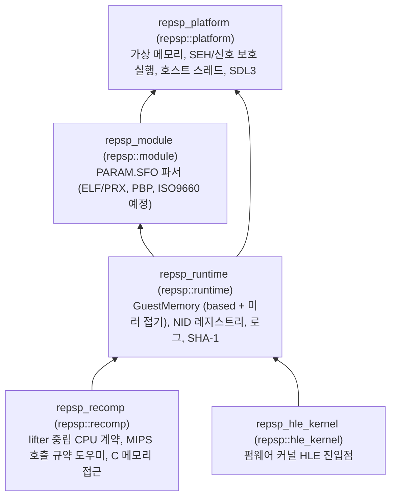

# repsp

repsp는 원본 PSP 타이틀을 정적 재컴파일로 네이티브 실행하는 프로젝트들이 공유하는 **공용 PSP 런타임 라이브러리**입니다. 특정 타이틀에 종속되지 않습니다.

디스크 및 모듈 컨테이너 파서, 게스트 가상 메모리 관리, NID 레지스트리 및 HLE 모듈 호출 진입점, lifter 중립적인 재컴파일 코드 계약(CPU 레지스터 콜백, 인자/반환 도우미), 그리고 호스트 플랫폼 추상화(가상 메모리, SEH/신호 보호 호출, 호스트 스레드, SDL3 백엔드)를 제공합니다.

---

## 목차 (Table of Contents)

1. [아키텍처 및 레이어](#아키텍처-및-레이어)
2. [소비자 사용법 (Consumer Usage)](#소비자-사용법-consumer-usage)
3. [빌드 방법 (Building)](#빌드-방법-building)
4. [라이선스 (License)](#라이선스-license)

---

## 아키텍처 및 레이어

repsp는 엄격한 하향식 단방향 의존성 규칙을 따릅니다:



## 소비자 사용법 (Consumer Usage)

소비자 타이틀 프로젝트(예: `reDMP1`)는 repsp를 서브모듈(`third_party/repsp`)로 포함하고 CMake를 통해 연동합니다:

```cmake
add_subdirectory(third_party/repsp)

target_link_libraries(my_title_target PRIVATE
    repsp::platform
    repsp::module
    repsp::runtime
    repsp::recomp
    repsp::hle_kernel
)
```

소비자는 공개 헤더(`include/repsp/`)만 사용하며 내부 소스 파일(`src/`)은 참조하지 않습니다.

## 빌드 방법 (Building)

### 사전 요구사항
* CMake 3.25 이상
* Windows: Visual Studio 2022 이상 (C++20 지원)
* Linux: GCC 11+ 또는 Clang 14+, Ninja
* Git (서브모듈 재귀 클론 필요)

### CMake Presets 빌드
```bash
# Win64 Debug
cmake --preset win64-debug
cmake --build build/win64-debug --config Debug
ctest --test-dir build/win64-debug -C Debug --output-on-failure

# Win64 Release
cmake --preset win64-release
cmake --build build/win64-release --config Release
ctest --test-dir build/win64-release -C Release --output-on-failure
```

### 전용 스크립트 빌드
* Windows PowerShell: `.\scripts\build_win64.ps1 -Config Debug`
* Windows Batch: `.\scripts\build_win64.bat Debug`
* Linux: `./scripts/build_linux.sh Debug`

## 현재 상태

* `repsp_platform`: 가상 메모리 예약/commit/보호, 보호 실행(`GuardedRun`), 호스트 스레드, 경로, SDL3 연동 완료.
* `repsp_module`: `PARAM.SFO` 메타데이터 파서 구현 완료.
* `repsp_runtime`: 160 MiB 게스트 메모리 윈도우(scratchpad, VRAM, kernel RAM, user RAM) 및 0x1FFFFFFF 미러 접기, NID 레지스트리 및 미구현 집계, SHA-1 구현 완료.
* `repsp_recomp`: lifter 중립 CPU 콜백 계약(`repsp_guest_cpu_ops`), 인자/반환 도우미, C 메모리 접근 API 완료.
* `repsp_hle_kernel`: HLE 모듈 등록 스켈레톤 완료.
* CTest 검증: `memory_probe`, `module_probe`, `nid_probe`, `recomp_contract_probe`, `platform_probe` 5개 프로브 전체 통과.

## 라이선스 (License)

repsp는 [MIT License](LICENSE)로 배포됩니다.

---

# English Description

repsp is a **title-agnostic PSP runtime library** shared by static recompilation projects that run original PSP titles natively.

It provides container metadata parsers, guest memory management with PSP mirror folding, a NID registry and HLE dispatch entry, a lifter-neutral recompiled-code contract (CPU register callbacks, calling convention helpers), and host platform abstractions (virtual memory, guarded execution, host threads, SDL3).

See the sections above for architecture, consumer integration, building instructions, and licensing.
