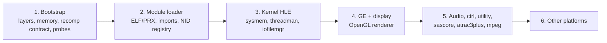

# 프로젝트 헌장

## 목적

repsp는 PSP 타이틀을 정적 재컴파일로 네이티브 실행하는 프로젝트들이 공유하는 PSP 런타임이다. 재컴파일된 게임 코드가 부르는 PSP(펌웨어, GE, 오디오, 입력, 파일 시스템)를 호스트 위에 제공한다. 첫 소비자는 [reDMP1](https://github.com/reexec/reDMP1)(DJMAX Portable)이다.

## Purpose

repsp is the PSP runtime shared by projects that run PSP titles natively through static recompilation. It provides, on the host, the PSP that recompiled game code calls: the firmware, the GE, audio, input and the file system. The first consumer is [reDMP1](https://github.com/reexec/reDMP1) (DJMAX Portable).

## 현재 1차 목표

* 1차 호스트는 Win64(MSVC x64), 이어서 Linux x64. 그 뒤 Win32, Linux x86, Web, Android.
* 표시·입력·오디오 백엔드는 SDL3 + OpenGL.
* repsp는 lifter에 의존하지 않는다. 재컴파일 코드와는 lifter 중립 계약으로만 만나고, 특정 lifter(첫 소비자는 [psprecomp](https://github.com/sp00nznet/psprecomp))의 ABI를 그 계약에 잇는 어댑터는 소비자에 둔다.
* 1차 범위의 펌웨어 모듈은 첫 소비자가 import하는 것부터 넓힌다.

## Current First Target

* The first host is Win64 (MSVC x64), then Linux x64, then Win32, Linux x86, the web and Android.
* The display, input and audio backends are SDL3 + OpenGL.
* repsp depends on no lifter. It meets recompiled code only through a lifter-neutral contract, and the adapter connecting a particular lifter's ABI (for the first consumer, [psprecomp](https://github.com/sp00nznet/psprecomp)) to that contract lives in the consumer.
* Firmware modules are widened starting from those the first consumer imports.

## 방향성

* 타이틀에 의존하지 않는다. 타이틀 고유 사항은 공개 계약으로 받는다.
* HLE는 NID·시스템 콜 경계에서 하고, 하드웨어 수준 처리는 GE 디스플레이 리스트처럼 불가피한 곳에만 둔다.
* 에뮬레이터 코드를 통합하지 않는다. 라이선스는 MIT이며 전염성 라이선스 코드는 빌드에 넣지 않는다.
* 게임 없이 검사할 수 있는 것은 probe(CTest)로 CI에서 검사한다.
* 프로젝트 버전은 `VERSION` 파일의 `major.minor.patch` 형식으로 관리한다.

## Direction

* Know no title; title specifics come through public contracts.
* Do HLE at the NID and syscall boundary, with hardware-level processing only where unavoidable, as with GE display lists.
* Integrate no emulator code. The license is MIT, and copyleft code is not built in.
* Whatever can be checked without a game is checked in CI by probes (CTest).
* Manage the project version in the `VERSION` file using `major.minor.patch`.

## 단계

1. 부트스트랩(issue #1): 규칙, 레이어, 게스트 메모리, 재컴파일 코드 계약, NID 레지스트리 골격, 플랫폼 기본 서비스, probe, Win64·Linux x64 CI.
2. ELF/PRX 로더, import stub 연결, 재배치.
3. 커널 HLE.
4. GE 해석기와 OpenGL 렌더러, display.
5. 오디오(sceAudio, sasCore, ATRAC3plus), 입력, utility, 동영상.
6. 다른 플랫폼.

## Stages

1. Bootstrap (issue #1): rules, layers, guest memory, the recompiled-code contract, the NID registry skeleton, basic platform services, probes, Win64 and Linux x64 CI.
2. ELF/PRX loader, import stub binding, relocation.
3. Kernel HLE.
4. The GE interpreter and OpenGL renderer, display.
5. Audio (sceAudio, sasCore, ATRAC3plus), input, utility, movies.
6. Other platforms.
