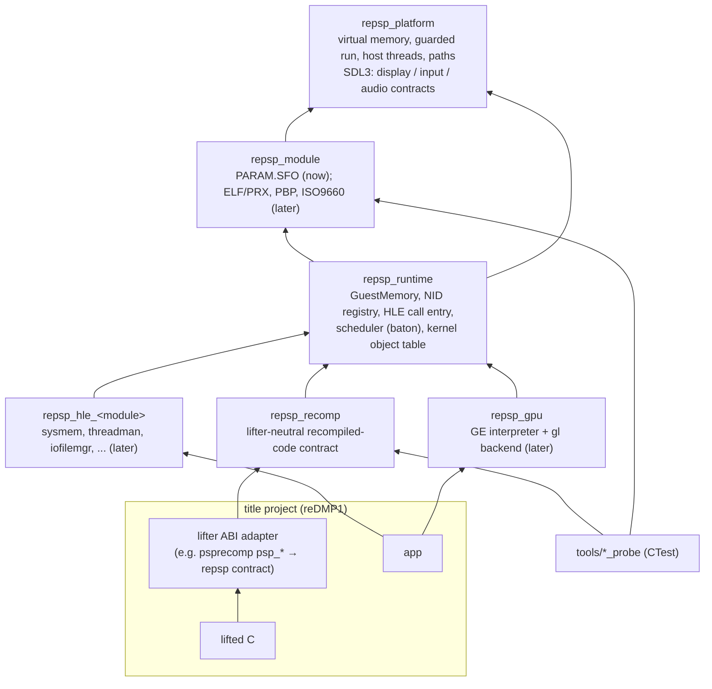

# 설계: 런타임 부트스트랩 — 레이어, 게스트 메모리, lifter 중립 재컴파일 코드 계약 (issue #1)

## 1. 요구사항

* PSP 타이틀 재컴파일 프로젝트들이 공유하는 PSP 런타임을 만든다. 첫 소비자는 [reDMP1](https://github.com/reexec/reDMP1)(DJMAX Portable, [설계 i001](https://github.com/reexec/reDMP1/blob/i001-project-bootstrap/docs/design/20261111-i001-project-bootstrap.md)).
* 구조와 규칙은 Xbox용 공유 런타임 [rexbox](https://github.com/reexec/rexbox)를 따른다.
* repsp가 런타임(메모리, 스케줄러, HLE, GE, 플랫폼)을 소유한다. **repsp는 psprecomp(첫 소비자의 lifter)에 의존하지 않는다**(사용자 결정). 어떤 lifter의 헤더, 소스, 생성 코드도 include·링크·submodule로 갖지 않는다.
* 1차 호스트는 Win64, 이어서 Linux x64. 백엔드는 SDL3 + OpenGL.
* 이번 범위: 규칙, 레이어와 CMake 골격, 게스트 메모리, 재컴파일 코드 계약, NID 레지스트리, `PARAM.SFO` 파서, 플랫폼 기본 서비스, probe, CI. 펌웨어 HLE 모듈의 실제 동작, ELF/PRX 로더, GE, 오디오는 이후 issue.

## 2. rexbox에서 가져오는 것과 바뀌는 것

| rexbox | repsp | 판단 |
|---|---|---|
| 규칙 문서(`AGENTS.md`, `CODING_STYLE.md`, 헌장) | 같은 규칙, PSP에 맞게 | 동일 |
| 레이어 `platform` → `xbe` → `runtime` → `recomp`/`hle` | `platform` → `module` → `runtime` → `recomp`/`hle`/`gpu` | XBE 대신 PSP 컨테이너·모듈 |
| `GuestMemory`(based 모델) | `GuestMemory`(based 모델 + PSP 미러 접기, §4) | 같은 원칙 |
| `HleRegistry`(게스트 주소 → HLE export) | NID 레지스트리(모듈 이름 + NID → HLE 함수, §6) | PSP는 import가 NID로 식별된다 |
| `recomp_abi.c`(xboxrecomp 헤더 구현이 런타임 안) | 없음. lifter 중립 계약(§5)만 제공, lifter ABI 어댑터는 소비자에 | 사용자 결정 |
| `GuestCpu`/`GuestExecutor` 계약, `RecompExecutor` | 같은 생각을 C 콜백 표로(§5) | lifter가 C여서 C 호환 |
| 스레드: 게스트 스레드 = 호스트 스레드 | 같음 + 한 번에 하나만 실행(baton, §7) | PSP는 단일 코어 |
| `src/platform/{win32,linux,sdl}` | 같음 | |
| SDL3, Dear ImGui submodule | SDL3(이번), imgui(오버레이 task에서) | |
| probe 도구(`tools/*_probe`) | 같음(§9) | 게임 없이 CI |
| `XbSymbolDatabase` | 없음 | NID가 import 표에 있음 |

psprecomp의 런타임(MIT)에는 이 런타임이 해야 할 일(메모리 맵, 스레드, GE 래스터라이저, VFPU, HLE 112개)이 이미 구현되어 있다. 필요한 부분은 출처와 커밋을 적고 repsp의 타입과 계약으로 고쳐 옮길 수 있다(옮긴 코드는 psprecomp에 의존하지 않는다). 그 주장들은 repsp에서 다시 확인하기 전까지 **추정**이다.

## 3. 레이어와 CMake 타깃



| 타깃 | 경로 | 책임(이번 task) |
|---|---|---|
| `repsp_platform` | `include/repsp/platform/`, `src/platform/{win32,linux,sdl}/` | 주소 공간 예약·commit·보호(`VirtualAlloc`/`mmap`), 보호 호출(SEH/신호 → 정지 보고), 호스트 스레드 생성·이름·CPU 시간, 경로(실행 파일 폴더, 앱 이름 기반 사용자 폴더), SDL3 초기화와 표시·입력·오디오 계약의 선언(구현은 dummy 드라이버로 열고 닫기까지) |
| `repsp_module` | `include/repsp/module/`, `src/module/` | `PARAM.SFO` 파서(키·형식·값). 이후 ELF/PRX, PBP, ISO9660 |
| `repsp_runtime` | `include/repsp/runtime/`, `src/runtime/` | `GuestMemory`(§4), NID 레지스트리와 HLE 호출 진입점(§6), 로그 |
| `repsp_recomp` | `include/repsp/recomp/`, `src/recomp/` | 재컴파일 코드 계약(§5)의 등록과 PSP 호출 규약 도우미 |
| `repsp_hle_<module>` | `src/hle/<module>/` | 이번에는 디렉터리와 등록 함수 자리만(`repsp_hle_kernel` 하나로 시작해도 된다; 모듈 경계는 구현 task에서) |
| `repsp_gpu` | `src/gpu/`, `src/gpu/gl/` | 이번에는 없음 |

소비자 계약: 소비자는 `add_subdirectory(third_party/repsp)` 뒤 공개 타깃(`repsp::platform`, `repsp::module`, `repsp::runtime`, `repsp::recomp`, `repsp::hle_*`)만 링크한다. 옵션 `REPSP_BUILD_PROBES`(standalone 빌드에서 기본 ON, 소비자 빌드에서 기본 OFF 또는 소비자가 선택). 호스트 컴파일 플래그 함수 `repsp_apply_host_flags(<target>)`를 제공한다.

## 4. 게스트 메모리

PSP의 메모리 맵(**추정**, 출처: psprecomp `docs/ARCHITECTURE.md`, [PSP Developer Wiki](https://www.psdevwiki.com/psp/); PSP-1000 기준, PSP-2000 이후의 추가 RAM은 이번 범위 밖):

| 물리 주소 | 크기 | 내용 |
|---|---|---|
| `0x00010000` | 16 KiB | scratchpad |
| `0x04000000` | 2 MiB | VRAM (위로 미러) |
| `0x08000000` | 8 MiB | 커널 RAM |
| `0x08800000` | 24 MiB | 사용자 RAM (게임) |

* 가상 주소의 상위 3비트는 캐시·권한 미러다(`0x40000000` uncached, `0x80000000` 커널, `0xA0000000` 커널 uncached 등). `GuestMemory::Translate(addr)`는 `phys = addr & 0x1FFFFFFF`로 접고 `host = base + phys`로 바꾼다(based 모델, 모든 호스트에서 같은 코드).
* 호스트에는 접기 결과 전체인 `0x20000000`(512 MiB) 창을 예약하고 위 영역만 commit한다. 접힌 주소는 어떤 값이든 이 창 안에 떨어지므로, 영역 밖 접근은 commit 안 된 예약 페이지에서 반드시 보호 호출로 잡힌다(창이 접기 범위보다 작으면 창 밖의 다른 호스트 메모리를 조용히 덮어쓸 수 있다; 처음 기준안의 160 MiB는 이 결함이 있어 리뷰에서 고쳤다).
* 공개 계약: `Translate`, 스칼라 읽기·쓰기(little-endian), 블록 복사, 영역 질의, 그리고 어댑터가 빠른 경로를 만들 수 있도록 `Base()`와 접기 마스크를 노출한다(어댑터가 `base[addr & mask]`로 인라인할 수 있다). C에서도 쓸 수 있는 함수(`repsp_guest_base`, `repsp_guest_mask` 등)를 `include/repsp/recomp/`에 둔다.
* 영역 밖 접근 정책: Debug에서는 즉시 보고하고 정지, Release에서는 보호 호출이 잡아 정지 보고. 측정 전까지 이것이 기본이다.

## 5. 재컴파일 코드 계약 (lifter 중립)

repsp는 레지스터 파일을 소유하지 않는다. 레지스터 파일은 lifter의 것이고(psprecomp는 전역 `psp_cpu`), 소비자의 어댑터가 repsp에 아래 콜백 표를 등록한다. 계약은 C 헤더 `include/repsp/recomp/guest_cpu.h`로 둔다.

```c
typedef struct repsp_guest_cpu_ops
{
    uint32_t context_size;                        /* bytes of one saved context */
    void (*save)(void* context);                  /* live register file -> context */
    void (*restore)(const void* context);         /* context -> live register file */
    uint32_t (*get_gpr)(int index);               /* MIPS GPR 0..31 */
    void (*set_gpr)(int index, uint32_t value);
    void (*call_guest)(uint32_t address);         /* run a guest function until it returns */
} repsp_guest_cpu_ops;

void repsp_recomp_register_cpu(const repsp_guest_cpu_ops* ops);
void repsp_recomp_hle_call(uint32_t nid);         /* an import thunk was called */
void repsp_recomp_syscall(uint32_t code);         /* a raw syscall instruction */
void repsp_recomp_poll(void);                     /* safe point: deliver pending interrupts */
```

* 위 이름과 형태는 기준안이며, 구현에서 바꾸면 그 이유를 작업 로그에 적고 `ARCHITECTURE.md`의 소비자 계약 절을 맞춘다.
* MIPS GPR 번호와 PSP 펌웨어 호출 규약은 아키텍처의 사실이지 lifter의 것이 아니므로 repsp가 안다. 인자 읽기(`$a0`-`$a3`, 5~8번째는 `$t0`-`$t3`, 그 뒤는 스택; **추정**, psprecomp `hle.h`의 측정), 반환값(`$v0`, 64비트는 `$v0:$v1`)은 `repsp_recomp`의 도우미(`repsp::recomp::Arg(n)`, `Return(v)`)가 `get_gpr`/`set_gpr`과 `GuestMemory`로 구현한다. HLE 모듈은 이 도우미만 쓴다.
* FPU·VFPU 레지스터는 계약에 넣지 않는다. 펌웨어 API는 정수 레지스터로만 인자를 받는다(**추정**; 예외가 확인되면 계약을 넓힌다).
* 계약 probe(§9)는 C로 쓴 가짜 어댑터(작은 레지스터 배열)로 등록, 인자·반환, NID 호출, 컨텍스트 저장·복원을 검사한다. 실제 lifter 없이 계약만 검사하므로 repsp CI에 lifter가 필요 없다.

## 6. NID 레지스트리와 HLE 호출

* 항목: `{모듈 이름, NID, 함수 이름, 처리 함수}`. NID는 함수 이름 SHA-1의 앞 4바이트(little-endian)다(**추정**, psprecomp `hle.h`; 레지스트리 probe가 등록된 이름마다 검사한다). SHA-1은 repsp 안의 작은 구현(또는 허용적 라이선스 구현)으로 한다.
* `repsp_recomp_hle_call(nid)`: 등록된 NID면 처리 함수를 부르고, 아니면 NID별로 처음 한 번 `모듈:NID`를 기록하고 `$v0`에 `0x80020002`(`SCE_KERNEL_ERROR_NOTIMPLEMENTED`)를 둔다. "처음 미구현 NID에서 정지" 옵션을 환경 변수나 설정으로 둔다.
* 미구현 호출 통계(NID별 횟수)를 종료 시 출력할 수 있게 한다. 소비자가 "이 타이틀의 import 중 몇 개가 구현됐나"를 측정하는 기준이 된다.
* import 표와 stub의 연결(PRX 로더가 import 표를 읽어 stub 주소 → NID를 만드는 일)은 ELF/PRX 로더 task에서 한다. 이번에는 NID로 직접 부르는 경로만 있다.

## 7. 실행 모델 (이번에는 설계만)

* PSP는 단일 코어이고 스케줄러는 고정 우선순위 선점형이다(**추정**, uOFW·psprecomp `docs/THREADING.md`). 게스트 스레드마다 호스트 스레드를 두고, 한 순간에 하나만 실행한다(baton). 전환은 대기하는 HLE 호출과 `repsp_recomp_poll()` 안전점에서만 일어나며, 그때 `save`/`restore`로 레지스터 파일을 바꿔 끼운다.
* 인터럽트(vblank, GE 완료, 오디오)는 호스트 스레드에서 발생해 대기열에 들어가고, 다음 안전점에서 전달된다. 시스템 콜 없이 메모리만 보며 도는 게스트 루프는 어댑터가 루프 back-edge나 디스패치마다 `repsp_recomp_poll()`을 부르게 해서 다룬다(빈도는 측정으로 정한다).
* 이 모델의 구현은 커널 HLE task(threadman)에서 하고, 그 task에서 이 절을 갱신한다.

## 8. 저장소 구성

```
repsp/
├── AGENTS.md, CLAUDE.md, GEMINI.md, README.md, ARCHITECTURE.md, LICENSE, VERSION
├── THIRD_PARTY_NOTICES.md, CREDITS.md
├── CMakeLists.txt, CMakePresets.json, cmake/      # repsp_apply_host_flags, ...
├── include/repsp/{platform,module,runtime,recomp}/
├── src/platform/{win32,linux,sdl}/
├── src/{module,runtime,recomp}/
├── src/hle/                                       # per firmware module (later)
├── src/gpu/                                       # GE (later)
├── tools/{memory,module,nid,recomp_contract,platform}_probe/
├── third_party/SDL/                               # submodule, release-3.4.x
├── docs/{design,work-orders,work-logs,kb,guides,release-notes}/
└── .github/workflows/{ci,release}.yml
```

## 9. 이번 task의 검증

1. Win64 Debug/Release, Linux x64 Debug/Release가 경고 없이 빌드된다(standalone, `REPSP_BUILD_PROBES=ON`).
2. CTest probe가 모두 통과한다.
   * `memory_probe`: 각 영역의 Translate, 미러 접기(`0x08800000`, `0x48800000`, `0x88800000`이 같은 바이트), little-endian 스칼라, 블록 복사, 영역 밖 질의.
   * `module_probe`: 손으로 만든 합성 `PARAM.SFO`(문자열·정수 키)의 파싱과 잘못된 입력의 거부.
   * `nid_probe`: 등록된 이름의 NID = SHA-1 앞 4바이트(LE), 미구현 NID의 반환값과 통계.
   * `recomp_contract_probe`: 가짜 어댑터 등록, `Arg(0..9)`·`Return`, NID 호출이 처리 함수에 닿는지, 컨텍스트 저장·복원.
   * `platform_probe`: 주소 공간 예약·commit, 보호 호출이 잘못된 접근을 잡음, 호스트 스레드, SDL3 dummy 드라이버 초기화.
3. CI(`windows-2022` Win64 Debug/Release, `ubuntu-24.04` Linux x64)에서 같다.
4. `git grep -i psprecomp`가 문서의 설명·출처 표기에서만 나온다. 어떤 타이틀 이름도 문서 밖에 나오지 않는다.

---

# Design: runtime bootstrap — layers, guest memory, the lifter-neutral recompiled-code contract (issue #1)

## 1. Requirements

* Create the PSP runtime shared by PSP title recompilation projects. The first consumer is [reDMP1](https://github.com/reexec/reDMP1) (DJMAX Portable, [design i001](https://github.com/reexec/reDMP1/blob/i001-project-bootstrap/docs/design/20261111-i001-project-bootstrap.md)).
* Structure and rules follow the shared Xbox runtime [rexbox](https://github.com/reexec/rexbox).
* repsp owns the runtime (memory, scheduler, HLE, GE, platform). **repsp does not depend on psprecomp (the first consumer's lifter)** (user decision): it neither includes, links nor carries as a submodule any lifter's headers, sources or generated code.
* The first host is Win64, then Linux x64. The backend is SDL3 + OpenGL.
* In scope: rules, the layer and CMake skeleton, guest memory, the recompiled-code contract, the NID registry, a `PARAM.SFO` parser, basic platform services, probes, CI. The real behavior of firmware HLE modules, the ELF/PRX loader, the GE and audio are later issues.

## 2. What comes from rexbox and what changes

See the table above: the same rules; layers `platform` → `module` → `runtime` → `recomp`/`hle`/`gpu` in place of the XBE layer; `GuestMemory` keeps the based model and adds PSP mirror folding (§4); the address-keyed `HleRegistry` becomes a NID registry (module name + NID → HLE function, §6) because PSP imports are identified by NID; there is no counterpart of `recomp_abi.c`: repsp offers only a lifter-neutral contract (§5) and the lifter ABI adapter lives in the consumer (user decision); the `GuestCpu`/`GuestExecutor` idea becomes a C callback table, since the lifter emits C; guest threads are host threads, with exactly one running at a time (a baton, §7) because the PSP is single-core; the platform directories stay; SDL3 now and Dear ImGui later; probes as in rexbox (§9); no XbSymbolDatabase, since NIDs are in the import tables.

psprecomp's runtime (MIT) already implements much of what this runtime must do (the memory map, threads, a GE rasterizer, the VFPU, 112 HLE functions). Parts of it may be carried over with source and commit noted and reshaped to repsp's types and contracts (carried code does not depend on psprecomp). Its claims stay **inferred** until re-checked in repsp.

## 3. Layers and CMake targets

See the diagram and table above. In this task: `repsp_platform` reserves, commits and protects address space (`VirtualAlloc`/`mmap`), runs guarded calls (SEH/signals → stop report), creates host threads with names and CPU time, resolves paths (executable folder, a user folder named by the app), and initializes SDL3 with the display, input and audio contracts declared (implemented as far as opening and closing with the dummy driver); `repsp_module` parses `PARAM.SFO` (keys, formats, values), with ELF/PRX, PBP and ISO9660 later; `repsp_runtime` holds `GuestMemory` (§4), the NID registry and HLE call entry (§6) and logging; `repsp_recomp` registers the recompiled-code contract (§5) and provides PSP calling-convention helpers; `repsp_hle_<module>` gets only its directories and registration entry points (starting with a single `repsp_hle_kernel` is fine; module boundaries are set by the implementing tasks); `repsp_gpu` does not exist yet.

Consumer contract: a consumer does `add_subdirectory(third_party/repsp)` and links only the public targets (`repsp::platform`, `repsp::module`, `repsp::runtime`, `repsp::recomp`, `repsp::hle_*`). The option `REPSP_BUILD_PROBES` defaults ON standalone and OFF (or the consumer's choice) in a consumer build. The host compile-flag function `repsp_apply_host_flags(<target>)` is provided.

## 4. Guest memory

The PSP memory map is in the table above (**inferred**, sources: psprecomp `docs/ARCHITECTURE.md`, the [PSP Developer Wiki](https://www.psdevwiki.com/psp/); PSP-1000, the extra RAM of PSP-2000 and later out of scope).

* The top three bits of a virtual address select cache and privilege mirrors (`0x40000000` uncached, `0x80000000` kernel, `0xA0000000` kernel uncached, ...). `GuestMemory::Translate(addr)` folds with `phys = addr & 0x1FFFFFFF` and maps `host = base + phys` (the based model, one code path on every host).
* The host reserves a `0x20000000` (512 MiB) window, the whole fold range, and commits only the regions above. Every folded address lands inside the window, so a stray access always hits a reserved, uncommitted page and is caught by the guarded call (a window smaller than the fold range could silently overwrite other host memory beyond it; the first baseline of 160 MiB had this flaw and was fixed in review).
* Public contract: `Translate`, little-endian scalar reads and writes, block copies, region queries, plus `Base()` and the fold mask so an adapter can build a fast path (`base[addr & mask]` inline). C-callable functions (`repsp_guest_base`, `repsp_guest_mask`, ...) live in `include/repsp/recomp/`.
* Out-of-range policy: Debug reports and stops at once; Release stops through the guarded call's report. This is the default until measured.

## 5. Recompiled-code contract (lifter-neutral)

repsp does not own the register file. The register file belongs to the lifter (psprecomp's global `psp_cpu`), and the consumer's adapter registers the callback table above with repsp. The contract is the C header `include/repsp/recomp/guest_cpu.h`.

* The names and shapes above are the baseline; an implementation that changes them records why in the work log and updates the consumer-contract section of `ARCHITECTURE.md`.
* MIPS GPR numbers and the PSP firmware calling convention are facts of the architecture, not of a lifter, so repsp knows them. Reading arguments (`$a0`-`$a3`, the 5th to 8th in `$t0`-`$t3`, then the stack; **inferred**, measured by psprecomp's `hle.h`) and returning values (`$v0`, 64-bit in `$v0:$v1`) are implemented by `repsp_recomp` helpers (`repsp::recomp::Arg(n)`, `Return(v)`) on top of `get_gpr`/`set_gpr` and `GuestMemory`. HLE modules use only these helpers.
* FPU and VFPU registers are not in the contract: firmware APIs take arguments in integer registers only (**inferred**; the contract widens if an exception is confirmed).
* The contract probe (§9) uses a fake adapter written in C (a small register array) to check registration, arguments and returns, NID calls and context save/restore. It checks the contract without any real lifter, so repsp's CI needs no lifter.

## 6. NID registry and HLE calls

* Entries are `{module name, NID, function name, handler}`. A NID is the first four bytes (little-endian) of the SHA-1 of the function name (**inferred**, psprecomp `hle.h`; the registry probe checks every registered name). SHA-1 comes from a small implementation inside repsp (or a permissively licensed one).
* `repsp_recomp_hle_call(nid)`: a registered NID calls its handler; otherwise the first call of each NID logs `module:NID` and sets `$v0` to `0x80020002` (`SCE_KERNEL_ERROR_NOTIMPLEMENTED`). An option (environment variable or setting) stops at the first unimplemented NID.
* Per-NID counts of unimplemented calls can be printed at exit; they are how a consumer measures how much of a title's import surface is implemented.
* Binding import tables and stubs (the PRX loader reading the import table into stub address → NID) is the ELF/PRX loader task. For now NIDs are called directly.

## 7. Execution model (design only for now)

* The PSP is single-core with a fixed-priority preemptive scheduler (**inferred**, uOFW and psprecomp `docs/THREADING.md`). Each guest thread gets a host thread, and exactly one runs at a time (a baton). Switches happen only in waiting HLE calls and at `repsp_recomp_poll()` safe points, where `save`/`restore` swap the register file.
* Interrupts (vblank, GE completion, audio) arise on host threads, are queued, and are delivered at the next safe point. A guest loop that spins on memory without syscalls is handled by the adapter calling `repsp_recomp_poll()` on loop back-edges or per dispatch (the frequency is set by measurement).
* The model is implemented in the kernel HLE task (threadman), which updates this section.

## 8. Repository layout

See the tree above.

## 9. Verification for this task

1. Win64 Debug/Release and Linux x64 Debug/Release build without warnings (standalone, `REPSP_BUILD_PROBES=ON`).
2. All CTest probes pass: `memory_probe` (Translate in each region, mirror folding with `0x08800000`, `0x48800000` and `0x88800000` reaching the same byte, little-endian scalars, block copies, out-of-range queries); `module_probe` (a hand-made synthetic `PARAM.SFO` with string and integer keys, and rejection of bad input); `nid_probe` (NID = first four SHA-1 bytes LE for each registered name, the return value and counts of unimplemented NIDs); `recomp_contract_probe` (fake adapter registration, `Arg(0..9)` and `Return`, NID calls reaching their handlers, context save/restore); `platform_probe` (address-space reservation and commit, the guarded call catching a bad access, host threads, SDL3 dummy-driver initialization).
3. The same in CI (`windows-2022` Win64 Debug/Release, `ubuntu-24.04` Linux x64).
4. `git grep -i psprecomp` finds only explanations and attributions in documents, and no title name appears outside documents.
