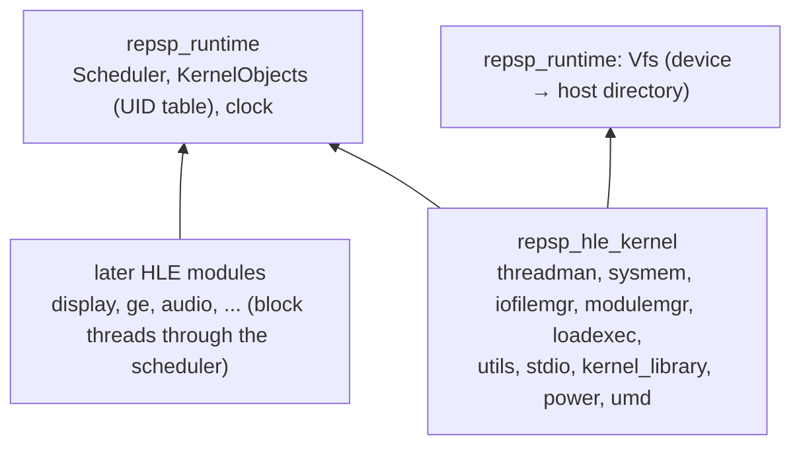

# 설계: 커널 HLE — 스케줄러, 커널 객체, 첫 펌웨어 모듈 (issue #5)

## 1. 요구사항

* 타이틀이 `module_start`부터 부팅해 첫 비커널 펌웨어 호출(화면, GE, 오디오, utility)까지 가는 데 필요한 커널을 HLE로 제공한다. 첫 소비자는 [reDMP1 issue #5](https://github.com/reexec/reDMP1/issues/5)다.
* 대상은 소비자의 import 표에서 측정한 65개 함수다. 이름은 모두 NID = SHA-1(이름)의 앞 4바이트로 확인했다.

| 라이브러리 | 함수 |
|---|---|
| `ThreadManForUser` (27) | `sceKernelCreateThread`, `StartThread`, `ExitThread`, `DeleteThread`, `TerminateDeleteThread`, `WaitThreadEnd`, `GetThreadId`, `ChangeThreadPriority`, `SleepThread`, `WakeupThread`, `DelayThread`, `DelayThreadCB`, `CreateSema`, `DeleteSema`, `WaitSema`, `SignalSema`, `CreateEventFlag`, `DeleteEventFlag`, `SetEventFlag`, `ClearEventFlag`, `WaitEventFlag`, `PollEventFlag`, `ReferEventFlagStatus`, `CreateCallback`, `CheckCallback`, `GetSystemTimeWide`, `GetSystemTimeLow` (앞의 `sceKernel` 생략) |
| `IoFileMgrForUser` (11) | `sceIoOpen`, `Close`, `Read`, `Write`, `Lseek`, `OpenAsync`, `ReadAsync`, `LseekAsync`, `WaitAsync`, `WaitAsyncCB`, `PollAsync` |
| `ModuleMgrForUser` (5) | `sceKernelLoadModule`, `StartModule`, `StopModule`, `UnloadModule`, `SelfStopUnloadModule` |
| `SysMemUserForUser` (3) | `sceKernelAllocPartitionMemory`, `FreePartitionMemory`, `GetBlockHeadAddr` |
| `UtilsForUser` (4) | `sceKernelDcacheWritebackAll`, `DcacheWritebackInvalidateAll`, `GetGPI`, `SetGPO` |
| `StdioForUser` (3) | `sceKernelStdin`, `Stdout`, `Stderr` |
| `Kernel_Library` (2) | `sceKernelCpuSuspendIntr`, `CpuResumeIntr` |
| `LoadExecForUser` (2) | `sceKernelExitGame`, `RegisterExitCallback` |
| `sceSuspendForUser` (1), `scePower` (1) | `sceKernelPowerTick`, `scePowerRegisterCallback` |
| `sceUmdUser` (6) | `sceUmdActivate`, `Deactivate`, `GetDriveStat`, `WaitDriveStat`, `WaitDriveStatWithTimer`, `CancelWaitDriveStat` |

* 타이틀에 의존하지 않는다. 장치 경로(`disc0:`, `ms0:`), 첫 스레드의 매개변수는 소비자가 정한다.
* 출처: 동작은 uOFW(MIT, 일부 PSPSDK BSD)와 psprecomp `src/hle`(MIT)의 구현·문서, PSP SDK 헤더의 공개 정의를 참고한다(**추정**, 확인은 probe와 타이틀 실행). psprecomp·uOFW 코드는 출처를 적고 옮길 수 있다. PPSSPP(GPL)는 동작 비교에만 쓰고 코드를 보지 않는다.

## 2. 레이어

* 스케줄러와 커널 객체 표는 `repsp_runtime`에 둔다. 이후의 HLE 모듈(display의 vblank 대기, GE 완료 대기, 오디오 출력 대기)도 스레드를 대기시켜야 하는데, HLE 모듈끼리는 서로 링크하지 않는다(규칙). 그래서 공통 부분은 runtime에 있어야 한다.
* 커널 HLE 함수는 `repsp_hle_kernel` 하나에 펌웨어 라이브러리별 파일로 둔다(`src/hle/kernel/threadman_thread.cpp`, `threadman_sync.cpp`, `sysmem.cpp`, `iofilemgr.cpp`, …). 진입점은 `repsp::hle::kernel::Register(const KernelConfig&)`.
* 파일 시스템(`Vfs`: 장치 이름 → 호스트 디렉터리, 경로 정규화)도 runtime에 둔다. 이후 `sceUtility`의 저장 데이터가 함께 쓴다.

## 3. 스케줄러

PSP는 단일 코어이고, 고정 우선순위 선점형 스케줄러다. 숫자가 작을수록 우선순위가 높고, 같은 우선순위는 FIFO다(**추정**).

* **실행 모델**: 게스트 스레드마다 호스트 스레드 하나를 둔다. 한 순간에는 하나만 실행한다(baton). 바꿀 때는 나가는 스레드가 `repsp_guest_cpu_ops.save`로 레지스터 파일을 자기 컨텍스트에 담고, 들어오는 스레드가 `restore`한다. 스레드 시작은 `call_guest(entry)`이고, 진입 함수가 돌아오면 `$v0`을 종료 상태로 `ExitThread`와 같게 처리한다.
* **전환 시점**: (a) 대기하는 HLE 호출, (b) 다른 스레드를 준비 상태로 만든 HLE 호출의 끝(더 높은 우선순위가 준비되면 즉시 넘김), (c) `repsp_recomp_poll()` 안전점. HLE 호출 도중에는 전환하지 않는다.
* **대기**: 대기 종류(스레드 종료, sleep, delay, sema, event flag, async I/O, UMD, 이후 vblank 등), 시간 제한(µs, 호스트 단조 시계), 결과 코드(정상, timeout `0x800201A8`, 삭제됨 `0x800201B5`, 취소 `0x800201A9`, 해제 `0x800201AA`; 값은 uOFW 정의, **추정**).
* **콜백**: 스레드별 콜백 목록과 알림 카운트. `...CB` 대기와 `sceKernelCheckCallback`은 그 스레드에 대기 중인 콜백을 그 스레드의 컨텍스트에서 실행한다(콜백 함수 호출은 `call_guest`). 콜백이 0이 아닌 값을 돌려주면 삭제한다(**추정**).
* **유휴**: 준비된 스레드가 없으면 가장 가까운 시간 제한이나 외부 이벤트(이후의 vblank 등)까지 호스트가 잠든다. 시간 제한도 외부 이벤트도 없으면 교착이다. 이때는 모든 스레드와 대기 상태를 담아 `RaiseStop`으로 멈춘다.
* **시스템 시각**: 부팅부터의 µs(호스트 단조 시계). `GetSystemTimeWide`는 64비트(`$v0:$v1`), `GetSystemTimeLow`는 하위 32비트다.
* **스레드 생성**: 스택은 사용자 파티션의 높은 쪽에서 할당한다(크기는 256바이트 단위로 올림, 이름 `stack:<thread>`). 초기 `$sp`는 스택 끝에서 정렬한 위치, `$gp`는 생성한 모듈의 값(스레드 속성이 아닌 생성 시점의 현재 `$gp`)이다. `StartThread(argsize, argp)`는 인자 블록을 스택 끝에 복사하고 `$a0 = argsize`, `$a1` = 복사본 주소로 둔다(**추정**, uOFW). 정확한 오프셋은 작업 로그에 출처와 함께 적는다.
* **probe 가능성**: 스케줄러는 `repsp_guest_cpu_ops`만 쓴다. 그래서 probe는 C로 쓴 가짜 어댑터로 "게스트 함수"를 주소에 등록하고 HLE를 직접 부르게 해서 검사할 수 있다.

## 4. 커널 객체와 오류

* UID는 양의 32비트 값이고, 종류가 붙은 표에서 찾는다. 다른 종류의 UID를 넘기면 그 종류의 "unknown ID" 오류를 낸다(예: `0x80020198` unknown thread, `0x80020199` sema, `0x8002019A` event flag; uOFW, **추정**).
* 오류 코드는 `include/repsp/hle/kernel_errors.h`에 이름과 출처를 붙여 모은다. 확인되지 않은 값을 그럴듯하게 지어내지 않는다. 출처가 없으면 `SCE_KERNEL_ERROR_ERROR`(`0x80020001`)를 쓰고 작업 로그에 적는다.

## 5. SysMem

* 사용자 파티션(id 2): `0x08800000`부터 24 MiB(**추정**, PSP-1000). 시작할 때 소비자가 모듈 이미지 범위(`LoadPrx` 결과)와 그 앞 영역을 예약 블록으로 등록한다.
* `AllocPartitionMemory(partition, name, type, size, addr)`: type 0 low, 1 high, 2 지정 주소. 3과 4(정렬 low/high)는 `addr`를 정렬로 쓴다(**추정**). 반환값은 블록 UID다. `GetBlockHeadAddr(uid)`는 블록 시작 주소, `FreePartitionMemory(uid)`는 해제다.
* 파티션 1(커널)이나 다른 id는 이번에는 거부하고 기록한다.

## 6. IoFileMgr와 Vfs

* **장치**: 소비자가 `KernelConfig.mounts`로 `disc0:`, `umd0:`, `ms0:`, `flash0:`(선택)를 호스트 디렉터리에 연결한다. `disc0:`와 `umd0:`는 읽기 전용이다.
* **경로**: `device:/path`와 `device:path`를 받는다. `/`와 `\`, 중복 구분자, `.`/`..`를 정리한다. 장치 밖으로 나가는 경로는 거부한다. 대소문자 구분이 있는 호스트(Linux)에서는 구성 요소별로 대소문자를 무시하고 찾는다. UMD는 ISO9660 대문자이고, 게임은 소문자로 부를 수 있다.
* **fd**: 0~2는 stdio, 파일은 3부터다. open 플래그(`PSP_O_RDONLY` 1, `WRONLY` 2, `RDWR` 3, `APPEND` 0x100, `CREAT` 0x200, `TRUNC` 0x400, `EXCL` 0x800; PSP SDK, **추정**). 없는 파일은 `0x80010002`(ENOENT), 잘못된 fd는 `0x80020323`(**추정**).
* **비동기**: fd마다 진행 중인 작업 하나와 결과(64비트)를 둔다. 이번에는 작업을 요청 시점에 동기로 끝내고 결과를 저장한다(**추정**: 대부분의 게임은 결과만 기다린다; 실제 UMD 지연을 흉내 낼지는 측정 후). `WaitAsync`/`WaitAsyncCB`(콜백 처리)는 결과를 `*res`에 쓰고 0, `PollAsync`는 끝났으면 0과 결과, 아니면 1을 돌려준다. 진행 중 작업이 있는 fd에 또 요청하면 `0x80020329`(busy, **추정**)다. 비동기 완료를 실제로 늦추는 경우를 위해 대기 경로는 스케줄러를 거치게 만든다.
* 모든 open·close·read(크기)·seek를 `REPSP_HLE_TRACE`에서 경로와 함께 기록한다(부팅 순서 분석용).

## 7. ModuleMgr, LoadExec, 나머지

* `LoadModule(path, flags, opt)`: 경로의 파일이 있으면 코드를 올리지 않고 "HLE 모듈" UID를 만들어 이름(파일 이름)을 기록한다. 그 모듈의 export는 NID 경계에서 HLE한다(AGENTS 규칙: 디스크의 Sony 사용자 모드 PRX). 파일이 없으면 ENOENT다. `StartModule`은 0을 돌려주고 `*status`를 0으로 둔다. `StopModule`/`UnloadModule`은 0이다. `SelfStopUnloadModule`은 실행을 정상 종료로 멈춘다(`RaiseStop("module self-unload")`).
* `ExitGame`: 실행을 정상 종료로 멈춘다(이유 `ExitGame`). `RegisterExitCallback(cbid)`: 기록만 한다.
* `CpuSuspendIntr`: 현재 인터럽트 허용 상태를 돌려주고 끈다. `CpuResumeIntr(flags)`: 복원한다. baton 모델에서 전환은 HLE 경계에서만 일어나므로 상태만 유지하면 된다. 인터럽트가 꺼진 동안에는 안전점 전환과 인터럽트 전달을 미룬다.
* `Dcache*`: 아무것도 하지 않는다(호스트 메모리는 일관). `GetGPI`는 0이다. `SetGPO`는 기록한다.
* `Stdin/Stdout/Stderr`: 0, 1, 2. fd 1·2에 쓴 내용은 repsp 로그(`[guest stdout]`)로 보낸다.
* `PowerTick`: 0. `scePowerRegisterCallback(slot, cbid)`: 기록하고 0을 돌려준다(전원 이벤트는 보내지 않는다).
* UMD: 장치는 늘 "들어 있고 준비됨"이다(`GetDriveStat` = `0x32`: PRESENT|INITED|READY, **추정**). `Activate`/`Deactivate`는 0. `WaitDriveStat*`는 원하는 상태가 이미 맞으면 바로 0이고, 아니면 timeout까지 대기한다. `CancelWaitDriveStat`는 대기를 깨운다.

## 8. 추적

* `REPSP_HLE_TRACE=1`이면 HLE 호출마다 `라이브러리:이름(인자...) = 반환`을 기록한다. NID 레지스트리가 이름을 알고 있다.
* `REPSP_HLE_TRACE_LIMIT`로 개수를 제한한다.
* 종료할 때 함수별 호출 횟수를 요약한다.

## 9. 검증

1. `kernel_sched_probe`: 가짜 어댑터로 두 스레드 우선순위 선점, 같은 우선순위 FIFO, sema 대기와 signal, event flag(AND/OR, clear 옵션), delay와 시간 제한, sleep/wakeup, `WaitThreadEnd`, 콜백(CB 대기에서 실행), 교착 정지 보고를 검사한다.
2. `sysmem_probe`: low/high/지정 주소 할당, 겹침 거부, 해제 후 재사용, 블록 주소.
3. `iofile_probe`: 임시 디렉터리에 합성 파일을 만들고 open/read/seek/close, 대소문자 무시 찾기, 읽기 전용 장치 쓰기 거부, 장치 밖 경로 거부, 비동기 경로(`OpenAsync`→`WaitAsync`, `ReadAsync`→`PollAsync`, busy 오류)를 검사한다.
4. `nid_probe`에 이번에 등록한 65개 이름의 NID가 소비자 import 표에서 잰 값과 같은지 표로 넣는다(값은 reDMP1 analysis의 표).
5. Win64 Debug/Release, Linux x64 Debug/Release 빌드와 CTest.
6. 타이틀 부팅은 reDMP1 issue #5가 확인한다.

---

# Design: kernel HLE — scheduler, kernel objects, the first firmware modules (issue #5)

## 1. Requirements

* Provide, as HLE, the kernel a title needs to boot from `module_start` to its first non-kernel firmware call (display, GE, audio, utility). The first consumer is [reDMP1 issue #5](https://github.com/reexec/reDMP1/issues/5).
* The targets are the 65 functions measured from the consumer's import table (the table above), every name confirmed as NID = the first four bytes of SHA-1(name).
* Title-agnostic: device paths (`disc0:`, `ms0:`) and the first thread's parameters come from the consumer.
* Sources: behavior follows uOFW (MIT, with PSPSDK parts under BSD), psprecomp `src/hle` (MIT) and the public PSP SDK headers (**inferred**, checked by probes and title runs); psprecomp and uOFW code may be carried with attribution; PPSSPP (GPL) is used only to compare behavior, and its code is not read.

## 2. Layers

See the diagram above. The scheduler and the kernel object table live in `repsp_runtime`, because later HLE modules (display's vblank wait, GE completion, audio output) must block threads too and HLE modules never link each other. The kernel HLE functions live in one `repsp_hle_kernel`, one file per firmware library (`src/hle/kernel/threadman_thread.cpp`, `threadman_sync.cpp`, `sysmem.cpp`, `iofilemgr.cpp`, ...), entered through `repsp::hle::kernel::Register(const KernelConfig&)`. The file system (`Vfs`: device name → host directory, path normalization) lives in runtime too, for `sceUtility` save data later.

## 3. Scheduler

The PSP is single-core with a fixed-priority preemptive scheduler: a lower number is a higher priority, and equal priorities are FIFO (**inferred**).

* Execution: one host thread per guest thread, exactly one running at a time (a baton). On a switch the outgoing thread saves the register file into its context with `repsp_guest_cpu_ops.save` and the incoming one `restore`s it. A thread starts with `call_guest(entry)`; when the entry returns, `$v0` is its exit status as with `ExitThread`.
* Switch points: (a) a waiting HLE call, (b) the end of an HLE call that readied another thread (handing over at once if a higher priority became ready), (c) the `repsp_recomp_poll()` safe point. Never in the middle of an HLE call.
* Waits: wait kinds (thread end, sleep, delay, sema, event flag, async I/O, UMD, later vblank, ...), timeouts (µs, host monotonic clock) and result codes (normal, timeout `0x800201A8`, deleted `0x800201B5`, cancelled `0x800201A9`, released `0x800201AA`; values from uOFW, **inferred**).
* Callbacks: per-thread callback lists with notify counts; `...CB` waits and `sceKernelCheckCallback` run that thread's pending callbacks in its context (through `call_guest`); a callback returning non-zero is deleted (**inferred**).
* Idle: with no ready thread the host sleeps until the nearest timeout or external event (later, vblank and the like); with neither, it is a deadlock and `RaiseStop` reports every thread and its wait.
* System time: µs since boot (host monotonic clock); `GetSystemTimeWide` is 64-bit (`$v0:$v1`), `GetSystemTimeLow` the low 32 bits.
* Thread creation: the stack comes from the high end of the user partition (size rounded to 256 bytes, block name `stack:<thread>`); the initial `$sp` is aligned near the stack's end and `$gp` is the current `$gp` at creation. `StartThread(argsize, argp)` copies the argument block to the top of the stack with `$a0 = argsize` and `$a1` = the copy's address (**inferred**, uOFW); the exact offsets go to the work log with their source.
* Probeable: the scheduler uses only `repsp_guest_cpu_ops`, so a probe can register "guest functions" at addresses through a fake adapter written in C that calls HLE directly.

## 4. Kernel objects and errors

UIDs are positive 32-bit values looked up in a typed table; passing a UID of another kind gives that kind's "unknown ID" error (for example `0x80020198` unknown thread, `0x80020199` sema, `0x8002019A` event flag; uOFW, **inferred**). Error codes are gathered in `include/repsp/hle/kernel_errors.h` with names and sources; unconfirmed values are not made up — without a source, `SCE_KERNEL_ERROR_ERROR` (`0x80020001`) is used and the work log says so.

## 5. SysMem

The user partition (id 2) is 24 MiB from `0x08800000` (**inferred**, PSP-1000); at start the consumer registers the module image range (the `LoadPrx` result) and the area before it as reserved blocks. `AllocPartitionMemory(partition, name, type, size, addr)`: type 0 low, 1 high, 2 at an address, 3 and 4 (aligned low/high) using `addr` as the alignment (**inferred**); it returns a block UID; `GetBlockHeadAddr(uid)` gives the block's start and `FreePartitionMemory(uid)` frees it. Partition 1 (kernel) and other ids are refused and recorded this time.

## 6. IoFileMgr and Vfs

* Devices: the consumer maps `disc0:`, `umd0:`, `ms0:` and optionally `flash0:` to host directories through `KernelConfig.mounts`; `disc0:` and `umd0:` are read-only.
* Paths: `device:/path` and `device:path` are accepted; `/` and `\`, repeated separators and `.`/`..` are normalized; paths leaving the device are refused; on case-sensitive hosts (Linux) each component is looked up case-insensitively (UMDs are upper-case ISO9660, games may ask in lower case).
* fds: 0-2 are stdio, files start at 3; open flags (`PSP_O_RDONLY` 1, `WRONLY` 2, `RDWR` 3, `APPEND` 0x100, `CREAT` 0x200, `TRUNC` 0x400, `EXCL` 0x800; PSP SDK, **inferred**); a missing file gives `0x80010002` (ENOENT) and a bad fd `0x80020323` (**inferred**).
* Asynchronous calls: each fd holds one pending operation and its 64-bit result. This time the operation completes synchronously when requested and its result is stored (**inferred**: most games only wait for the result; whether to imitate UMD latency is decided after measuring). `WaitAsync`/`WaitAsyncCB` (with callbacks) write the result to `*res` and return 0; `PollAsync` returns 0 with the result when done, otherwise 1; a request on an fd with a pending operation gives `0x80020329` (busy, **inferred**). The wait path goes through the scheduler so completion can be delayed for real later.
* Every open, close, read (size) and seek is logged with its path under `REPSP_HLE_TRACE` (for the boot-sequence analysis).

## 7. ModuleMgr, LoadExec and the rest

* `LoadModule(path, flags, opt)`: when the file exists, no code is loaded; an "HLE module" UID is made with the file name recorded, and its exports are HLE'd at the NID boundary (the AGENTS rule for Sony user-mode PRX on the disc); a missing file gives ENOENT. `StartModule` returns 0 with `*status` 0; `StopModule`/`UnloadModule` return 0; `SelfStopUnloadModule` stops the run as a normal end (`RaiseStop("module self-unload")`).
* `ExitGame` stops the run as a normal end (reason `ExitGame`); `RegisterExitCallback(cbid)` only records.
* `CpuSuspendIntr` returns the current interrupt-enable state and clears it; `CpuResumeIntr(flags)` restores it. With switches only at HLE boundaries, keeping the state is enough; while interrupts are off, safe-point switches and interrupt delivery are deferred.
* `Dcache*` do nothing (host memory is coherent); `GetGPI` returns 0; `SetGPO` records.
* `Stdin/Stdout/Stderr` return 0, 1, 2; what is written to fd 1 and 2 goes to the repsp log (`[guest stdout]`).
* `PowerTick` returns 0; `scePowerRegisterCallback(slot, cbid)` records and returns 0 (no power events are sent).
* UMD: the drive is always "present and ready" (`GetDriveStat` = `0x32`: PRESENT|INITED|READY, **inferred**); `Activate`/`Deactivate` return 0; `WaitDriveStat*` return 0 at once when the wanted state already holds, otherwise wait until the timeout; `CancelWaitDriveStat` wakes the waiters.

## 8. Tracing

`REPSP_HLE_TRACE=1` logs every HLE call as `library:name(args...) = result` (the NID registry knows the names), `REPSP_HLE_TRACE_LIMIT` caps the count, and the per-function call counts are summarized at exit.

## 9. Verification

1. `kernel_sched_probe`: with a fake adapter — priority preemption between two threads, FIFO within a priority, sema wait and signal, event flags (AND/OR, clear options), delay and timeouts, sleep/wakeup, `WaitThreadEnd`, callbacks (run in a CB wait), the deadlock stop report.
2. `sysmem_probe`: low, high and fixed-address allocation, overlap refusal, reuse after free, block addresses.
3. `iofile_probe`: synthetic files in a temporary directory — open/read/seek/close, case-insensitive lookup, refused writes on a read-only device, refused paths leaving the device, the asynchronous paths (`OpenAsync`→`WaitAsync`, `ReadAsync`→`PollAsync`, the busy error).
4. `nid_probe` gains a table checking that the NIDs of the 65 registered names equal the values measured in the consumer's import table (the table in reDMP1's analysis).
5. Win64 Debug/Release and Linux x64 Debug/Release builds and CTest.
6. The title boot is checked by reDMP1 issue #5.
