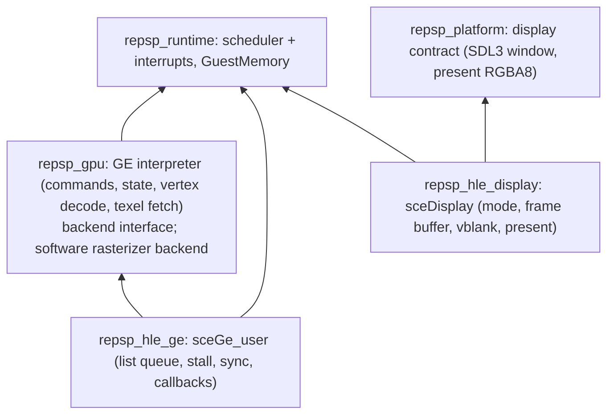

# 설계: GE와 display — 디스플레이 리스트 해석기, 소프트웨어 백엔드, 인터럽트 (issue #7)

## 1. 요구사항

* 타이틀이 GE에 디스플레이 리스트를 넘기고 display에 프레임버퍼를 지정해 화면을 내는 경로를 HLE로 제공한다. 첫 소비자는 [reDMP1 issue #7](https://github.com/reexec/reDMP1/issues/7)이다.
* 대상 함수(소비자 import 표, 이름은 SHA-1로 확인):
  * `sceGe_user`: `sceGeEdramGetAddr`(`0xE47E40E4`), `sceGeSetCallback`(`0xA4FC06A4`), `sceGeUnsetCallback`(`0x05DB22CE`), `sceGeListEnQueue`(`0xAB49E76A`), `sceGeListUpdateStallAddr`(`0xE0D68148`), `sceGeListSync`(`0x03444EB4`), `sceGeDrawSync`(`0xB287BD61`).
  * `sceDisplay`: `sceDisplaySetMode`(`0x0E20F177`), `sceDisplaySetFrameBuf`(`0x289D82FE`), `sceDisplayWaitVblankStart`(`0x984C27E7`), `sceDisplayWaitVblankStartCB`(`0x46F186C3`), `sceDisplayGetVcount`(`0x9C6EAAD7`), `sceDisplayGetFramePerSec`(`0xDBA6C4C4`).
* 사용자 결정(issue #7): 첫 렌더러는 **소프트웨어**다. 게스트 VRAM에 직접 그리므로 CPU의 VRAM 읽기·쓰기가 그대로 맞는다. OpenGL 렌더러(고해상도, 속도)는 이후 task에서 같은 백엔드 계약 뒤에 더한다.
* 출처: psprecomp `src/hle/ge.c`, `src/render.c`, `include/psprecomp/render.h`, `docs/RENDERER.md`(MIT, 커밋 `5ca18fa`)의 해석기와 래스터라이저를 출처 표기 후 옮겨 repsp 타입으로 고친다. GE 명령의 의미는 공개 자료(psdevwiki GE 명령 표, PSPSDK `pspgu.h`)로 확인한다. PPSSPP(GPL) 코드는 보지 않는다.

## 2. 레이어

* `repsp_gpu`는 HLE를 모른다. 입력은 디스플레이 리스트(게스트 주소)와 `GuestMemory`, 출력은 백엔드 호출이다. 해석은 한 곳에서만 하고(명령 해독, 상태, 정점 형식 해독, 텍스처 형식·swizzle·CLUT), 백엔드는 조립된 primitive만 받는다(psprecomp의 분리를 따름).
* 소프트웨어 백엔드는 게스트 VRAM(`0x04000000`, 2 MiB)의 프레임버퍼와 깊이 버퍼에 직접 쓴다. 이후 OpenGL 백엔드를 비교할 기준(oracle)이 된다.
* HLE 모듈은 runtime과 gpu(GE의 경우) 또는 platform display 계약(display의 경우)만 링크하고 서로 링크하지 않는다(규칙).

## 3. GE 실행 모델

* **리스트 큐**: `ListEnQueue(list, stall, cbid, arg)`는 리스트 UID를 돌려주고 큐에 넣는다. 해석기는 큐 앞의 리스트를 실행한다. 리스트는 `END`/`FINISH`에 닿거나 stall 주소에 닿을 때까지 돈다(stall이 0이면 제한 없음).
* **즉시 실행(결정성)**: 실행은 `EnQueue`와 `UpdateStallAddr`를 부른 스레드 위에서 동기로 한다. GE가 무한히 빠르다고 보는 것이다. 그래서 같은 입력이면 같은 결과다. 실제 GE는 CPU와 병렬로 돈다. 그 차이가 문제가 되는 경우(CPU가 그리기 도중의 상태를 기대하는 경우)는 측정으로 찾아 기록한다(**미확정**).
* **stall**: 리스트가 stall에 닿으면 멈추고 상태를 "stalled"로 둔다. `UpdateStallAddr(id, addr)`가 오면 이어서 실행한다.
* **sync**: `ListSync(id, mode)`와 `DrawSync(mode)`는 mode 0이면 끝날 때까지 기다린다(즉시 실행이므로 stall이 없으면 이미 끝남; stall이면 스케줄러로 대기). mode 1이면 상태를 돌려준다(값: 완료 0, 대기열 1, 실행 중 2, stall 3 — PSPSDK `pspge.h`, **추정**).
* **콜백**: `SetCallback(cb)`은 `PspGeCallbackData{signal_func, signal_arg, finish_func, finish_arg}`를 등록하고 UID를 돌려준다. `UnsetCallback(id)`은 해제한다. 리스트의 `SIGNAL` 명령과 `FINISH` 명령은 GE 인터럽트를 큐에 넣는다. 이 인터럽트가 `signal_func(id, arg)`와 `finish_func(id, arg)`를 부른다. `SIGNAL`의 동작 종류(wait, continue, jump 등)는 해석기가 처리하고, 이번 범위는 소비자가 실제로 쓰는 것부터 시작한다. 쓰지 않은 종류를 만나면 정지 보고를 한다.

## 4. 인터럽트 (runtime)

* 스케줄러에 인터럽트 대기열을 더한다. 인터럽트는 GE signal/finish, 이후의 vblank 핸들러, 오디오 등이 쓴다.
* 전달 시점은 인터럽트가 허용된 상태의 안전점(HLE 호출의 끝, `repsp_recomp_poll`, 스케줄러가 스레드를 바꾸기 직전)이다.
* 핸들러는 현재 baton을 가진 호스트 스레드에서 `call_guest`로 실행한다. 이때 현재 스레드의 레지스터 파일을 저장하고, 핸들러가 끝나면 복원한다. 핸들러는 **인터럽트 전용 스택**(커널 영역에 예약한 16 KiB)에서 돈다. `$gp`는 콜백을 등록한 모듈의 값이다.
* 핸들러 안에서는 인터럽트를 다시 전달하지 않는다. 핸들러가 대기하는 HLE를 부르면 `RaiseStop`으로 멈추고 보고한다(PSP에서도 금지).
* 전달할 스레드가 없는 유휴 상태에서 인터럽트가 오면, 스케줄러가 인터럽트 컨텍스트를 만들어 핸들러를 실행한다.

## 5. display

* `SetMode(mode, width, height)`: 기록한다(값은 소비자가 쓰는 0, 480, 272를 기대, **추정**).
* `SetFrameBuf(topaddr, bufferwidth, pixelformat, sync)`: 화면에 보낼 프레임버퍼를 정한다. pixelformat은 0 565, 1 5551, 2 4444, 3 8888이다(PSPSDK). sync 0은 즉시, 1은 다음 vblank에 바꾼다. `topaddr` 0이면 화면을 끈다.
* **vblank**: 59.94 Hz. 호스트 단조 시계의 주기 타이머가 스케줄러의 외부 이벤트 원천이 된다. vblank 카운트를 올리고, `WaitVblankStart*` 대기자를 깨운다(CB 변형은 콜백 처리). `GetVcount`는 카운트를 돌려준다.
* **float 반환**: `GetFramePerSec`는 float(`59.94005966`, **추정**)를 `$f0`에 돌려준다. 이를 위해 재컴파일 코드 계약 `repsp_guest_cpu_ops`에 `get_fpr`/`set_fpr`(MIPS COP1 레지스터 0~31, 비트 패턴 `uint32_t`)를 더한다. 이것은 아키텍처의 사실이라 lifter 중립성을 해치지 않는다. 구조체에 필드를 덧붙이고, 기존 소비자(reDMP1 어댑터)를 같은 task에서 맞춘다.
* **표시**: vblank마다(또는 프레임버퍼가 바뀐 vblank에만) 지정된 프레임버퍼를 RGBA8로 바꿔 platform display 계약으로 보낸다. 창은 480×272의 정수 배율(기본 2배)이다. 전용 모드 두 가지를 둔다. 하나는 창이 없는 headless(CI, probe; SDL dummy)이고, 다른 하나는 프레임 덤프(`REPSP_FRAME_DUMP=<dir>`, `REPSP_FRAME_DUMP_LIMIT`)다. 덤프는 BMP로 쓰고 커밋하지 않는다. 분석용이다.
* 창을 닫으면 실행을 정상 종료로 멈춘다(이유 `window closed`).

## 6. NID 이름 표

* `include/repsp/runtime/nid_names.h`: 라이브러리별로 알려진 함수 이름 목록을 두고, 시작할 때 SHA-1로 NID를 계산해 표를 만든다. 정지 보고와 추적이 미구현 NID도 `라이브러리:이름(NID)`로 보여 준다.
* 이름은 공개 SDK의 함수 이름이다(사실). 표에 넣는 이름은 SHA-1이 소비자의 import NID와 맞는 것이 확인된 것과 공개 SDK 헤더에 있는 것이다. 출처를 파일 머리에 적는다.
* 같은 NID에 두 이름이 걸리면(충돌) 둘 다 보여 주고 경고한다.

## 7. 검증

1. `ge_probe`(합성 디스플레이 리스트, 게임 데이터 없음):
   * clear, 단색 sprite, 정점 색 triangle을 VRAM에 그려 특정 픽셀 값을 확인한다.
   * 텍스처 형식(8888, 4444, CLUT8, swizzle 여부)마다 하나씩 확인한다.
   * stall에서 멈춤과 `UpdateStallAddr` 뒤 이어서 실행을 확인한다.
   * `SIGNAL`/`FINISH`가 가짜 어댑터의 콜백을 인터럽트로 부르는지 확인한다.
   * `ListSync`/`DrawSync`의 mode 0·1을 확인한다.
   * psprecomp `tests/test_raster.c`(MIT)의 검사를 옮겨 쓸 수 있다.
2. `display_probe`: 프레임버퍼 형식 변환(네 형식), `SetFrameBuf` sync 0·1, vblank 카운트가 시간에 맞는지(허용 오차 명시), `WaitVblankStart` 대기와 깨움, `GetFramePerSec`의 `$f0`.
3. `nid_probe`: 이름 표의 NID가 SHA-1과 맞는지, 이번 함수 13개의 NID.
4. `recomp_contract_probe`: `get_fpr`/`set_fpr`.
5. Win64 Debug/Release, Linux x64 Debug/Release 빌드와 CTest(헤드리스).
6. 실제 화면은 reDMP1 issue #7이 확인한다.

---

# Design: GE and display — the display-list interpreter, the software backend, interrupts (issue #7)

## 1. Requirements

* Provide, as HLE, the path by which a title hands display lists to the GE and frame buffers to the display to put a picture on screen. The first consumer is [reDMP1 issue #7](https://github.com/reexec/reDMP1/issues/7).
* Targets (the consumer's import table, names confirmed by SHA-1): `sceGe_user` — `sceGeEdramGetAddr` (`0xE47E40E4`), `sceGeSetCallback` (`0xA4FC06A4`), `sceGeUnsetCallback` (`0x05DB22CE`), `sceGeListEnQueue` (`0xAB49E76A`), `sceGeListUpdateStallAddr` (`0xE0D68148`), `sceGeListSync` (`0x03444EB4`), `sceGeDrawSync` (`0xB287BD61`); `sceDisplay` — `sceDisplaySetMode` (`0x0E20F177`), `sceDisplaySetFrameBuf` (`0x289D82FE`), `sceDisplayWaitVblankStart` (`0x984C27E7`), `sceDisplayWaitVblankStartCB` (`0x46F186C3`), `sceDisplayGetVcount` (`0x9C6EAAD7`), `sceDisplayGetFramePerSec` (`0xDBA6C4C4`).
* User decision (issue #7): the first renderer is **software**, drawing straight into guest VRAM so CPU reads and writes of VRAM stay right; the OpenGL renderer (high resolution, speed) is added in a later task behind the same backend contract.
* Sources: psprecomp's interpreter and rasterizer (`src/hle/ge.c`, `src/render.c`, `include/psprecomp/render.h`, `docs/RENDERER.md`; MIT, commit `5ca18fa`) are carried over with attribution and reshaped to repsp types; GE command meanings are checked against public material (the psdevwiki GE command table, PSPSDK `pspgu.h`); PPSSPP (GPL) code is not read.

## 2. Layers

See the diagram above. `repsp_gpu` knows no HLE: its input is a display list (a guest address) and `GuestMemory`, its output backend calls; interpretation happens in one place (command decoding, state, vertex-format decoding, texture formats/swizzle/CLUT) and backends receive assembled primitives (psprecomp's split). The software backend writes the frame and depth buffers in guest VRAM (`0x04000000`, 2 MiB) directly and becomes the oracle a later OpenGL backend is checked against. HLE modules link runtime plus gpu (GE) or the platform display contract (display) only, and never each other (the rule).

## 3. GE execution model

* List queue: `ListEnQueue(list, stall, cbid, arg)` returns a list UID and queues it; the interpreter runs the list at the front until it reaches `END`/`FINISH` or the stall address (no limit when stall is 0).
* Immediate execution (determinism): lists run synchronously on the thread that called `EnQueue` or `UpdateStallAddr`, as if the GE were infinitely fast, so equal input gives equal output. The real GE runs in parallel with the CPU; cases where that difference matters (the CPU expecting mid-draw state) are found by measurement and recorded (**unresolved**).
* Stall: a list reaching its stall stops in the "stalled" state and resumes on `UpdateStallAddr(id, addr)`.
* Sync: `ListSync(id, mode)` and `DrawSync(mode)` wait for completion in mode 0 (already complete with immediate execution unless stalled; stalled lists wait through the scheduler) and return the state in mode 1 (complete 0, queued 1, running 2, stalled 3 — PSPSDK `pspge.h`, **inferred**).
* Callbacks: `SetCallback(cb)` registers `PspGeCallbackData{signal_func, signal_arg, finish_func, finish_arg}` and returns a UID; `UnsetCallback(id)` releases it. A list's `SIGNAL` and `FINISH` commands queue GE interrupts that call `signal_func(id, arg)` and `finish_func(id, arg)`. The interpreter handles the `SIGNAL` behavior kinds (wait, continue, jump, ...), starting with those the consumer actually uses; any other kind is a stop report.

## 4. Interrupts (runtime)

The scheduler gains an interrupt queue (GE signal/finish now; vblank handlers, audio and others later). Interrupts are delivered at safe points while interrupts are enabled (the end of an HLE call, `repsp_recomp_poll`, just before the scheduler switches threads). A handler runs through `call_guest` on the host thread holding the baton, with the current thread's register file saved and restored around it, on a dedicated **interrupt stack** (16 KiB reserved in kernel space), with the `$gp` of the module that registered the callback. No interrupt is delivered inside a handler, and a handler calling a waiting HLE stops with `RaiseStop` and a report (forbidden on the PSP as well). An interrupt arriving while idle with no thread to borrow runs in an interrupt context the scheduler creates.

## 5. Display

* `SetMode(mode, width, height)` records (the consumer is expected to use 0, 480, 272; **inferred**).
* `SetFrameBuf(topaddr, bufferwidth, pixelformat, sync)` picks the frame buffer sent to the screen; pixel formats 0 565, 1 5551, 2 4444, 3 8888 (PSPSDK); sync 0 switches at once, 1 at the next vblank; `topaddr` 0 blanks the screen.
* Vblank: 59.94 Hz, a periodic timer on the host monotonic clock as an external event source of the scheduler; it advances the vblank count and wakes the `WaitVblankStart*` waiters (the CB variant processing callbacks); `GetVcount` returns the count.
* Float returns: `GetFramePerSec` returns a float (`59.94005966`, **inferred**) in `$f0`. The recompiled-code contract `repsp_guest_cpu_ops` therefore gains `get_fpr`/`set_fpr` (MIPS COP1 registers 0-31 as `uint32_t` bit patterns) — an architectural fact that keeps the contract lifter-neutral; the fields are appended to the struct and the existing consumer (reDMP1's adapter) is updated in the same task.
* Presentation: at each vblank (or only at vblanks where the frame buffer changed) the chosen frame buffer is converted to RGBA8 and sent through the platform display contract; the window is an integer multiple of 480×272 (2× by default). Two special modes exist: headless (CI and probes; SDL dummy) and frame dumps (`REPSP_FRAME_DUMP=<dir>`, `REPSP_FRAME_DUMP_LIMIT`) written as BMP for analysis and never committed.
* Closing the window stops the run as a normal end (reason `window closed`).

## 6. NID name table

`include/repsp/runtime/nid_names.h` keeps known function names per library and computes their NIDs with SHA-1 at start, so stop reports and traces show unimplemented NIDs as `library:name (NID)` too. The names are public SDK function names (facts): those whose SHA-1 is confirmed against the consumer's import NIDs and those in the public SDK headers, with sources at the top of the file. Two names on one NID (a collision) are both shown with a warning.

## 7. Verification

1. `ge_probe` (synthetic display lists, no game data): clear, a flat sprite and a vertex-coloured triangle drawn into VRAM, checked at specific pixels; one check per texture format (8888, 4444, CLUT8, swizzled or not); stopping at a stall and continuing after `UpdateStallAddr`; `SIGNAL`/`FINISH` calling the fake adapter's callbacks as interrupts; `ListSync`/`DrawSync` modes 0 and 1. The checks of psprecomp `tests/test_raster.c` (MIT) may be carried over.
2. `display_probe`: frame-buffer format conversion (the four formats), `SetFrameBuf` sync 0 and 1, the vblank count against time (with a stated tolerance), waiting and waking in `WaitVblankStart`, and `GetFramePerSec` in `$f0`.
3. `nid_probe`: the name table's NIDs against SHA-1, and the NIDs of this task's 13 functions.
4. `recomp_contract_probe`: `get_fpr`/`set_fpr`.
5. Win64 Debug/Release and Linux x64 Debug/Release builds and CTest (headless).
6. The real picture is checked by reDMP1 issue #7.
