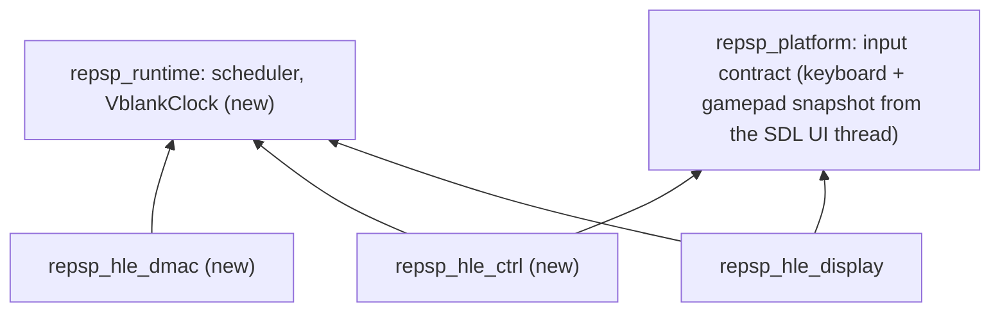

# 설계: 입력 — sceCtrl, runtime vblank 시계, 키보드·게임패드, sceDmac (issue #9)

## 1. 요구사항

* 타이틀이 패드를 읽는 경로를 HLE로 제공한다. 첫 소비자는 [reDMP1 issue #9](https://github.com/reexec/reDMP1/issues/9)이다.
* 대상 함수(소비자 import 표, 이름은 SHA-1로 확인):
  * `sceCtrl`: `sceCtrlSetSamplingCycle`(`0x6A2774F3`), `sceCtrlSetSamplingMode`(`0x1F4011E6`), `sceCtrlReadBufferPositive`(`0x1F803938`).
  * `sceDmac`: `sceDmacMemcpy`(`0x617F3FE6`).
* 범위 밖 함수(`Peek*`, `*Negative`, latch 등)는 등록하지 않는다. 불리면 이름 붙은 정지로 드러난다(조용한 stub 금지).
* 출처: PSPSDK `pspctrl.h`(구조체, 버튼 비트, 모드 값), uOFW `ctrl`(동작). PPSSPP(GPL) 코드는 보지 않는다.

## 2. 레이어

HLE 모듈끼리는 링크하지 않는다. display와 ctrl이 함께 쓰는 vblank는 runtime으로 내린다.

## 3. runtime `VblankClock`

* `include/repsp/runtime/vblank_clock.h`. 지금 `hle_display.cpp` 안에 있는 59.94 Hz 타이머 스레드, vblank 카운트, 대기자 깨우기를 옮긴다.
* 계약:
  * `Start()`/`Stop()`: 참조 계수. 첫 사용자가 켜고 마지막 사용자가 끈다.
  * `Count()`: vblank 카운트.
  * `Subscribe(fn)`/`Unsubscribe(id)`: 매 tick에 시계 스레드에서 등록 순서로 호출한다. 대기자를 깨우기 전에 부른다.
  * `WaitNext(allow_callbacks)`: 게스트 스레드가 다음 tick까지 대기한다. 스케줄러의 외부 대기 원천 수 관리는 시계가 맡는다.
  * `StepForTest()`: 스레드 없이 tick을 한 번 진행한다(probe의 결정성).
* display는 구독자로 바뀐다(프레임버퍼 latch와 표시). 동작과 `display_probe` 결과는 그대로다.

## 4. platform 입력 계약

* SDL 이벤트는 UI 스레드에서만 받는다(issue #7). UI 스레드가 키보드와 첫 게임패드의 상태를 `ControllerState` 스냅숏(mutex)으로 유지하고, `InputBackend::Poll`은 어느 스레드에서든 스냅숏을 복사한다.
* `ControllerState.buttons`는 PSP 버튼 비트(`pspctrl.h`)로 채운다. 아날로그는 -1.0~1.0이다.
* 기본 매핑은 코드의 표 하나로 두고 문서에 적는다.

| PSP | 키보드 | 게임패드(SDL) |
|---|---|---|
| 방향 | 방향키 | D-pad |
| Cross / Circle / Square / Triangle | Z / X / A / S | South / East / West / North |
| L / R | Q / W | 왼쪽 / 오른쪽 shoulder |
| Start / Select | Enter / Backspace | Start / Back |
| 아날로그 | I J K L | 왼쪽 스틱 |

* headless(dummy)에서는 중립 상태만 돌려준다.

## 5. sceCtrl

* 상태: sampling cycle(기본 0 = vblank 동기), sampling mode(0 digital, 1 analog), 샘플 링 버퍼(64개).
* 매 vblank tick에 입력 원천에서 한 샘플을 만들어 링 버퍼에 넣는다. 샘플은 `SceCtrlData`(16바이트: `TimeStamp` u32 µs, `Buttons` u32, `Lx` u8, `Ly` u8, 예약 6)다. 아날로그는 0~255(중립 128)이고, digital 모드에서는 128로 고정한다.
* `SetSamplingCycle(cycle)`: 이전 값을 돌려준다. 0이 아닌 값은 기록하되 샘플링은 vblank에 맞춘다(**미확정**, KB에 기록).
* `SetSamplingMode(mode)`: 이전 값을 돌려준다. 0, 1이 아니면 오류다(값은 `pspctrl.h`와 uOFW로 확인).
* `ReadBufferPositive(buf, count)`: 지난 읽기 뒤의 새 샘플이 없으면 다음 샘플까지 대기한다(`VblankClock::WaitNext`). 새 샘플을 오래된 것부터 최대 `count`개(1~64) 쓰고, 쓴 개수를 돌려준다. 버퍼 주소가 유효하지 않거나 `count`가 범위 밖이면 오류를 돌려준다.
* **입력 원천 주입**: `hle::ctrl::SetInputSource(fn)`으로 `fn(vcount) -> ControllerState`를 지정할 수 있다. 기본은 platform 입력 계약이다. probe와 이후의 스크립트 입력(자동 진행)이 쓴다.

## 6. sceDmac

* `sceDmacMemcpy(dst, src, size)`: 게스트 메모리를 복사한다. 범위가 유효하지 않으면 오류, 성공은 0이다(반환값은 uOFW로 확인하고, 못 하면 **추정**으로 기록).
* 겹치는 범위의 동작은 **미확정**으로 적고 `memmove`처럼 처리한다.

## 7. 이번 task의 검증

1. `vblank_probe`(또는 `display_probe` 확장): 구독 순서, `Count`, `WaitNext` 깨움, 참조 계수 Start/Stop, `StepForTest`.
2. `ctrl_probe`(합성 입력 원천): 모드·주기의 이전 값 반환, digital 모드의 아날로그 128, `ReadBufferPositive`의 대기와 여러 샘플 읽기, 버튼 비트, 오류 인자.
3. `platform_probe` 확장: dummy 입력이 중립 상태를 돌려준다.
4. `dmac_probe`(또는 기존 probe 확장): 복사 결과와 오류 인자.
5. Win64 Debug/Release, Linux x64 Debug/Release 빌드와 CTest.

---

# Design: input — sceCtrl, a runtime vblank clock, keyboard and gamepad, sceDmac (issue #9)

## 1. Requirements

HLE for the path by which a title reads the pad; the first consumer is [reDMP1 issue #9](https://github.com/reexec/reDMP1/issues/9). Functions (from the consumer import table, names confirmed by SHA-1): `sceCtrlSetSamplingCycle` (`0x6A2774F3`), `sceCtrlSetSamplingMode` (`0x1F4011E6`), `sceCtrlReadBufferPositive` (`0x1F803938`) and `sceDmacMemcpy` (`0x617F3FE6`). Functions outside this set (`Peek*`, `*Negative`, latches) are not registered, so a call surfaces as a named stop; no silent stubs. Sources: PSPSDK `pspctrl.h` (structures, button bits, mode values) and uOFW `ctrl` (behaviour); PPSSPP (GPL) code is not read.

## 2. Layers

See the diagram above. HLE modules never link each other, so the vblank shared by display and ctrl moves down into runtime.

## 3. Runtime `VblankClock`

`include/repsp/runtime/vblank_clock.h` takes over the 59.94 Hz timer thread, the vblank count and the waking of waiters that now live in `hle_display.cpp`. Contract: reference-counted `Start()`/`Stop()`; `Count()`; `Subscribe(fn)`/`Unsubscribe(id)`, called on the clock thread at every tick in subscription order before waiters wake; `WaitNext(allow_callbacks)` for guest threads, with the clock managing the scheduler's external wait sources; `StepForTest()`, which advances one tick without the thread. Display becomes a subscriber (latching the frame buffer and presenting) with unchanged behaviour and `display_probe` results.

## 4. Platform input contract

SDL events arrive on the UI thread only (issue #7). The UI thread keeps a `ControllerState` snapshot of the keyboard and the first gamepad under a mutex, and `InputBackend::Poll` copies it from any thread. `buttons` uses the PSP button bits (`pspctrl.h`); analog axes are -1.0 to 1.0. The default mapping is the table above (one table in code, documented). Headless (dummy) mode returns the neutral state.

## 5. sceCtrl

State: the sampling cycle (default 0, vblank-synchronous), the sampling mode (0 digital, 1 analog) and a ring of 64 samples. Each vblank tick takes one sample from the input source: `SceCtrlData` (16 bytes: `TimeStamp` u32 in µs, `Buttons` u32, `Lx` u8, `Ly` u8, 6 reserved). Analog values are 0-255 with 128 neutral, fixed at 128 in digital mode. `SetSamplingCycle` returns the previous value; non-zero values are recorded but sampling stays on vblank (**unconfirmed**, recorded in the KB). `SetSamplingMode` returns the previous value and rejects values other than 0 and 1 (values confirmed from `pspctrl.h` and uOFW). `ReadBufferPositive(buf, count)` waits for the next sample (`VblankClock::WaitNext`) when none is new since the last read, then writes up to `count` (1-64) new samples oldest first and returns how many; an invalid buffer or count is an error. An input source can be injected with `hle::ctrl::SetInputSource(fn)` (`fn(vcount) -> ControllerState`), the default being the platform input contract; probes and later scripted input use it.

## 6. sceDmac

`sceDmacMemcpy(dst, src, size)` copies guest memory, returning an error for invalid ranges and 0 on success (the return value is to be confirmed from uOFW, else recorded as **inferred**). Overlapping ranges are **unconfirmed** and handled like `memmove`.

## 7. Verification for this task

1. `vblank_probe` (or an extended `display_probe`): subscription order, `Count`, `WaitNext` wake-up, reference-counted Start/Stop, `StepForTest`.
2. `ctrl_probe` with a synthetic input source: previous-value returns of mode and cycle, analog 128 in digital mode, `ReadBufferPositive` waiting and multi-sample reads, button bits, bad arguments.
3. `platform_probe`: dummy input returns the neutral state.
4. `dmac_probe` (or an extension of an existing probe): the copy and bad arguments.
5. Win64 Debug/Release and Linux x64 Debug/Release builds and CTest.
