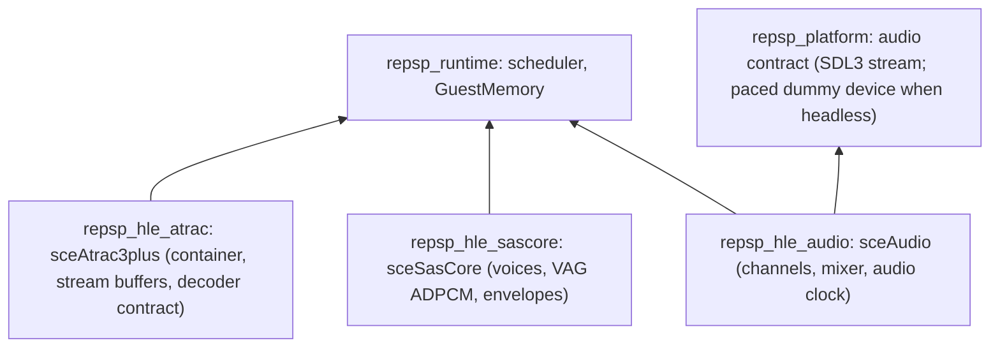

# 설계: 오디오 — sceAudio 출력, sceSasCore 믹서, sceAtrac3plus(무음 디코딩) (issue #11)

## 1. 요구사항

* 타이틀이 소리를 내는 세 경로를 HLE로 제공한다. 첫 소비자는 [reDMP1 issue #11](https://github.com/reexec/reDMP1/issues/11)이다.
* 대상 함수(소비자 import 표, 이름은 SHA-1로 확인):
  * `sceAudio`(6): `sceAudioChReserve`(`0x5EC81C55`), `sceAudioChRelease`(`0x6FC46853`), `sceAudioOutputBlocking`(`0x136CAF51`), `sceAudioOutputPannedBlocking`(`0x13F592BC`), `sceAudioGetChannelRestLength`(`0xB011922F`), `sceAudioSetChannelDataLen`(`0xCB2E439E`).
  * `sceSasCore`(13): `__sceSasInit`(`0x42778A9F`), `__sceSasCore`(`0xA3589D81`), `__sceSasSetVoice`(`0x99944089`), `__sceSasSetKeyOn`(`0x76F01ACA`), `__sceSasSetKeyOff`(`0xA0CF2FA4`), `__sceSasSetPitch`(`0xAD84D37F`), `__sceSasSetVolume`(`0x440CA7D8`), `__sceSasSetADSR`(`0x019B25EB`), `__sceSasSetSimpleADSR`(`0xCBCD4F79`), `__sceSasGetEndFlag`(`0x68A46B95`), `__sceSasRevType`(`0x33D4AB37`), `__sceSasRevEVOL`(`0xD5A229C9`), `__sceSasRevVON`(`0xF983B186`).
  * `sceAtrac3plus`(11): `sceAtracSetDataAndGetID`(`0x7A20E7AF`), `sceAtracDecodeData`(`0x6A8C3CD5`), `sceAtracGetRemainFrame`(`0x9AE849A7`), `sceAtracGetStreamDataInfo`(`0x5D268707`), `sceAtracAddStreamData`(`0x7DB31251`), `sceAtracSetLoopNum`(`0x868120B5`), `sceAtracReleaseAtracID`(`0x61EB33F5`), `sceAtracGetSoundSample`(`0xA2BBA8BE`), `sceAtracResetPlayPosition`(`0x644E5607`), `sceAtracGetBufferInfoForReseting`(`0xCA3CA3D2`), `sceAtracGetInternalErrorInfo`(`0xE88F759B`).
* **사용자 결정(reDMP1 issue #11)**: ATRAC3plus는 지금은 **무음**으로 디코딩한다. 허용적 라이선스의 디코더가 없기 때문이다. API의 상태, 버퍼 관리, 프레임·샘플 계산은 실제대로 구현하고 PCM 출력만 0으로 채운다. 디코더 선택은 소리가 필요해질 때 따로 정한다. 그래서 디코더는 교체 가능한 계약 뒤에 둔다(§5).
* 출처: PSPSDK `pspaudio.h`·`pspatrac3.h`, uOFW(audio, 오류 코드), psdevwiki(SAS, VAG ADPCM), RIFF/WAVE와 ATRAC3plus 컨테이너의 공개 자료. PPSSPP(GPL)와 FFmpeg(LGPL) 코드는 보지 않는다. 확인하지 못한 동작은 **추정**으로 KB에 적는다.
* 범위 밖 함수는 등록하지 않는다(조용한 stub 금지). 받아 두기만 하고 효과를 내지 않는 호출(§4의 reverb)은 통계와 KB에 그 사실을 드러낸다.

## 2. 레이어

SAS와 ATRAC는 게스트 버퍼에 PCM을 쓸 뿐이고, 소리는 타이틀이 그 버퍼를 `sceAudioOutput*`로 넘길 때 난다. 그래서 두 모듈은 platform을 링크하지 않는다.

## 3. sceAudio

* 채널 8개. 형식은 44.1 kHz, 16비트, stereo(0) 또는 mono(0x10). `ChReserve(channel, samplecount, format)`은 `channel`이 -1이면 빈 채널을 고른다. `samplecount`는 64의 배수(64~65472)다. 값과 오류 코드는 `pspaudio.h`·uOFW로 확인한다.
* `OutputBlocking(ch, vol, buf)`과 `OutputPannedBlocking(ch, lvol, rvol, buf)`: 채널의 `samplecount`만큼 게스트 버퍼를 복사해 채널 큐에 넣는다. 채널에 아직 재생되지 않은 앞 버퍼가 있으면 그것이 다 소비될 때까지 호출 스레드를 대기시킨다(스케줄러 대기, 외부 대기 원천). 음량은 0~0x8000이다. `buf`가 0이면 대기만 한다(**추정**, 확인해 기록).
* `GetChannelRestLength(ch)`: 아직 재생되지 않은 샘플 수. `SetChannelDataLen(ch, samplecount)`, `ChRelease(ch)`.
* **오디오 시계와 믹서**: 믹서는 8채널을 더해(포화) stereo 44.1 kHz로 platform 오디오 계약에 넘긴다. 소비 속도가 타이틀의 진행 속도를 정한다. 장치가 있으면 장치가 끌어가는 양이 시계다. headless에서는 **dummy 장치**가 호스트 단조 시계에 맞춰 같은 속도로 소비한다(소리는 버린다). platform 계약을 이 끌어가기 방식에 맞게 고친다.
* 통계: 채널별 출력 호출 수와 샘플 수, underrun 수.

## 4. sceSasCore

* `__sceSasInit(core, grain, maxVoices, outputMode, sampleRate)`: 게스트의 core 구조체 주소로 인스턴스를 식별한다. voice 최대 32개.
* `__sceSasCore(core, out)`: grain개 샘플(stereo s16)을 섞어 게스트 버퍼에 쓴다. 호출 스레드에서 동기로 계산하므로 결정적이다.
* voice: `SetVoice(core, v, vagAddr, size, loop)`(VAG ADPCM: 16바이트 블록, 예측 계수 5종, 루프·끝 플래그), `SetKeyOn/Off`, `SetPitch`(0x1000 = 원래 속도), `SetVolume(l, r, el, er)`, `SetADSR`·`SetSimpleADSR`(envelope), `GetEndFlag`(끝난 voice의 비트마스크).
* envelope의 정확한 곡선과 비율 표는 공개 자료로 확인되는 만큼 구현하고, 나머지는 **추정**으로 표시한다. 재생 길이와 끝 플래그의 시점은 probe로 고정한다.
* `RevType`/`RevEVOL`/`RevVON`: 값을 기록하고 유효성만 검사한다. reverb 효과는 이번 범위에서 섞지 않는다(dry만). 통계에 "reverb 미적용"을 표시하고 KB에 적는다.

## 5. sceAtrac3plus

* `SetDataAndGetID(buf, size)`: RIFF/WAVE 헤더를 해석한다. `fmt`(코덱: ATRAC3 `0x0270`, ATRAC3plus는 WAVE_FORMAT_EXTENSIBLE의 GUID; 채널, 샘플레이트, 블록 크기), `fact`(전체 샘플 수, 인코더 지연), `smpl`(루프), `data`의 위치와 크기. ID를 돌려준다(최대 수는 공개 자료로 확인).
* 프레임당 샘플 수는 ATRAC3 1024, ATRAC3plus 2048이다. `DecodeData(id, out, outSamples, outEnd, outRemainFrame)`은 한 프레임 분량을 쓰고, 마지막 프레임과 루프를 처리한다.
* 스트림 버퍼 관리: `GetStreamDataInfo`, `AddStreamData`, `GetRemainFrame`(전체가 메모리에 있으면 특수값), `GetBufferInfoForReseting`, `ResetPlayPosition`, `SetLoopNum`, `GetSoundSample`(끝 샘플, 루프 시작·끝), `GetInternalErrorInfo`, `ReleaseAtracID`. 상태 전이와 특수값은 `pspatrac3.h`와 공개 자료로 확인하고, 확인 상태를 KB에 적는다.
* **디코더 계약**: `AtracDecoder { DecodeFrame(frame_bytes, pcm_out) }`. 이번 구현은 `SilentDecoder`(0으로 채움) 하나다. 통계와 정지 보고에 "ATRAC decode: silent"와 디코딩한 프레임 수를 표시한다.

## 6. HLE 모듈 표

* 커널 HLE가 디스크의 PRX를 HLE 모듈로 다룬다(issue #5). `sc_sascore.prx`, `audiocodec.prx`, `libatrac3plus.prx`를 로드·시작하는 호출이 지금 성공으로 지나가는지, 이름이 이 표에 실제로 있어서인지 확인한다. 표에 없는 PRX를 조용히 성공시키고 있다면 고친다.

## 7. 이번 task의 검증

1. `audio_probe`: 채널 예약·해제와 오류, `OutputBlocking`의 대기와 소비 속도(dummy 장치, 허용 오차), 음량·pan 믹싱 결과, `GetChannelRestLength`.
2. `sas_probe`: 합성 VAG 데이터의 디코딩 결과(알려진 샘플), pitch, 음량, 루프, key on/off와 끝 플래그, grain 크기.
3. `atrac_probe`: 합성 RIFF 헤더(ATRAC3, ATRAC3plus) 해석, 프레임·샘플 계산, 끝과 루프, 스트림 버퍼 추가, 무음 출력.
4. `platform_probe` 확장: dummy 오디오 장치의 소비 속도.
5. Win64 Debug/Release, Linux x64 Debug/Release 빌드와 CTest. probe는 실제 게임 데이터를 쓰지 않는다.

---

# Design: audio — sceAudio output, the sceSasCore mixer, sceAtrac3plus with silent decoding (issue #11)

## 1. Requirements

HLE for the three paths by which a title makes sound; the first consumer is [reDMP1 issue #11](https://github.com/reexec/reDMP1/issues/11). The functions are those listed above (6 of `sceAudio`, 13 of `sceSasCore`, 11 of `sceAtrac3plus`; from the consumer import table, names confirmed by SHA-1).

**User decision (reDMP1 issue #11)**: ATRAC3plus decodes to **silence** for now, because no permissively licensed decoder exists. API state, buffer management and frame and sample accounting are implemented as they are; only the PCM output is zero. The decoder choice is made separately when sound is needed, so the decoder sits behind a replaceable contract (§5).

Sources: PSPSDK `pspaudio.h` and `pspatrac3.h`, uOFW (audio, error codes), psdevwiki (SAS, VAG ADPCM), and public material on RIFF/WAVE and the ATRAC3plus container. PPSSPP (GPL) and FFmpeg (LGPL) code is not read. Unconfirmed behaviour is recorded as **inferred** in the KB. Functions outside the set are not registered (no silent stubs); calls that are accepted without effect (reverb, §4) are shown as such in statistics and the KB.

## 2. Layers

See the diagram above. SAS and ATRAC only write PCM into guest buffers; sound is made when the title passes those buffers to `sceAudioOutput*`, so neither module links platform.

## 3. sceAudio

Eight channels, 44.1 kHz, 16-bit, stereo (0) or mono (0x10). `ChReserve(channel, samplecount, format)` picks a free channel for -1; `samplecount` is a multiple of 64 (64-65472); values and error codes are confirmed from `pspaudio.h` and uOFW. `OutputBlocking` and `OutputPannedBlocking` copy the channel's `samplecount` samples from the guest buffer into the channel queue, first making the caller wait (a scheduler wait with an external wait source) until the channel's previous buffer is consumed; volumes are 0-0x8000; a null buffer only waits (**inferred**, to be confirmed and recorded). `GetChannelRestLength` returns samples not yet played; `SetChannelDataLen` and `ChRelease` complete the set.

Audio clock and mixer: the mixer sums the eight channels with saturation into 44.1 kHz stereo for the platform audio contract, and the rate of consumption sets the title's pace. With a device, what the device pulls is the clock; when headless, a **dummy device** consumes at the same rate on the host monotonic clock and discards the sound. The platform contract is reshaped for this pull model. Statistics: output calls and samples per channel, and underruns.

## 4. sceSasCore

`__sceSasInit(core, grain, maxVoices, outputMode, sampleRate)` identifies an instance by the guest address of its core structure, with up to 32 voices. `__sceSasCore(core, out)` mixes grain stereo s16 samples into the guest buffer synchronously on the calling thread, so it is deterministic. Voices: `SetVoice` (VAG ADPCM: 16-byte blocks, five predictor pairs, loop and end flags), `SetKeyOn/Off`, `SetPitch` (0x1000 is native rate), `SetVolume(l, r, el, er)`, `SetADSR` and `SetSimpleADSR` (the envelope), and `GetEndFlag` (a bit mask of finished voices). Envelope curves and rate tables are implemented as far as public material confirms them and marked **inferred** beyond that; play length and end-flag timing are pinned by the probe. `RevType`, `RevEVOL` and `RevVON` record and validate their values; no reverb is mixed in this task (dry only), which the statistics and the KB state.

## 5. sceAtrac3plus

`SetDataAndGetID(buf, size)` parses the RIFF/WAVE header: `fmt` (codec: ATRAC3 `0x0270`, ATRAC3plus by the GUID of WAVE_FORMAT_EXTENSIBLE; channels, sample rate, block size), `fact` (total samples, encoder delay), `smpl` (loops), and the position and size of `data`; it returns an ID (the maximum count confirmed from public material). A frame is 1024 samples for ATRAC3 and 2048 for ATRAC3plus. `DecodeData(id, out, outSamples, outEnd, outRemainFrame)` writes one frame and handles the last frame and loops. Stream buffer management covers `GetStreamDataInfo`, `AddStreamData`, `GetRemainFrame` (special values when the whole file is in memory), `GetBufferInfoForReseting`, `ResetPlayPosition`, `SetLoopNum`, `GetSoundSample`, `GetInternalErrorInfo` and `ReleaseAtracID`; state transitions and special values are confirmed from `pspatrac3.h` and public material, with their status in the KB.

Decoder contract: `AtracDecoder { DecodeFrame(frame_bytes, pcm_out) }`, with `SilentDecoder` (zeros) as the only implementation here. Statistics and the stop report show "ATRAC decode: silent" and the number of frames decoded.

## 6. HLE module table

The kernel HLE treats PRX files on the disc as HLE modules (issue #5). Check whether loading and starting `sc_sascore.prx`, `audiocodec.prx` and `libatrac3plus.prx` succeeds because those names are really in the table; a PRX that is not in the table must not succeed silently, and that is fixed if it does.

## 7. Verification for this task

1. `audio_probe`: channel reserve and release with errors, the wait in `OutputBlocking` and the consumption rate (dummy device, with a tolerance), volume and pan mixing results, `GetChannelRestLength`.
2. `sas_probe`: decoding of synthetic VAG data (known samples), pitch, volume, loops, key on/off and the end flag, grain sizes.
3. `atrac_probe`: parsing synthetic RIFF headers (ATRAC3 and ATRAC3plus), frame and sample accounting, end and loop, adding stream data, silent output.
4. `platform_probe`: the consumption rate of the dummy audio device.
5. Win64 Debug/Release and Linux x64 Debug/Release builds and CTest. Probes use no real game data.
