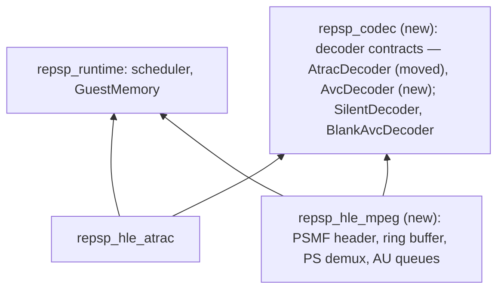

# 설계: 동영상 — sceMpeg와 PSMF(빈 프레임 디코딩) (issue #13)

## 1. 요구사항

* 타이틀이 PSMF(PMF) 동영상을 재생하는 경로를 HLE로 제공한다. 첫 소비자는 [reDMP1 issue #13](https://github.com/reexec/reDMP1/issues/13)이다.
* 대상 함수(`sceMpeg` 24개; 소비자 import 표, 이름은 SHA-1로 확인):
  * 수명: `sceMpegInit`(`0x682A619B`), `sceMpegFinish`(`0x874624D6`), `sceMpegQueryMemSize`(`0xC132E22F`), `sceMpegCreate`(`0xD8C5F121`), `sceMpegDelete`(`0x606A4649`).
  * 링버퍼: `sceMpegRingbufferQueryMemSize`(`0xD7A29F46`), `sceMpegRingbufferConstruct`(`0x37295ED8`), `sceMpegRingbufferDestruct`(`0x13407F13`), `sceMpegRingbufferAvailableSize`(`0xB5F6DC87`), `sceMpegRingbufferPut`(`0xB240A59E`).
  * 스트림: `sceMpegQueryStreamOffset`(`0x21FF80E4`), `sceMpegQueryStreamSize`(`0x611E9E11`), `sceMpegRegistStream`(`0x42560F23`), `sceMpegUnRegistStream`(`0x591A4AA2`).
  * AU: `sceMpegMallocAvcEsBuf`(`0xA780CF7E`), `sceMpegFreeAvcEsBuf`(`0xCEB870B1`), `sceMpegQueryAtracEsSize`(`0xF8DCB679`), `sceMpegInitAu`(`0x167AFD9E`), `sceMpegGetAvcAu`(`0xFE246728`), `sceMpegGetAtracAu`(`0xE1CE83A7`).
  * 디코딩: `sceMpegAvcDecode`(`0x0E3C2E9D`), `sceMpegAvcDecodeStop`(`0x740FCCD1`), `sceMpegAvcDecodeFlush`(`0x4571CC64`), `sceMpegAtracDecode`(`0x800C44DF`).
* **사용자 결정(reDMP1 issue #13)**: 영상은 지금은 **빈(검은) 프레임**으로, 음성은 무음으로 디코딩한다. 허용적 라이선스의 H.264·ATRAC3plus 디코더가 없기 때문이다. API의 상태, 링버퍼, 스트림 분리, 타임스탬프는 실제대로 구현하고 디코딩 결과만 비운다. 영상 길이만큼 시간이 흐른 뒤 타이틀이 다음으로 넘어가야 한다.
* 출처: PSPSDK `pspmpeg.h`(구조체, 함수 원형), MPEG-2 program stream 규격의 공개 자료, PSMF 헤더의 공개 자료(psdevwiki), uOFW(있는 범위). PPSSPP(GPL)와 FFmpeg(LGPL) 코드는 보지 않는다. 확인하지 못한 동작과 값은 **추정**으로 KB에 적는다.
* 범위 밖 함수는 등록하지 않는다(조용한 stub 금지).

## 2. 레이어

* HLE 모듈끼리 링크하지 않는다. issue #11에서 `repsp_hle_atrac` 안에 둔 디코더 계약을 새 타깃 `repsp_codec`으로 옮기고, 영상 디코더 계약을 그 옆에 둔다.
* `AvcDecoder { DecodeAu(au_bytes, width, height, pixel_format, out) }`. 이번 구현은 `BlankAvcDecoder`(불투명한 검은색) 하나다. 통계와 정지 보고에 "AVC decode: blank"와 디코딩한 프레임 수를 표시한다.

## 3. PSMF와 스트림 분리

* **헤더**: 매직 `PSMF`, 버전, 스트림 시작 오프셋과 크기(big-endian), 스트림 표(영상·음성 스트림의 종류와 번호), 첫·마지막 타임스탬프. `QueryStreamOffset(mpeg, header, &offset)`과 `QueryStreamSize(header, &size)`가 이 헤더를 읽는다. 잘못된 헤더는 오류다.
* **본문**: 2048바이트 pack의 MPEG-2 program stream이다. pack 헤더, system 헤더, PES 패킷을 해석한다. 영상은 stream id `0xE0`대, 음성은 private stream 1(`0xBD`)의 하위 스트림이다. PES의 PTS·DTS(90 kHz)를 읽는다.
* **AU 경계**: 영상 AU는 PTS가 붙은 PES에서 시작한다고 본다(**추정**). 구현 중 H.264 access unit delimiter로 확인되면 그쪽을 쓴다. 음성 AU는 ATRAC3plus 프레임 헤더와 크기로 나눈다.
* 분리 결과는 스트림별 AU 큐(바이트, PTS, DTS)에 쌓는다. `RegistStream(mpeg, type, num)`으로 등록한 스트림만 큐를 가진다.

## 4. 링버퍼와 콜백

* `RingbufferConstruct(ring, packets, data, size, callback, cbParam)`: 게스트의 `SceMpegRingbuffer` 구조체를 채운다(`pspmpeg.h`의 배치). `RingbufferQueryMemSize(packets)`는 pack 수에 따른 필요 크기를 돌려준다(값은 공개 자료로 확인, 못 하면 **추정**).
* `RingbufferPut(ring, numPackets, available)`: 게스트 콜백 `callback(dst, numPackets, cbParam)`을 **호출 스레드 위에서** 부른다. 콜백은 파일을 읽으며 대기할 수 있으므로 인터럽트 경로가 아니라 스레드 문맥의 게스트 호출이다. 커널 콜백 실행에 쓰는 기존 경로를 쓰고, 없으면 스케줄러에 "현재 스레드에서 게스트 함수를 부르고 돌아오는" 기능을 더한다(레지스터 보존, 호출 중 대기 허용). 콜백이 돌려준 pack 수만큼을 분리기로 넘긴다.
* `RingbufferAvailableSize(ring)`: 비어 있는 pack 수.

## 5. AU와 디코딩

* `InitAu(mpeg, esBuffer, au)`, `GetAvcAu(mpeg, stream, au, &attr)`, `GetAtracAu(mpeg, stream, au, &attr)`: 큐의 다음 AU를 게스트의 `SceMpegAu`(PTS, DTS, ES 버퍼, 크기)에 채운다. 큐가 비면 "데이터 없음" 오류를 돌려준다(오류 코드는 공개 자료로 확인).
* `AvcDecode(mpeg, au, frameWidth, &buffer, &init)`: 디코더 계약으로 한 프레임을 만들어 게스트 버퍼에 쓴다(기본 480×272, 픽셀 형식은 기본값 8888로 두고 **추정** 표시). `AvcDecodeStop`은 남은 프레임을 내보내고, `AvcDecodeFlush`는 상태를 비운다.
* `AtracDecode(mpeg, au, buffer, init)`: 한 프레임(2048 샘플 stereo)을 `AtracDecoder` 계약으로 디코딩한다(무음).
* `MallocAvcEsBuf`/`FreeAvcEsBuf`, `QueryAtracEsSize(mpeg, &esSize, &outSize)`: 값은 공개 자료로 확인한다.
* **시간**: HLE는 스스로 시간을 보내지 않는다. 타이틀이 PTS와 자기 오디오·vblank 루프로 속도를 맞춘다. 빈 프레임이어도 AU 수와 PTS는 실제 스트림 그대로이므로 영상 길이만큼 진행한다.

## 6. 이번 task의 검증

1. `mpeg_probe`(합성 PSMF: 손으로 만든 헤더와 pack 몇 개): 헤더 해석과 오류, 링버퍼 구성·채우기(게스트 콜백을 probe의 게스트 함수로 대신), 영상·음성 AU 분리와 PTS, 큐가 빌 때의 오류, `AvcDecode`의 검은 프레임과 `AtracDecode`의 무음, 수명 함수.
2. 게스트 콜백 호출 경로의 probe: 콜백 안에서 대기(`DelayThread`)한 뒤 돌아와도 호출 스레드의 레지스터가 보존된다.
3. `atrac_probe`가 `repsp_codec` 이전 뒤에도 그대로 통과한다.
4. Win64 Debug/Release, Linux x64 Debug/Release 빌드와 CTest. probe는 실제 게임 데이터를 쓰지 않는다.

---

# Design: video — sceMpeg and PSMF with blank-frame decoding (issue #13)

## 1. Requirements

HLE for the path by which a title plays PSMF (PMF) movies; the first consumer is [reDMP1 issue #13](https://github.com/reexec/reDMP1/issues/13). The functions are the 24 of `sceMpeg` listed above (from the consumer import table, names confirmed by SHA-1).

**User decision (reDMP1 issue #13)**: video decodes to **blank (black) frames** and audio to silence for now, because no permissively licensed H.264 or ATRAC3plus decoder exists. API state, the ring buffer, demultiplexing and timestamps are implemented as they are; only the decoded output is empty. The title must move on after the movie's real duration.

Sources: PSPSDK `pspmpeg.h` (structures, prototypes), public material on the MPEG-2 program stream and on the PSMF header (psdevwiki), and uOFW where it covers this. PPSSPP (GPL) and FFmpeg (LGPL) code is not read. Unconfirmed behaviour and values are recorded as **inferred** in the KB. Functions outside the set are not registered (no silent stubs).

## 2. Layers

See the diagram above. HLE modules never link each other, so the decoder contract that issue #11 placed inside `repsp_hle_atrac` moves to a new target `repsp_codec`, with the video decoder contract beside it: `AvcDecoder { DecodeAu(au_bytes, width, height, pixel_format, out) }`, implemented here only by `BlankAvcDecoder` (opaque black). Statistics and the stop report show "AVC decode: blank" and the number of frames decoded.

## 3. PSMF and demultiplexing

Header: the magic `PSMF`, a version, the stream start offset and size (big-endian), the stream table (kinds and numbers of video and audio streams) and the first and last timestamps; `QueryStreamOffset` and `QueryStreamSize` read it and reject a bad header. Body: an MPEG-2 program stream in 2048-byte packs, with pack headers, system headers and PES packets; video uses stream ids in the `0xE0` range and audio a substream of private stream 1 (`0xBD`); PES PTS and DTS are at 90 kHz. Access-unit boundaries: a video AU is taken to start at a PES that carries a PTS (**inferred**), replaced by the H.264 access unit delimiter if that proves right during implementation; audio AUs are split by the ATRAC3plus frame header and size. Results go to per-stream AU queues (bytes, PTS, DTS); only streams registered with `RegistStream` have a queue.

## 4. Ring buffer and callback

`RingbufferConstruct(ring, packets, data, size, callback, cbParam)` fills the guest `SceMpegRingbuffer` (layout from `pspmpeg.h`); `RingbufferQueryMemSize(packets)` returns the size needed (confirmed from public material, else **inferred**). `RingbufferPut(ring, numPackets, available)` calls the guest `callback(dst, numPackets, cbParam)` **on the calling thread**: the callback reads files and may wait, so it is a thread-context guest call, not the interrupt path. The existing path for kernel callbacks is used, or the scheduler gains a "call a guest function on the current thread and return" facility (registers preserved, waiting allowed). The packs the callback reports are fed to the demultiplexer. `RingbufferAvailableSize` returns the free packs.

## 5. Access units and decoding

`InitAu`, `GetAvcAu` and `GetAtracAu` fill the guest `SceMpegAu` (PTS, DTS, ES buffer, size) with the next queued AU, returning the "no data" error when the queue is empty (code confirmed from public material). `AvcDecode(mpeg, au, frameWidth, &buffer, &init)` produces one frame through the decoder contract into the guest buffer (480x272; the pixel format defaults to 8888, marked **inferred**); `AvcDecodeStop` drains remaining frames and `AvcDecodeFlush` clears state. `AtracDecode` decodes one frame (2048 stereo samples) through the `AtracDecoder` contract (silence). `MallocAvcEsBuf`/`FreeAvcEsBuf` and `QueryAtracEsSize` use values confirmed from public material. Time: the HLE never spends time itself; the title paces playback by PTS against its own audio and vblank loops, and since AU counts and PTS are those of the real stream, playback lasts the movie's duration even with blank frames.

## 6. Verification for this task

1. `mpeg_probe` (a synthetic PSMF: a hand-built header and a few packs): header parsing and errors, ring buffer construction and filling (with a probe guest function as the callback), video and audio AU splitting with PTS, the empty-queue error, the black frame of `AvcDecode` and the silence of `AtracDecode`, and the lifetime functions.
2. A probe of the guest-callback path: after a wait (`DelayThread`) inside the callback, the calling thread's registers are preserved on return.
3. `atrac_probe` passes unchanged after the move to `repsp_codec`.
4. Win64 Debug/Release and Linux x64 Debug/Release builds and CTest. Probes use no real game data.
