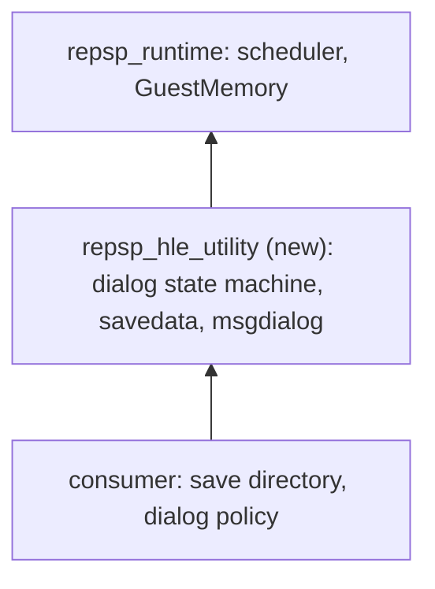

# 설계: 유틸리티 — sceUtility 세이브 데이터와 메시지 다이얼로그 (issue #15)

## 1. 요구사항

* 타이틀이 세이브 데이터를 읽고 쓰는 경로와 메시지 다이얼로그를 HLE로 제공한다. 첫 소비자는 [reDMP1 issue #15](https://github.com/reexec/reDMP1/issues/15)이다.
* 대상 함수(`sceUtility` 8개; 소비자 import 표, 이름은 SHA-1로 확인):
  * 세이브 데이터: `sceUtilitySavedataInitStart`(`0x50C4CD57`), `sceUtilitySavedataGetStatus`(`0x8874DBE0`), `sceUtilitySavedataUpdate`(`0xD4B95FFB`), `sceUtilitySavedataShutdownStart`(`0x9790B33C`).
  * 메시지 다이얼로그: `sceUtilityMsgDialogInitStart`(`0x2AD8E239`), `sceUtilityMsgDialogGetStatus`(`0x9A1C91D7`), `sceUtilityMsgDialogUpdate`(`0x95FC253B`), `sceUtilityMsgDialogShutdownStart`(`0x67AF3428`).
* 다이얼로그는 이번에는 **그리지 않는다**. 화면에 그리는 UI(글꼴, 목록, 버튼)는 뒤의 과제다. 상태 기계, 결과 값, 실제 파일 입출력은 실제대로 구현한다. 그리지 않는다는 사실을 통계에 드러낸다("dialog UI: not drawn").
* 출처: PSPSDK `psputility.h`, `psputility_savedata.h`, `psputility_msgdialog.h`(구조체, 모드와 상태 값), psdevwiki의 공개 자료, uOFW(있는 범위). PPSSPP(GPL) 코드는 보지 않는다. 확인하지 못한 동작과 값은 **추정**으로 KB에 적는다.
* 범위 밖 함수는 등록하지 않는다(조용한 stub 금지).

## 2. 레이어

* 새 타깃 `repsp_hle_utility`. 다른 HLE 모듈과 링크하지 않는다. 파일 입출력은 호스트 파일 시스템(`std::filesystem`)을 직접 쓴다. 세이브 데이터는 게스트의 `ms0:` 경로가 아니라 유틸리티가 관리하는 저장소이기 때문이다.
* 소비자 계약(`include/repsp/hle/utility.h`):
  * `Config { std::filesystem::path save_root; int language; int button_swap; }`와 `Register(config)`, `Shutdown()`.
  * `SetDialogPolicy(policy)`: 그리지 않는 다이얼로그에 답을 주는 함수. 입력은 다이얼로그 종류, 표시할 글, 선택지 종류(없음, 예/아니오)이고 출력은 선택(확인, 예, 아니오, 취소)이다. 기본 정책은 "예/확인"이다.
  * `GetStats()`, `FormatStats()`: 다이얼로그별 시작 횟수, 세이브 데이터 모드별 횟수와 마지막 결과, 읽고 쓴 바이트, 마지막 메시지 글.

## 3. 다이얼로그 상태 기계

* 상태(`psputility.h`의 값): 없음(0), 초기화(1), 표시 중(2), 종료 요청됨(3), 끝남(4). 세이브 데이터와 메시지 다이얼로그가 각각 하나의 상태를 가진다.
* `InitStart(params)`: 공통 머리(`pspUtilityDialogCommon`: 크기, 언어, 버튼 배치, 스레드 우선순위 4개, 결과)를 읽고 상태를 초기화로 둔다. 이미 진행 중이면 오류를 돌려준다(오류 코드는 공개 자료로 확인).
* `GetStatus()`: 현재 상태를 돌려준다. 초기화 상태는 한 번 읽힌 뒤 표시 중으로 넘어간다.
* `Update(n)`: 표시 중일 때 일을 진행한다. 이번 구현은 첫 `Update`에서 작업(§4, §5)을 끝내고 결과를 params에 쓴 뒤 종료 요청됨으로 넘어간다.
* `ShutdownStart()`: 끝남으로 넘어가고, 그 상태가 한 번 읽힌 뒤 없음으로 돌아간다.
* 실제 기기의 전이 시점(몇 번째 호출에서 넘어가는지)은 확인한 범위에서 맞추고 나머지는 **추정**으로 적는다. 타이틀이 기대하는 순서와 다르면 소비자 실행에서 드러나므로 그때 고친다.

## 4. 세이브 데이터

* **params**: `SceUtilitySavedataParam`(`psputility_savedata.h`의 배치). 모드, `gameName`(13), `saveName`(20), `saveNameList`, `fileName`(13), `dataBuf`, `dataBufSize`, `dataSize`, `sfoParam`(제목, 세이브 제목, 설명, parental level), `icon0`·`icon1`·`pic1`·`snd0`의 파일 데이터, 그리고 크기에 따라 붙는 뒤쪽 필드. 구조체 크기(`base.size`)로 변종을 구분하고, 모르는 크기는 분명한 오류로 멈춘다.
* **저장 위치**: `<save_root>/<gameName><saveName>/`. 그 안에 데이터 파일(`fileName`), `PARAM.SFO`, 받은 아이콘·배경 파일을 둔다.
* **데이터 형식**: 실제 기기는 데이터 파일을 타이틀 키로 암호화한다. HLE는 타이틀이 준 바이트를 **평문 그대로** 저장한다(다른 구현과의 세이브 호환은 이번 범위가 아니다; KB와 릴리스 노트에 적는다). `PARAM.SFO`는 실제 형식으로 쓴다(`TITLE`, `SAVEDATA_TITLE`, `SAVEDATA_DETAIL`, `SAVEDATA_DIRECTORY`, `CATEGORY`, `PARENTAL_LEVEL`). SFO를 쓰는 코드는 이 모듈 안에 둔다.
* **모드**: 소비자가 실제로 부르는 모드만 구현한다. 처음에는 자동 읽기·자동 쓰기·읽기·쓰기(목록 UI 없는 것)와 크기 조회 계열 중 타이틀이 부르는 것을 구현하고, 구현하지 않은 모드는 모드 번호와 이름을 적은 치명적 정지로 드러낸다(조용히 성공시키지 않는다).
* **결과**: 데이터가 없을 때의 "no data" 오류, 버퍼가 작을 때의 오류 등 `base.result`에 쓰는 값은 공개 자료로 확인한다. 읽기 성공 시 `dataBuf`를 채우고 `dataSize`를 쓴다.
* 목록 UI가 있는 모드는 정책이 "첫 항목 선택"으로 답한다(그리지 않으므로).

## 5. 메시지 다이얼로그

* **params**: `pspUtilityMsgDialogParams`(`psputility_msgdialog.h`). 모드(오류 코드 표시, 글 표시), 오류 값, 글(512바이트, UTF-8), 선택지 옵션(예/아니오, 기본 선택), 누른 버튼.
* 글(또는 오류 값)을 로그와 통계에 남기고 `SetDialogPolicy`의 답을 `buttonPressed`에 쓴다(값은 공개 자료로 확인: 예, 아니오, 뒤로).
* 통계에 다이얼로그마다 글과 답을 남겨, 소비자가 타이틀이 무엇을 물었는지 기록할 수 있게 한다.

## 6. 이번 task의 검증

1. `utility_probe`(합성 params, 임시 디렉터리): 상태 전이(없음→초기화→표시 중→종료 요청됨→끝남→없음), 진행 중 재시작 오류, 세이브 쓰기 뒤 읽기의 왕복(바이트 일치, `PARAM.SFO` 필드), 데이터 없음 결과, 작은 버퍼 결과, 구현하지 않은 모드의 정지, 메시지 다이얼로그의 글 기록과 정책 답(예/아니오 각각), 통계.
2. probe는 임시 디렉터리만 쓰고 끝나면 지운다. 실제 게임 데이터를 쓰지 않는다.
3. Win64 Debug/Release, Linux x64 Debug/Release 빌드와 CTest.

---

# Design: utility — sceUtility save data and message dialog (issue #15)

## 1. Requirements

Provide, as HLE, the path a title uses to load and save its save data, and the message dialog. The first consumer is [reDMP1 issue #15](https://github.com/reexec/reDMP1/issues/15). Functions (8 in `sceUtility`, from the consumer's import table, names confirmed by SHA-1): save data `sceUtilitySavedataInitStart` (`0x50C4CD57`), `sceUtilitySavedataGetStatus` (`0x8874DBE0`), `sceUtilitySavedataUpdate` (`0xD4B95FFB`), `sceUtilitySavedataShutdownStart` (`0x9790B33C`); message dialog `sceUtilityMsgDialogInitStart` (`0x2AD8E239`), `sceUtilityMsgDialogGetStatus` (`0x9A1C91D7`), `sceUtilityMsgDialogUpdate` (`0x95FC253B`), `sceUtilityMsgDialogShutdownStart` (`0x67AF3428`).

Dialogs are **not drawn** this time; an on-screen UI (font, lists, buttons) is a later task. The state machine, result values and real file I/O are implemented as they are, and the statistics say that nothing is drawn ("dialog UI: not drawn"). Sources: PSPSDK `psputility.h`, `psputility_savedata.h`, `psputility_msgdialog.h` (structures, mode and status values), public psdevwiki material, uOFW where it covers this. PPSSPP (GPL) code is not read. Unconfirmed behaviour and values are marked **assumed** in the knowledge base. Functions outside this list are not registered (no silent stubs).

## 2. Layers

A new target `repsp_hle_utility` on `repsp_runtime`, linked to no other HLE module. File I/O goes straight to the host file system (`std::filesystem`): save data is storage managed by the utility, not a guest `ms0:` path. Consumer contract (`include/repsp/hle/utility.h`): `Config { save_root, language, button_swap }` with `Register(config)` and `Shutdown()`; `SetDialogPolicy(policy)`, a function that answers undrawn dialogs — given the dialog kind, its text and the choice kind (none, yes/no) it returns the choice (confirm, yes, no, cancel), the default policy being "yes/confirm"; `GetStats()` and `FormatStats()` with per-dialog start counts, per-mode save data counts and last result, bytes read and written, and the last message text.

## 3. Dialog state machine

States (values from `psputility.h`): none (0), initializing (1), visible (2), quit requested (3), finished (4). Save data and the message dialog each have one. `InitStart(params)` reads the common header (`pspUtilityDialogCommon`: size, language, button assignment, four thread priorities, result) and enters initializing; starting while one is in progress is an error (code from public sources). `GetStatus()` returns the state; initializing moves to visible after being read once. `Update(n)` does the work while visible: this implementation finishes the job (§4, §5) on the first `Update`, writes the result into the params and moves to quit requested. `ShutdownStart()` moves to finished, which returns to none after being read once. Transition timing on real hardware is matched where confirmed and otherwise recorded as **assumed**; a mismatch with what the title expects shows up in the consumer's run and is fixed then.

## 4. Save data

Params are `SceUtilitySavedataParam` (layout from `psputility_savedata.h`): mode, `gameName` (13), `saveName` (20), `saveNameList`, `fileName` (13), `dataBuf`, `dataBufSize`, `dataSize`, `sfoParam` (title, save title, detail, parental level), the `icon0`, `icon1`, `pic1` and `snd0` file data, and the trailing fields that depend on the size. The structure size (`base.size`) selects the variant; an unknown size is a clear error stop.

Data lives in `<save_root>/<gameName><saveName>/`: the data file (`fileName`), `PARAM.SFO`, and any icon and background files supplied. Real hardware encrypts the data file with a title key; the HLE stores the bytes the title supplied **as plaintext** (save compatibility with other implementations is out of scope; this is stated in the knowledge base and release notes). `PARAM.SFO` is written in its real format (`TITLE`, `SAVEDATA_TITLE`, `SAVEDATA_DETAIL`, `SAVEDATA_DIRECTORY`, `CATEGORY`, `PARENTAL_LEVEL`) by code inside this module.

Only the modes the consumer actually calls are implemented: at first auto-load, auto-save, load and save (those without a list UI) and whichever size query modes the title calls. An unimplemented mode is a fatal stop naming the mode number and name, never a silent success. Result values written to `base.result` (the "no data" error, a buffer too small, and so on) come from public sources; a successful load fills `dataBuf` and writes `dataSize`. Modes with a list UI are answered by the policy as "first entry", since nothing is drawn.

## 5. Message dialog

Params are `pspUtilityMsgDialogParams` (`psputility_msgdialog.h`): mode (error code or text), error value, text (512 bytes, UTF-8), options (yes/no, default choice), and the button pressed. The text (or error value) goes to the log and statistics and the answer from `SetDialogPolicy` is written to `buttonPressed` (values from public sources: yes, no, back). Statistics keep the text and the answer of each dialog so the consumer can record what the title asked.

## 6. Verification for this task

1. `utility_probe` (synthetic params, a temporary directory): the state transitions (none → initializing → visible → quit requested → finished → none), the error on starting twice, a save-then-load round trip (identical bytes, `PARAM.SFO` fields), the no-data result, the small-buffer result, the stop on an unimplemented mode, the message dialog's recorded text and policy answers (yes and no), and the statistics.
2. The probe uses only a temporary directory and removes it; no real game data.
3. Win64 Debug/Release and Linux x64 Debug/Release builds and CTest.
