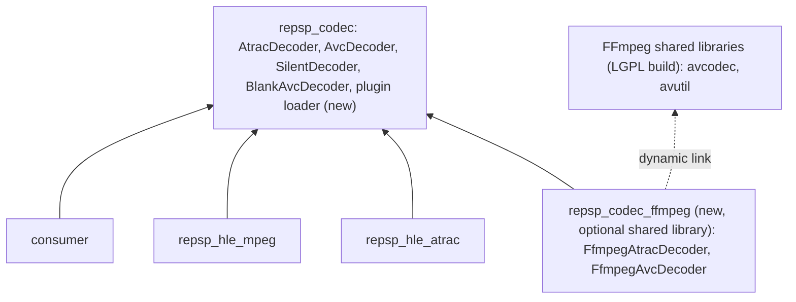

# 설계: 코덱 플러그인 — 동적으로 불러오는 FFmpeg으로 ATRAC3plus와 H.264 디코딩 (issue #21)

## 1. 요구사항

* `AtracDecoder`와 `AvcDecoder` 계약의 실제 구현을 더한다. 디코딩은 FFmpeg의 libavcodec(LGPL 구성의 공유 라이브러리)이 한다.
* **사용자 결정(2026-11-14)**: 허용적 라이선스의 ATRAC3plus·H.264 디코더가 없어, 선택적 플러그인에 한해 FFmpeg에 동적으로 링크하는 것을 허용한다(`AGENTS.md`의 라이선스 규칙에 예외로 적었다).
* 지킬 경계:
  * 기본 빌드(`REPSP_CODEC_FFMPEG=OFF`)에는 FFmpeg 의존이 전혀 없다. CI의 기존 작업도 그대로다.
  * 플러그인은 별도의 공유 라이브러리이고 실행 시에 불러온다. 없거나 불러오지 못하면 지금처럼 무음·빈 프레임으로 동작한다. repsp의 다른 타깃은 FFmpeg 헤더를 포함하지 않는다.
  * FFmpeg의 소스와 바이너리를 저장소에 넣지 않는다. 빌드에는 공개 API 헤더와 import 라이브러리만 쓴다. FFmpeg의 구현 소스(`libavcodec/*.c`)와 PPSSPP 코드는 읽지 않는다.
  * GPL 구성의 FFmpeg 빌드를 받거나 싣지 않는다.
  * 사용자가 원하면 받을 수 있어야 한다: 명시적으로 실행하는 받기 스크립트(§6).

## 2. 레이어

* **플러그인 계약**(`include/repsp/codec/plugin.h`): 플러그인은 C 연결의 함수 몇 개를 내보낸다. ABI 버전, 설명 문자열(예: `ffmpeg avcodec 62.x`), ATRAC 디코더 생성·해제, AVC 디코더 생성·해제. 생성 함수는 repsp의 디코더 인터페이스 포인터를 돌려준다. 플러그인과 호스트는 같은 빌드에서 나온 것만 지원하고, ABI 버전이 다르면 불러오지 않는다.
* **로더**(`repsp_codec`): `LoadCodecPlugin(path)`가 공유 라이브러리를 열고(플랫폼 계층에 동적 라이브러리 열기 기능이 없으면 platform에 더한다) 계약을 확인한 뒤 디코더를 만든다. 실패하면 이유를 돌려주고 호스트는 기본 디코더를 그대로 쓴다. FFmpeg 공유 라이브러리가 없어서 플러그인이 열리지 않는 경우도 같은 실패다.
* 소비자가 로더를 부르고, 얻은 디코더를 `hle::atrac`와 `hle::mpeg`의 디코더 설정 함수에 넘긴다. HLE 모듈은 플러그인을 모른다.
* 통계의 디코더 이름이 `silent`·`blank`에서 플러그인의 이름으로 바뀐다.

## 3. ATRAC3·ATRAC3plus 디코딩

* 계약의 입력은 프레임 정보(형식 태그, 채널 수, 표본화 주파수, 프레임당 샘플 수, block align)와 프레임 바이트다. FFmpeg의 디코더를 열려면 형식에 따라 추가 정보(ATRAC3의 extradata 등)가 필요하다. 필요한 만큼 `AtracFrameInfo`를 넓히고(예: RIFF `fmt ` 청크의 확장 바이트), `repsp_hle_atrac`와 `repsp_hle_mpeg`가 그 값을 채운다. 무음 디코더는 새 필드를 무시한다.
* 디코더는 스트림마다 상태를 가진다(프레임 사이의 겹침 구간). 지금 계약은 인스턴스 하나를 전역으로 쓰므로, 스트림별 상태를 가질 수 있게 계약을 고친다(예: 디코더가 스트림 문맥을 만들고 해제하는 함수를 갖고, HLE가 ATRAC ID·mpeg 스트림마다 문맥을 가진다). 탐색(`ResetPlayPosition`)과 루프에서는 문맥을 비운다.
* 출력은 interleaved s16le다. FFmpeg의 출력이 float planar면 플러그인 안에서 변환한다(포화 처리). 리샘플링 라이브러리에 의존하지 않는다.
* 인코더 지연(처음 버려야 하는 샘플 수)과 끝 샘플의 처리는 `repsp_hle_atrac`의 기존 계산(RIFF `fact` 청크)에 맞춘다. 실제 디코더가 들어오면서 드러나는 차이는 고치고 KB에 적는다.
* PSMF 안의 ATRAC3plus 프레임은 8바이트 머리 뒤의 데이터다. 머리에서 프레임 크기와 채널 구성을 얻는 방식은 KB의 기존 내용을 따른다.

## 4. H.264 디코딩

* 입력은 access unit(Annex B) 하나, 출력은 요청한 픽셀 형식의 프레임이다. libavcodec의 H.264 디코더에 패킷을 보내고 프레임을 받는다. 프레임이 아직 나오지 않으면(재정렬 지연) 직전 프레임을 유지하고, `Flush`에서 남은 프레임을 내보낸다.
* YUV 4:2:0에서 RGB로의 변환은 플러그인 안에 직접 쓴다(BT.601, 제한 범위; 실제 기기의 변환과의 차이는 **추정**으로 KB에 적는다). 출력 형식은 계약이 정한 것(8888과 16비트 형식들)을 지원한다. libswscale에 의존하지 않는다.
* 스트림의 해상도가 요청과 다르면 겹치는 영역만 쓴다.

## 5. 빌드

* `REPSP_CODEC_FFMPEG`(기본 OFF). ON이면 FFmpeg의 헤더와 라이브러리를 찾는다: `FFMPEG_ROOT`(include, lib, bin을 가진 디렉터리)를 먼저 보고, 없으면 pkg-config(`libavcodec`, `libavutil`). 찾지 못하면 구성 단계에서 받는 방법을 알려 주는 분명한 메시지로 실패한다.
* 지원 범위: libavcodec 주 버전 60 이상(send/receive API와 채널 배치 API). 주 버전에 따라 달라지는 API는 버전 매크로로 가른다.
* 플러그인 타깃은 공유 라이브러리 `repsp_codec_ffmpeg`다. 플러그인이 의존하는 FFmpeg 공유 라이브러리의 목록과 위치를 CMake 변수로 내보내, 소비자가 실행 파일 옆에 플러그인과 함께 놓을 수 있게 한다(빌드 디렉터리로의 복사는 소비자가 정한다).
* 교체 가능성: 플러그인은 FFmpeg을 이름으로만 동적 링크하므로, 같은 주 버전의 다른 FFmpeg 공유 라이브러리로 바꿔 끼울 수 있다(LGPL 조건).

## 6. FFmpeg을 받는 방법

* FFmpeg 프로젝트는 바이너리를 배포하지 않는다. ffmpeg.org의 다운로드 페이지가 링크하는 빌드 제공처 가운데 LGPL 구성의 공유 빌드를 내는 곳(BtbN FFmpeg-Builds의 `lgpl-shared`)을 쓴다.
* `scripts/fetch_ffmpeg.py`: 사용자가 직접 실행한다. 고정한 릴리스(날짜가 붙은 autobuild 태그)와 파일 이름, SHA-256을 스크립트 안의 표에 둔다(Win64, Linux x64). 받기 전에 출처 URL, 라이선스(LGPL 버전), 대응 소스의 위치를 출력하고, 받은 뒤 해시를 확인하고, 지정한 디렉터리(기본값은 git이 무시하는 `third_party/_ffmpeg/`)에 풀고, 라이선스 사본이 그 안에 있음을 확인한다. 해시가 다르면 풀지 않는다. 풀린 경로를 `FFMPEG_ROOT`로 쓰는 방법을 출력한다.
* 스크립트는 빌드나 실행 중에 자동으로 불리지 않는다. CMake가 스크립트를 실행하지 않는다.
* 고정한 릴리스가 사라진 경우를 대비해 스크립트는 다른 URL과 해시를 인자로 받을 수 있다. 우리 쪽에서 ffmpeg.org 소스로 최소 구성 빌드를 만들어 올리는 방안은 별도 이슈로 남긴다.
* Linux에서는 배포판 패키지(`libavcodec-dev`, `libavutil-dev`)를 쓰는 방법도 문서에 적는다. 배포판의 FFmpeg은 GPL 구성일 수 있으므로, 사용자가 설치한 것을 쓰는 데는 문제가 없지만 우리 배포물에 싣지는 않는다고 적는다.
* 문서: `THIRD_PARTY_NOTICES.md`에 FFmpeg을 "선택적, 동적 링크, 저장소에 없음"으로 적고, 함께 배포할 때의 조건(고지, 라이선스 사본, 대응 소스 안내, 교체 가능성)을 적는다. `docs/guides/`에 받는 방법과 빌드 옵션을 적는다.

## 7. 이번 task의 검증

1. 기본 빌드(OFF): 기존 CTest가 그대로 통과한다. 로더 probe: 없는 경로, 플러그인이 아닌 파일, ABI 버전이 다른 가짜 플러그인(probe용 작은 공유 라이브러리)에서 실패를 돌려주고 기본 디코더가 유지된다.
2. 플러그인 빌드(ON, Win64): 플러그인이 열리고 이름을 보고한다. 손으로 만든 최소 H.264 스트림(가능하면 I_PCM macroblock으로 만든 한 프레임; 합성 데이터)을 디코딩해 기대한 색이 나온다. ATRAC3plus는 합성 데이터를 만들 수 없으므로(공개 인코더가 없다) probe는 열기, 잘못된 프레임의 오류 처리, 문맥 생성과 해제까지만 검사하고, 실제 소리는 소비자 쪽에서 로컬 게임 데이터로 확인한다.
3. 계약 변경 뒤에도 `atrac_probe`, `mpeg_probe`가 통과한다(무음·빈 프레임 경로).
4. `fetch_ffmpeg.py`: 해시 불일치에서 풀지 않는 것, 이미 받은 경우 다시 받지 않는 것을 확인한다(네트워크가 막힌 환경이면 로컬 파일 URL로 검사하고 그 사실을 적는다).
5. Win64 Debug/Release와 Linux x64 Debug/Release 빌드·CTest(OFF). ON 구성은 Win64에서 검증하고, Linux는 개발 패키지가 있을 때 검증한다(없으면 작업 로그에 적는다).

---

# Design: codec plugin — ATRAC3plus and H.264 through a dynamically loaded FFmpeg (issue #21)

## 1. Requirements

Add real implementations of the `AtracDecoder` and `AvcDecoder` contracts; decoding is done by FFmpeg's libavcodec (shared libraries from an LGPL configuration). **User decision (2026-11-14)**: since no permissively licensed ATRAC3plus or H.264 decoder exists, an optional plugin, and only that, may link dynamically against FFmpeg (recorded as an exception in the licence rules of `AGENTS.md`). Boundaries: the default build (`REPSP_CODEC_FFMPEG=OFF`) has no FFmpeg dependency at all and the existing CI jobs are unchanged; the plugin is a separate shared library loaded at run time, and when it is missing or cannot be loaded decoding stays silent and blank; no other repsp target includes an FFmpeg header; FFmpeg's source and binaries are not added to the repository; the build uses only the public API headers and import libraries; FFmpeg's implementation source (`libavcodec/*.c`) and PPSSPP code are not read; FFmpeg builds configured as GPL are neither downloaded nor shipped; and a user who wants FFmpeg must be able to get it, through a download script run explicitly (§6).

## 2. Layers

**Plugin contract** (`include/repsp/codec/plugin.h`): the plugin exports a few functions with C linkage — an ABI version, a description string (for example `ffmpeg avcodec 62.x`), and creation and destruction of an ATRAC decoder and an AVC decoder; the creation functions return pointers to repsp's decoder interfaces. Only a plugin and host from the same build are supported, and a plugin with a different ABI version is not loaded. **Loader** (`repsp_codec`): `LoadCodecPlugin(path)` opens the shared library (the platform layer gains a dynamic library facility if it lacks one), checks the contract and creates the decoders; on failure it returns the reason and the host keeps the default decoders — a plugin that fails to open because the FFmpeg shared libraries are missing is the same failure. The consumer calls the loader and hands the decoders to the decoder setters of `hle::atrac` and `hle::mpeg`; HLE modules know nothing of plugins. The decoder name in the statistics changes from `silent`/`blank` to the plugin's name.

## 3. ATRAC3 and ATRAC3plus decoding

The contract's input is the frame information (format tag, channels, sample rate, samples per frame, block align) and the frame bytes. Opening FFmpeg's decoder needs more for some formats (ATRAC3 extradata, for one); `AtracFrameInfo` is widened as needed (for instance with the extension bytes of the RIFF `fmt ` chunk) and filled by `repsp_hle_atrac` and `repsp_hle_mpeg`; the silent decoder ignores the new fields. A decoder holds state per stream (the overlap between frames), while the present contract uses one global instance, so the contract is changed to allow per-stream state (for instance the decoder creates and destroys stream contexts, and the HLE keeps one per ATRAC ID or mpeg stream); the context is reset on seeking (`ResetPlayPosition`) and looping. Output is interleaved s16le; if FFmpeg outputs planar float the plugin converts it with saturation, without depending on a resampling library. Encoder delay (samples to drop at the start) and end-of-stream handling follow the existing accounting in `repsp_hle_atrac` (the RIFF `fact` chunk); differences that surface with a real decoder are fixed and recorded in the knowledge base. ATRAC3plus frames inside a PSMF follow an 8-byte header; frame size and channel configuration are taken from it as the knowledge base already describes.

## 4. H.264 decoding

Input is one access unit (Annex B), output a frame in the requested pixel format: a packet is sent to libavcodec's H.264 decoder and a frame received. If no frame comes out yet (reordering delay) the previous frame is kept, and `Flush` drains the rest. Conversion from YUV 4:2:0 to RGB is written inside the plugin (BT.601, limited range; any difference from the real device's conversion is recorded as **assumed**), supporting the output formats the contract defines (8888 and the 16-bit formats), without depending on libswscale. If the stream's resolution differs from the request, only the overlapping area is written.

## 5. Build

`REPSP_CODEC_FFMPEG` (default OFF). When ON, FFmpeg's headers and libraries are located through `FFMPEG_ROOT` (a directory with include, lib and bin) first, then pkg-config (`libavcodec`, `libavutil`); if they are not found, configuration fails with a clear message that says how to get them. Supported: libavcodec major version 60 and later (the send/receive API and the channel layout API); APIs that differ between major versions are selected by version macros. The plugin target is the shared library `repsp_codec_ffmpeg`; the list and location of the FFmpeg shared libraries it depends on are exported as CMake variables so a consumer can place them, with the plugin, next to its executable (copying into a build directory is the consumer's choice). Replaceability: the plugin links FFmpeg dynamically by name only, so another FFmpeg shared library of the same major version can be swapped in (an LGPL condition).

## 6. Getting FFmpeg

The FFmpeg project distributes no binaries. Of the build providers linked from ffmpeg.org's download page, the one that publishes shared builds in an LGPL configuration is used (BtbN FFmpeg-Builds, `lgpl-shared`). `scripts/fetch_ffmpeg.py` is run by the user. It holds a table of the pinned release (a dated autobuild tag), file name and SHA-256 for Win64 and Linux x64. Before downloading it prints the source URL, the licence (which LGPL version) and where the corresponding source is; after downloading it verifies the hash, unpacks into the given directory (default `third_party/_ffmpeg/`, ignored by git) and checks that the licence copy is there. On a hash mismatch nothing is unpacked. It prints how to use the unpacked path as `FFMPEG_ROOT`. The script is never invoked automatically during a build or a run, and CMake does not run it. In case the pinned release disappears, the script accepts another URL and hash as arguments; building a minimal configuration from ffmpeg.org's source ourselves and publishing it is left as a separate issue. On Linux the distribution packages (`libavcodec-dev`, `libavutil-dev`) are documented as an alternative, with the note that a distribution's FFmpeg may be a GPL configuration: fine for what a user installed, but never shipped by us. Documents: `THIRD_PARTY_NOTICES.md` lists FFmpeg as optional, dynamically linked and absent from the repository, with the conditions for shipping it alongside (notice, a copy of the licence, a pointer to the corresponding source, replaceability); `docs/guides/` explains how to get it and the build option.

## 7. Verification for this task

1. Default build (OFF): the existing CTest passes unchanged. Loader probe: a missing path, a file that is not a plugin, and a fake plugin with a different ABI version (a small shared library built for the probe) all return a failure and leave the default decoders in place.
2. Plugin build (ON, Win64): the plugin loads and reports its name. A hand-made minimal H.264 stream (one frame of I_PCM macroblocks if feasible; synthetic data) decodes to the expected colour. ATRAC3plus has no synthetic data (there is no public encoder), so the probe covers opening, error handling for a bad frame, and context creation and destruction; real sound is checked on the consumer's side with local game data.
3. `atrac_probe` and `mpeg_probe` still pass after the contract change (the silent and blank paths).
4. `fetch_ffmpeg.py`: nothing is unpacked on a hash mismatch, and an already downloaded file is not downloaded again (where the network is blocked, tested with a local file URL, and noted).
5. Win64 Debug/Release and Linux x64 Debug/Release builds and CTest (OFF). The ON configuration is verified on Win64, and on Linux when the development packages are present (otherwise noted in the work log).
