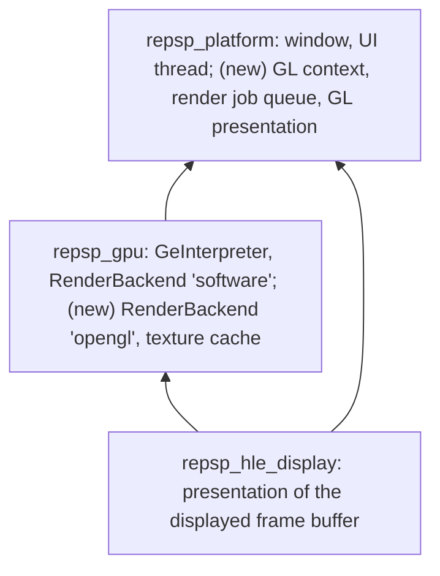

# 설계: OpenGL 렌더 백엔드 (issue #24)

## 1. 요구사항

* GE primitive를 OpenGL로 그리는 두 번째 `RenderBackend`를 더한다. 목적은 화면 확대(내부 해상도 배율)와 성능이다.
* 소프트웨어 래스터라이저는 그대로 두고 기본값과 기준(reference)으로 삼는다. headless 실행, CI, probe는 소프트웨어 백엔드를 쓴다.
* 같은 GE 리스트에 대해 OpenGL 백엔드의 결과가 소프트웨어 백엔드와 (1배율에서) 허용 오차 안에서 같아야 한다.
* 타이틀에 묶인 코드는 넣지 않는다. 첫 소비자는 [reDMP1 issue #24](https://github.com/reexec/reDMP1/issues/24)다.

## 2. 레이어와 스레드

* **GL 문맥은 UI 스레드가 가진다**(SDL을 한 스레드에 가둔 기존 규칙). GE 리스트는 게스트 스레드에서 동기적으로 실행되므로, OpenGL 백엔드는 GL을 직접 부르지 않는다. 그릴 내용을 **명령 버퍼**에 기록하고, 리스트 끝(`finish`)과 표시(`present`) 시점에 버퍼를 UI 스레드로 넘긴다. UI 스레드는 받은 순서대로 실행한다.
* **platform 계약의 추가**: (1) GL 3.3 core 문맥을 가진 창 모드, (2) UI 스레드에서 실행할 작업을 순서대로 넘기는 큐(`SubmitRenderJob`)와 "여기까지 끝날 때까지 기다림"(`WaitRenderIdle`), (3) GL 함수 주소를 얻는 함수. `repsp_gpu`는 SDL을 모른다. platform이 주는 함수 주소 얻기로 필요한 GL 함수 표를 채운다. 새 외부 의존(로더 라이브러리, submodule)은 더하지 않는다.
* 창이 없는 구성(headless dummy)에서는 OpenGL 백엔드를 고를 수 없다. 고르면 분명한 오류를 내고 소프트웨어로 남는다. 덤프 비교를 위해 "숨긴 창 + GL 문맥" 모드를 둔다.
* 게스트 스레드는 명령을 넘긴 뒤 기다리지 않는다. 기다리는 곳은 (a) 표시 시점의 흐름 제어(밀린 프레임이 한 장을 넘으면 기다림), (b) 프레임 덤프와 probe의 읽어 오기, (c) 종료뿐이다.

## 3. 렌더 대상과 표시

* 게스트의 프레임버퍼 주소(`set_target`의 addr)마다 호스트 렌더 대상(FBO: 색 RGBA8 + 깊이/스텐실)을 하나 둔다. 크기는 480×272의 내부 배율(1~8) 배다.
* **표시**: `hle_display`가 보여 줄 프레임버퍼 주소를 정하는 것은 그대로다. 그 주소에 GL 렌더 대상이 있고 마지막으로 GE가 그린 것이면 그 대상을 창에 그린다. 없거나 CPU가 직접 쓴 프레임버퍼(동영상 프레임 등)면 지금처럼 게스트 메모리를 변환해 텍스처로 올려 그린다. 이 판정을 위해 display가 platform에 넘기는 표시 계약에 "GL 대상 표시"를 더한다.
* **CPU가 쓴 것과 GE가 그린 것의 구분**: 렌더 대상마다 "GE가 마지막으로 그린 시점"을 가진다. 게스트 CPU가 GE 대상인 VRAM 영역에 직접 쓰는 경우와, 게스트가 GE로 그린 프레임버퍼를 CPU로 읽는 경우는 이번 범위에서 지원하지 않는다. 대신 조용히 틀리지 않도록, 표시 직전에 해당 영역의 게스트 메모리가 바뀌었는지를 (진단 옵션이 켜졌을 때) 검사해 통계에 센다.
* **프레임버퍼를 텍스처로 쓰는 경우**(render-to-texture): 텍스처 주소가 렌더 대상의 영역과 겹치면 그 대상의 색 텍스처를 쓴다.
* 프레임버퍼의 알파는 PSP에서 스텐실 역할을 한다. 색 버퍼의 알파에 유지하고, 표시할 때는 무시한다.
* **프레임 덤프**: `REPSP_FRAME_DUMP`는 OpenGL 백엔드에서도 동작한다(표시한 대상을 1배율로 읽어 와 같은 형식으로 저장).

## 4. 그리기

* 인터프리터가 이미 정점을 화면 좌표로 바꿔 준다(`Vertex`: x, y, z, 색, 텍셀 단위 u·v). OpenGL 백엔드는 이것을 정점 버퍼로 올려 그린다. sprite는 사각형(삼각형 둘)으로 편다.
* **래스터화 규칙**: 소프트웨어 백엔드와 같은 규칙(픽셀 중심 표본화, top-left 채움, sprite의 끝 좌표 처리)이 되도록 좌표를 맞춘다. 내부 배율이 1일 때 같은 픽셀이 채워져야 한다.
* **fragment 처리**는 셰이더에서 소프트웨어 백엔드와 같은 순서로 한다: 텍스처 표본화(nearest/linear, wrap/clamp) → 텍스처 함수(modulate, decal, blend, replace, add; 알파 사용 여부, 색 2배) → 색 테스트 → 알파 테스트 → (깊이 테스트) → 블렌드. 시저는 GL 시저로, 깊이는 GL 깊이 테스트로 한다.
* **블렌드**: GL의 블렌드 식으로 표현되는 조합은 그대로 쓴다(고정 색은 blend color). 표현되지 않는 조합(예: 2배 계수)은 종류별로 통계에 세고 한 번만 경고를 찍는다. 근사한 경우 그 사실을 KB에 적는다.
* **clear 모드**: 색·알파·깊이의 선택적 쓰기를 color mask와 depth mask로 한다.
* **텍스처**: 게스트 메모리의 텍스처(직접 색 형식, 인덱스 형식 + CLUT, swizzle, DXT)를 호출 스레드에서 RGBA8로 풀어 텍스처 캐시에 둔다. 푸는 코드는 소프트웨어 백엔드와 공유한다(한 곳에만 둔다). 캐시 키는 주소, 크기, 형식, CLUT의 내용 해시와 텍스처 바이트의 해시다. 해시 비용이 문제가 되면 프레임마다 다시 확인하는 방식으로 줄이되, 내용이 바뀐 텍스처를 놓치지 않는 것이 먼저다.
* 상태가 같은 연속 primitive는 한 번의 그리기로 묶는다.
* 지원하지 않는 것(형식, 블렌드 식, primitive)은 조용히 넘어가지 않고 통계와 한 번의 경고로 드러낸다.

## 5. 소비자 계약

* `gpu::SelectRenderBackend("opengl")`와 내부 배율 설정(`gpu::SetInternalScale(n)`). 실패하면 이유를 돌려주고 소프트웨어가 유지된다.
* display 설정에 창 크기 배율과 수직 동기 여부.
* 통계: 백엔드 이름, 그리기 호출 수, 묶인 primitive 수, 텍스처 캐시 적중·실패·올리기 바이트, 근사·미지원 횟수, (진단 시) CPU 쓰기 감지 횟수.

## 6. 이번 task의 검증

1. `gl_probe`: GL 문맥을 만들 수 없으면 건너뜀으로 끝난다(CTest의 skip 반환 코드). 만들 수 있으면 `ge_probe`와 같은 합성 리스트들을 두 백엔드로 그리고 1배율 결과를 픽셀 단위로 비교한다(허용 오차: 채널당 ±1, 가장자리 픽셀 불일치 0). 채움 규칙, 색 테스트, 알파 테스트, 블렌드, 시저, CLUT 텍스처, clear 모드, 깊이를 포함한다.
2. 기존 probe 전체가 소프트웨어 백엔드로 그대로 통과한다. 텍스처 풀기 코드를 공유하도록 옮긴 뒤에도 `ge_probe`의 결과가 같다.
3. Win64 Debug/Release와 Linux x64 Debug/Release 빌드·CTest. CI에서 `gl_probe`는 문맥이 없으면 건너뛴다.
4. 소비자에서 두 백엔드의 프레임 덤프를 비교한다(소비자 쪽 설계).

---

# Design: OpenGL render backend (issue #24)

## 1. Requirements

Add a second `RenderBackend` that draws GE primitives with OpenGL; the aims are a larger picture (an internal resolution scale) and performance. The software rasterizer stays as it is, as the default and the reference; headless runs, CI and probes use it. For the same GE lists the OpenGL backend's result must equal the software backend's, at scale 1, within a tolerance. No title-specific code; the first consumer is [reDMP1 issue #24](https://github.com/reexec/reDMP1/issues/24).

## 2. Layers and threads

**The UI thread owns the GL context** (the existing rule that confines SDL to one thread). GE lists run synchronously on guest threads, so the OpenGL backend never calls GL directly: it records what to draw into a **command buffer** and hands the buffer to the UI thread at the end of a list (`finish`) and at presentation (`present`); the UI thread executes buffers in order. **Additions to the platform contract**: (1) a window mode with a GL 3.3 core context, (2) a queue that passes jobs to the UI thread in order (`SubmitRenderJob`) with a "wait until everything so far is done" call (`WaitRenderIdle`), (3) a function that returns GL function addresses. `repsp_gpu` knows nothing of SDL; it fills a table of the GL functions it needs through that function. No new external dependency (loader library or submodule). In a configuration without a window (the headless dummy) the OpenGL backend cannot be selected: selecting it is a clear error and software stays; a "hidden window with a GL context" mode exists for dump comparisons. Guest threads do not wait after handing over commands, except for (a) flow control at presentation (waiting when more than one frame is pending), (b) read-back for frame dumps and probes, and (c) shutdown.

## 3. Render targets and presentation

Each guest frame buffer address (the addr of `set_target`) gets one host render target (an FBO: RGBA8 colour plus depth/stencil), sized 480×272 times the internal scale (1 to 8). **Presentation**: `hle_display` still decides which frame buffer address is shown. If a GL render target exists for that address and the GE drew it last, that target is drawn to the window; otherwise (no target, or a frame buffer written directly by the CPU, such as movie frames) guest memory is converted and uploaded as a texture, as now. The presentation contract between display and platform gains "present a GL target" for this. **CPU-written versus GE-drawn**: each render target records when the GE last drew to it. Guest CPU writes into a VRAM area that is a GE target, and guest CPU reads of a frame buffer drawn by the GE, are not supported in this task; so that this is not silently wrong, a diagnostic option checks before presentation whether guest memory in that area changed and counts it in the statistics. **A frame buffer used as a texture** (render-to-texture): when a texture address overlaps a render target's area, that target's colour texture is used. Frame buffer alpha acts as stencil on the PSP; it is kept in the colour buffer's alpha and ignored at presentation. **Frame dumps**: `REPSP_FRAME_DUMP` works with the OpenGL backend too (the presented target is read back at scale 1 and saved in the same format).

## 4. Drawing

The interpreter already delivers vertices in screen space (`Vertex`: x, y, z, colour, u and v in texels); the OpenGL backend uploads them as vertex buffers. Sprites are expanded to quads (two triangles). **Rasterization rules** match the software backend (sampling at pixel centres, the top-left fill rule, the handling of a sprite's end coordinate) by adjusting coordinates; at scale 1 the same pixels must be filled. **Fragment processing** follows the software backend's order in the shader: texture sampling (nearest/linear, wrap/clamp), the texture function (modulate, decal, blend, replace, add; whether texture alpha is used; colour doubling), the colour test, the alpha test, (the depth test,) and blending; scissor uses GL scissor and depth uses GL depth testing. **Blending**: combinations expressible by GL blend equations are used as they are (fixed colours through the blend colour); those that are not (doubled factors, for example) are counted per kind in the statistics with a warning printed once, and any approximation is recorded in the knowledge base. **Clear mode**: selective writes of colour, alpha and depth use the colour and depth masks. **Textures**: textures in guest memory (direct colour formats, indexed formats with a CLUT, swizzling, DXT) are decoded to RGBA8 on the calling thread into a texture cache; the decoding code is shared with the software backend (kept in one place). The cache key is the address, size, format, a hash of the CLUT contents and a hash of the texture bytes; if hashing proves costly it may be reduced to re-checking once per frame, but never at the price of missing a texture whose contents changed. Consecutive primitives with the same state are batched into one draw. Anything unsupported (a format, a blend equation, a primitive) shows in the statistics and a one-time warning rather than passing silently.

## 5. Consumer contract

`gpu::SelectRenderBackend("opengl")` and an internal scale setting (`gpu::SetInternalScale(n)`); on failure the reason is returned and software stays. The display configuration gains a window size scale and vertical sync. Statistics: the backend name, draw calls, batched primitives, texture cache hits, misses and uploaded bytes, counts of approximated and unsupported cases, and (with diagnostics) detected CPU writes.

## 6. Verification for this task

1. `gl_probe`: if no GL context can be created it ends as skipped (CTest's skip return code). Otherwise it draws the same kind of synthetic lists as `ge_probe` with both backends and compares the scale-1 results pixel by pixel (tolerance ±1 per channel, no mismatch in edge pixels), covering the fill rule, colour test, alpha test, blending, scissor, CLUT textures, clear mode and depth.
2. All existing probes pass unchanged on the software backend, and `ge_probe` gives the same results after the texture decoding code is moved to be shared.
3. Win64 Debug/Release and Linux x64 Debug/Release builds and CTest; in CI `gl_probe` is skipped when there is no context.
4. The consumer compares frame dumps of the two backends (the consumer's design).
