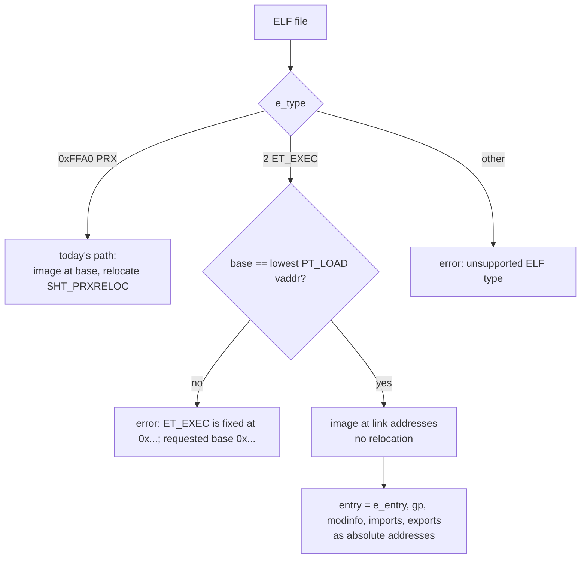

# 설계: 고정 주소 `ET_EXEC` 실행 파일 로드 (issue #65)

소비자 요구: [reexec/reDMP2#1](https://github.com/reexec/reDMP2/issues/1). 그 타이틀의 평문 실행 파일은 재배치 가능한 PRX가 아니라 사용자 메모리 시작 주소에 링크된 `ET_EXEC`이고, 지금의 로더는 이것을 거부한다(`Unsupported ELF type (expected PRX e_type 0xFFA0)`).

## 1. 배경

* PSP 실행 파일에는 두 종류가 있다. **PRX**(`e_type 0xFFA0`)는 주소 0에 링크되고 `SHT_PRXRELOC`(`0x700000A0`)으로 원하는 base에 재배치된다. **`ET_EXEC`**(`e_type 2`)는 고정 주소(보통 사용자 메모리 시작 `0x08804000`)에 링크되어 재배치 없이 그 주소에 놓인다. 초기 펌웨어용 게임 다수가 `ET_EXEC`다(**추정**, 소비자 바이너리에서 한 건 **확인됨**).
* 지금의 `ProcessPrx`(`src/module/prx.cpp`)는 버퍼를 "base로부터의 오프셋"으로 만들고, 세그먼트 `vaddr`를 그 오프셋으로, `e_entry`를 세그먼트 0 기준 상대값으로, 모듈 정보 위치를 `sh_addr` 또는 첫 프로그램 헤더의 `p_paddr`로 본다. 이것은 PRX의 규약이다.
* `ParsePrx`의 import/export 해석은 이미 "값이 base 이상이면 base를 뺀 오프셋"으로 다루므로 절대 주소를 담은 `ET_EXEC`의 표도 그대로 읽힌다(**추정**, probe로 확인).

## 2. 동작

* **image 기준**: `ET_EXEC`의 image 기준 주소는 가장 낮은 PT_LOAD `vaddr`다. 호출자가 넘긴 `base`가 그것과 다르면 이유(두 주소)를 담은 오류로 실패한다. 조용히 다른 주소에 놓지 않는다. 내부에서는 세그먼트 `vaddr`를 `vaddr - image_base`로 바꿔 지금의 버퍼 코드를 재사용한다. `LoadedPrx::segments`에는 링크 시점 값(절대 `vaddr`)을 그대로 둔다(필드 주석이 "Link-time values"다).
* **재배치**: 적용하지 않는다. `SHT_PRXRELOC` 섹션이 있으면 형식 위반이므로 오류로 실패한다(비어 있는 `.rel.*` 섹션은 일반 `SHT_REL`이고 크기 0이면 무시).
* **entry**: `e_entry`가 절대 주소다. 가장 낮은 세그먼트 범위 안이어야 한다.
* **모듈 정보**: `.rodata.sceModuleInfo`의 `sh_addr`(절대)에서 `image_base`를 뺀 오프셋으로 찾는다. 섹션 헤더가 없으면 첫 PT_LOAD의 `p_paddr`를 **파일 오프셋**으로 보고 `p_vaddr + (p_paddr - p_offset)`로 바꾼다(소비자 바이너리에서 섹션 주소와 일치함 **확인됨**). PRX에서 `p_paddr`는 세그먼트 안 오프셋이라 규약이 다르다.
* **gp, import, export**: 모듈 정보의 값을 절대 주소로 쓴다(`ParsePrx`의 지금 처리).
* **PRX 경로는 바뀌지 않는다.** 기존 probe가 그것을 확인한다.
* 공개 API(`ParsePrx`, `RelocateToBuffer`, `runtime::LoadPrx`)의 시그니처는 그대로 둔다. 이름에 "Prx"가 남지만 이름을 바꾸는 것은 소비자 전체를 건드리므로 이번 범위가 아니다. 헤더 주석에 `ET_EXEC`도 받는다고 적는다.
* 게스트 메모리: `LoadPrx`는 지금처럼 `[base, image_end)`가 유효한지 확인하고 쓴다. sysmem 할당기가 그 범위를 예약하는 방식은 PRX와 같다(같은 주소).

## 3. 검증

1. 합성 `ET_EXEC` probe(손으로 만든 바이트, 게임 데이터 없음): PT_LOAD 하나 + BSS, `.rodata.sceModuleInfo`, `.lib.stub`의 import 하나와 `.lib.ent`의 export 하나. `ParsePrx`의 base·entry·gp·image_end·모듈 이름·import(라이브러리, NID, stub 주소)·export, `RelocateToBuffer`의 바이트, `LoadPrx` 뒤 게스트 메모리 내용을 확인한다.
2. 거부: base 불일치, `SHT_PRXRELOC`이 있는 `ET_EXEC`, entry가 범위 밖, 섹션 헤더 없는 경우의 `p_paddr` 경로.
3. 기존 PRX probe 전부 통과(동작 불변).
4. Win64 Debug/Release 경고 0, Linux는 CI. 소비자(reDMP2)에서 로컬로 실제 실행 파일이 로드되는지 확인하고 그 결과는 소비자 작업 로그에 남긴다.

---

# Design: loading fixed-address `ET_EXEC` executables (issue #65)

Consumer need: [reexec/reDMP2#1](https://github.com/reexec/reDMP2/issues/1). That title's plain executable is not a relocatable PRX but an `ET_EXEC` linked at the start of user memory, and today's loader rejects it (`Unsupported ELF type (expected PRX e_type 0xFFA0)`).

## 1. Background

* PSP executables come in two kinds. A **PRX** (`e_type 0xFFA0`) links at address 0 and is relocated to a chosen base through `SHT_PRXRELOC` (`0x700000A0`). An **`ET_EXEC`** (`e_type 2`) links at a fixed address (usually the start of user memory, `0x08804000`) and is placed there without relocation. Many games for early firmware are `ET_EXEC` (**inferred**; one is **confirmed** in a consumer's binary).
* Today's `ProcessPrx` (`src/module/prx.cpp`) builds the buffer as offsets from base, treats segment `vaddr` as such an offset, `e_entry` as relative to segment 0, and finds the module info through `sh_addr` or the first program header's `p_paddr`. These are PRX conventions.
* `ParsePrx` already reads import/export values as "subtract base if at or above it", so an `ET_EXEC`'s tables of absolute addresses should read as they are (**inferred**, checked by the probe).

## 2. Behaviour

See the diagram above.

* **Image base**: the image base of an `ET_EXEC` is its lowest PT_LOAD `vaddr`. If the caller's `base` differs, loading fails with an error naming both addresses; it is never silently placed elsewhere. Internally segment `vaddr`s become `vaddr - image_base` so today's buffer code is reused; `LoadedPrx::segments` keeps the link-time (absolute) `vaddr`s, as its field comment says.
* **Relocation**: none. An `SHT_PRXRELOC` section in an `ET_EXEC` is malformed and fails; empty `.rel.*` sections are ordinary `SHT_REL` and are ignored when their size is 0.
* **Entry**: `e_entry` is absolute and must fall inside the loaded segments.
* **Module info**: found at `.rodata.sceModuleInfo`'s `sh_addr` (absolute) minus `image_base`. Without section headers, the first PT_LOAD's `p_paddr` is a **file offset**, mapped as `p_vaddr + (p_paddr - p_offset)` (matching the section address in a consumer's binary, **confirmed**). In a PRX `p_paddr` is an offset into the segment, a different convention.
* **gp, imports, exports**: the module info's values, as absolute addresses (today's `ParsePrx` handling).
* **The PRX path does not change**; the existing probes confirm it.
* The public API (`ParsePrx`, `RelocateToBuffer`, `runtime::LoadPrx`) keeps its signatures. "Prx" stays in the names; renaming would touch every consumer and is out of scope. The header comments say `ET_EXEC` is accepted too.
* Guest memory: `LoadPrx` checks and writes `[base, image_end)` as today; the sysmem allocator reserves that range the same way as for a PRX (same addresses).

## 3. Verification

1. A synthetic `ET_EXEC` probe (hand-made bytes, no game data): one PT_LOAD plus BSS, `.rodata.sceModuleInfo`, one import in `.lib.stub` and one export in `.lib.ent`. Check `ParsePrx`'s base, entry, gp, image_end, module name, import (library, NID, stub address) and export, `RelocateToBuffer`'s bytes, and guest memory after `LoadPrx`.
2. Rejections: base mismatch, an `ET_EXEC` with `SHT_PRXRELOC`, entry out of range; and the `p_paddr` path without section headers.
3. All existing PRX probes pass (behaviour unchanged).
4. Win64 Debug/Release with zero warnings, Linux in CI. In the consumer (reDMP2), check locally that the real executable loads; that result goes into the consumer's work log.
