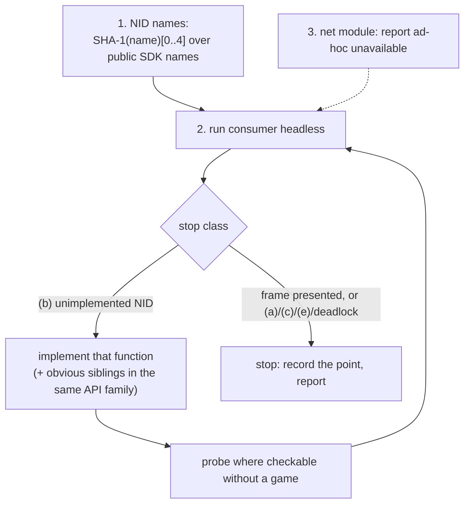

# 설계: 두 번째 타이틀의 부팅 경로 HLE와 "사용 불가" 애드혹 네트워크 (issue #67)

소비자 요구: [reexec/reDMP2#3](https://github.com/reexec/reDMP2/issues/3). `ET_EXEC` 로드(#65) 뒤 그 타이틀은 게스트 실행에 들어가 첫 import 호출 `SysMemUserForUser` `0x7591C7DB`에서 (b) 미구현 NID로 멈춘다. 소비자의 정적 대조(import 표 vs repsp 등록)로는 229개 중 88개가 미등록이고 많은 수가 `nid_names.cpp`에 이름이 없다.

## 1. 방침

* **측정이 이끈다.** 88개를 한꺼번에 추측으로 채우지 않는다. 소비자를 실행해 멈춘 함수를 구현하고 다시 실행하기를 반복한다. 원본 게임 로직이 실제로 부르는 함수가 우선이다(AGENTS.md 개발 철학: "실행해서 측정한다").
* **멈춤 기준(완료 조건)**: 첫 프레임이 표시되거나(`Present` > 0), 미구현 NID가 아닌 이유(접근 위반, 디스패치 미스, 교착, GE/오디오 오류 등)로 멈추면 이 issue를 끝내고 그 지점을 보고한다. 그 다음은 별도 issue다.
* **동작 출처**: uOFW(MIT), PSPSDK 헤더와 문서(BSD), psprecomp `src/hle`(MIT)의 공개 정의를 참고한다(**추정**으로 적고 probe·실행으로 확인). PPSSPP(GPL) 코드는 보지 않는다(i005와 같음). 확인되지 않은 반환값·오류 코드를 지어내지 않는다. 출처가 없으면 그 사실을 작업 로그에 적는다.
* **타이틀 중립**: 함수의 의미는 펌웨어 API로 정한다. 타이틀 이름·주소, 타이틀별 분기는 넣지 않는다.

## 2. 단계

1. **이름 확인**: 미등록 NID의 이름을 공개 SDK 함수 이름 후보의 SHA-1 앞 4바이트(리틀 엔디언 워드)로 확인해 `src/runtime/nid_names.cpp`에 더한다. 확인된 것만 넣는다. 확인 못 한 NID는 목록으로 작업 로그에 남긴다. 확인 방법을 스크립트로 재현할 수 있게 한다(예: `tools/nid_hash.py`, 표준 라이브러리만).
2. **부팅 경로 반복**: §1의 기준까지. 같은 API 묶음에서 의미가 분명한 이웃 함수(예: `sceIoDopen`을 구현하면 `sceIoDread`/`sceIoDclose`)는 같이 구현해도 된다. 의미가 불분명한 함수는 호출될 때까지 미루고, 호출되면 그때 근거를 찾는다.
3. **네트워크 모듈** (`repsp_hle_net`, 새 HLE 모듈, 런타임만 링크): `sceNet`, `sceNetAdhoc`, `sceNetAdhocctl`, `sceNetAdhocMatching`. 원칙은 "애드혹 네트워크가 없다"를 정직하게 보고하는 것이다. 초기화·종료는 성공, 연결·스캔·매칭 시작은 실패나 "상대 없음"을 돌려준다. 가짜 상대를 만들지 않는다. 정확한 반환값은 그 함수가 실제로 불릴 때 출처와 함께 정한다(**미확정**). 등록은 소비자가 고르게 `repsp::hle::net::Register()`로 둔다.
4. **작은 함수**: `sceHprm`(리모컨 없음), `sceImpose`(배터리·볼륨 표시 상태), `sceRtcGetCurrentClockLocalTime`, `sceKernelPowerLock`/`Unlock`, `sceUtilityGetSystemParamInt`는 문서로 의미가 분명하므로 2단계에서 불리면 구현한다.
* `sceUtility`의 모듈 로드 함수(`sceUtilityLoadModule`/`LoadAvModule`/`LoadNetModule` 계열, 이름 확인 뒤)는 "모듈이 이미 상주한다"로 성공을 돌려준다. repsp는 해당 펌웨어 라이브러리를 이미 HLE로 갖고 있다. 이 판단이 맞는지는 실행에서 확인한다(**추정**).

## 3. 검증

1. 각 구현에 대해 게임 없이 검사할 수 있는 것은 probe(CTest, `TIMEOUT`)로. 기존 probe 전부 통과.
2. Win64 Debug/Release 경고 0, Linux는 CI(GCC `-Wall -Wextra -Wpedantic -Werror`).
3. 소비자에서 반복 측정의 각 단계(멈춘 NID, 구현한 것)를 작업 로그에 시간순으로 적고, 마지막 정지 지점과 정지 보고 요약을 남긴다.
4. 소비자 쪽 정적 대조 수치(구현/미구현)의 변화를 적는다.

---

# Design: boot-path HLE for a second title and an "unavailable" ad-hoc network (issue #67)

Consumer need: [reexec/reDMP2#3](https://github.com/reexec/reDMP2/issues/3). After `ET_EXEC` loading (#65) that title enters guest execution and stops with class (b), unimplemented NID, at its first import call `SysMemUserForUser` `0x7591C7DB`. The consumer's static match (import table vs repsp registrations) finds 88 of 229 NIDs unregistered, many without a name in `nid_names.cpp`.

## 1. Approach

* **Measurement leads.** The 88 are not filled in by guesswork at once. Run the consumer, implement the function it stops on, run again. What the original game logic actually calls comes first (AGENTS.md: measure by running).
* **Stopping rule (done criterion)**: when a first frame is presented (`Present` > 0), or the run stops for a reason other than an unimplemented NID (access violation, dispatch miss, deadlock, a GE or audio error, ...), this issue ends and reports that point. What follows is another issue.
* **Sources of behaviour**: public definitions from uOFW (MIT), the PSPSDK headers and documents (BSD) and psprecomp `src/hle` (MIT), recorded as **inferred** and confirmed by probes and runs. PPSSPP (GPL) code is not read (as in i005). Unconfirmed return values and error codes are not invented; when there is no source, the work log says so.
* **Title-neutral**: a function's meaning comes from the firmware API. No title names, addresses or per-title branches.

## 2. Steps

See the diagram above.

1. **Names**: identify unregistered NIDs' names as the first 4 bytes (little-endian word) of SHA-1 over candidate public SDK function names, and add them to `src/runtime/nid_names.cpp`. Only confirmed ones go in; unconfirmed NIDs are listed in the work log. The check is reproducible by a script (for example `tools/nid_hash.py`, standard library only).
2. **Boot-path loop** up to the §1 rule. Neighbours in the same API family whose meaning is clear (for example `sceIoDread`/`sceIoDclose` with `sceIoDopen`) may be implemented together. Functions whose meaning is unclear wait until they are called, and their source is found then.
3. **Network module** (`repsp_hle_net`, a new HLE module linking only the runtime): `sceNet`, `sceNetAdhoc`, `sceNetAdhocctl`, `sceNetAdhocMatching`. The principle is to report honestly that there is no ad-hoc network: init and term succeed; connect, scan and matching start fail or report no peers. No fake peers. Exact return values are settled, with sources, when a function is actually called (**unresolved**). Registration is `repsp::hle::net::Register()`, chosen by the consumer.
4. **Small functions**: `sceHprm` (no remote), `sceImpose` (battery and volume indicator state), `sceRtcGetCurrentClockLocalTime`, `sceKernelPowerLock`/`Unlock` and `sceUtilityGetSystemParamInt` have documented meanings and are implemented when step 2 reaches them.
* `sceUtility`'s module-load functions (`sceUtilityLoadModule`/`LoadAvModule`/`LoadNetModule` family, once named) succeed as "the module is already resident": repsp already HLEs those firmware libraries. Whether that is right is checked by running (**inferred**).

## 3. Verification

1. Whatever can be checked without a game gets a probe (CTest, `TIMEOUT`); all existing probes pass.
2. Win64 Debug/Release with zero warnings; Linux in CI (GCC `-Wall -Wextra -Wpedantic -Werror`).
3. The consumer-side loop is recorded step by step in the work log (the NID it stopped on, what was implemented), with the final stopping point and a stop report summary.
4. The change in the consumer's static coverage numbers (implemented/missing) is recorded.
