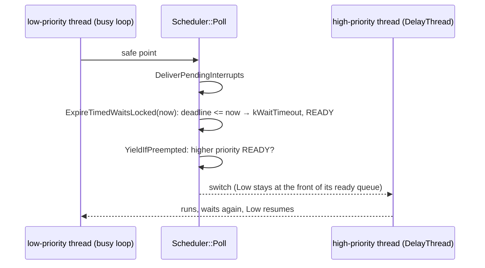

# 설계: 안전점에서 시간이 지난 대기를 깨우기 (issue #69)

소비자 요구: [reexec/reDMP2#6](https://github.com/reexec/reDMP2/issues/6).

## 1. 문제 (확인됨)

* 소비자 실행에서 우선순위 32 스레드가 반복문 안에서 `sceKernelSetEventFlag`를 7,500만 번 부르는 동안, 우선순위 18 스레드는 첫 `sceKernelDelayThread` 뒤로 다시 실행되지 않았다. 표시는 첫 프레임 뒤 멈췄다.
* 시간 제한이 있는 대기(`DelayThread`와 timeout을 받는 모든 대기)는 `Scheduler::Run`이 준비된 스레드가 없을 때(유휴)만 만료시킨다(`src/runtime/scheduler.cpp`의 유휴 경로: `now >= deadline`이면 `kWaitTimeout`으로 `MakeReadyLocked`).
* 재컴파일 코드의 안전점 `Scheduler::Poll()`(`repsp_recomp_poll`, 소비자 loop hook이 반복 1024번마다 부름)은 대기 중인 인터럽트를 전달하고 `YieldIfPreempted()`를 부른다. `YieldIfPreempted()`는 이미 READY인 스레드만 본다. 그래서 deadline이 지난 대기 스레드는 낮은 우선순위 스레드가 바쁜 반복을 도는 동안 WAITING에 남는다.
* PSP에서는 타이머 인터럽트가 그 스레드를 깨우고, 더 높은 우선순위가 즉시 선점한다(i005 설계 §3의 "고정 우선순위 선점형", **추정**, uOFW threadman).

## 2. 수정

* 유휴 경로의 만료 루프를 `ExpireTimedWaitsLocked(now)`로 빼고, 유휴 경로와 `Poll()`이 같이 쓴다. 결과(`kWaitTimeout`, 대기 종류별 후처리)는 유휴 경로와 완전히 같다.
* `Poll()` 순서: 인터럽트 전달 → 만료 → `YieldIfPreempted()`. 인터럽트가 꺼져 있으면(`CpuSuspendIntr`) 지금처럼 선점하지 않는다. 만료는 인터럽트 상태와 관계없이 한다(스레드는 READY가 될 뿐, 전환은 인터럽트가 켜진 뒤의 안전점에서).
* 비용: 시간 제한이 있는 대기 스레드 수를 세어 두고, 0이면 시계를 읽지 않는다. 있으면 `Poll()`마다 `steady_clock::now()` 한 번.
* 우선순위, 같은 우선순위의 FIFO, 선점된 스레드가 자기 큐의 앞에 남는 규칙(uITRON 4.0)은 바꾸지 않는다.
* HLE 호출 경계마다 만료를 검사하는 것은 이번에 하지 않는다. 바쁜 반복은 loop hook의 안전점을 지나므로 `Poll()`로 충분할 것으로 본다(**추정**, 소비자 측정으로 확인). 부족하면 측정을 근거로 다음 단계에서 정한다.

## 3. 검증

1. probe: 우선순위가 낮은 스레드가 안전점(`Poll()`)만 부르며 바쁘게 돌고, 높은 스레드가 짧은 `DelayThread`로 대기한다. deadline 뒤 첫 `Poll()`에서 높은 스레드가 실행되어야 한다. 인터럽트를 끈 동안에는 선점되지 않고, 켠 뒤 첫 안전점에서 선점되는 것도 확인한다. timeout이 있는 다른 대기(예: `WaitSema` timeout) 한 가지도 같은 경로로 확인한다.
2. 기존 probe 전부 통과(스케줄러 의미 불변).
3. Win64 Debug/Release 경고 0, Linux는 CI.
4. 소비자(reDMP2)에서 표시 프레임 수, `sceKernelSetEventFlag` 호출 수, 스레드 상태가 어떻게 바뀌는지 측정해 보고한다.
5. 다른 소비자(reDMP1)에 영향이 있을 수 있다(스케줄링이 PSP에 더 가까워짐). 릴리스 노트에 적는다.

---

# Design: waking expired timed waits at safe points (issue #69)

Consumer need: [reexec/reDMP2#6](https://github.com/reexec/reDMP2/issues/6).

## 1. Problem (confirmed)

* In the consumer's run, while a priority-32 thread called `sceKernelSetEventFlag` 75 million times in a loop, a priority-18 thread never ran again after its first `sceKernelDelayThread`, and the display stopped after the first frame.
* Timed waits (`DelayThread` and every wait taking a timeout) are expired by `Scheduler::Run` only when no thread is ready (the idle path in `src/runtime/scheduler.cpp`: `now >= deadline` → `MakeReadyLocked` with `kWaitTimeout`).
* The recompiled code's safe point `Scheduler::Poll()` (`repsp_recomp_poll`, called by the consumer's loop hook every 1024 iterations) delivers pending interrupts and calls `YieldIfPreempted()`, which looks only at threads already READY. A waiter whose deadline has passed therefore stays WAITING while a lower-priority thread busy-loops.
* On a PSP the timer interrupt wakes that thread and the higher priority preempts at once (i005 design §3, "fixed-priority preemptive"; **inferred**, uOFW threadman).

## 2. Fix

See the sequence above.

* The idle path's expiry loop becomes `ExpireTimedWaitsLocked(now)`, shared by the idle path and `Poll()`; the result (`kWaitTimeout`, per-wait-type follow-up) is exactly the idle path's.
* `Poll()` order: deliver interrupts → expire → `YieldIfPreempted()`. With interrupts disabled (`CpuSuspendIntr`) there is no preemption, as today; expiry happens regardless (threads only become READY; the switch waits for a safe point with interrupts enabled).
* Cost: a count of timed waiters is kept; when it is 0 the clock is not read; otherwise one `steady_clock::now()` per `Poll()`.
* Priorities, FIFO within a priority, and the rule that a preempted thread stays at the front of its queue (uITRON 4.0) do not change.
* Checking expiry at every HLE call boundary is not done now: a busy loop passes the loop hook's safe point, so `Poll()` should be enough (**inferred**, confirmed by the consumer's measurement); if not, the next step is decided from that measurement.

## 3. Verification

1. Probe: a low-priority thread busy at safe points (`Poll()` only) and a high-priority thread in a short `DelayThread`; the high thread must run at the first `Poll()` after its deadline. While interrupts are disabled it is not preempted; at the first safe point after they are enabled it is. One other timed wait (for example `WaitSema` with a timeout) is checked through the same path.
2. All existing probes pass (scheduler semantics unchanged).
3. Win64 Debug/Release with zero warnings, Linux in CI.
4. In the consumer (reDMP2), measure and report how frames presented, the `sceKernelSetEventFlag` call count and the thread states change.
5. Other consumers (reDMP1) may be affected (scheduling gets closer to the PSP's); the release note says so.
