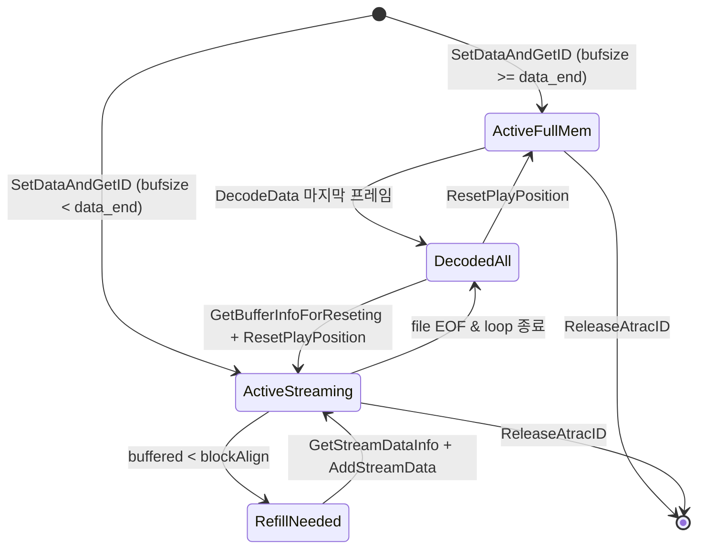

# ATRAC3 / ATRAC3plus 컨테이너와 `sceAtrac3plus` 상태 머신

이 문서는 PSP `sceAtrac3plus` 라이브러리가 다루는 RIFF/WAVE 컨테이너 형식, 스트리밍·메모리 상태 머신 및 `repsp_hle_atrac`의 교체 가능한 `AtracDecoder` 계약을 정리한다.

---

## 1. RIFF/WAVE 컨테이너 규격

PSP용 `.at3` 스트림은 Microsoft/Sony RIFF/WAVE 컨테이너를 사용한다(**추정** — 출처: Microsoft WAVEFORMATEXTENSIBLE 규격, PSPSDK `pspatrac3.h`, 공개 RIFF ATRAC 문서):

* **헤더**: `"RIFF"` + 크기 + `"WAVE"`.
* **`fmt ` 청크**:
  * **ATRAC3**: `wFormatTag = 0x0270`, 프레임당 샘플 수 **1024**.
  * **ATRAC3plus**: `wFormatTag = 0xFFFE` (`WAVE_FORMAT_EXTENSIBLE`, `cbSize >= 22`)이며 24바이트 위치 `SubFormat` GUID가 `{BFAA23E9-58CB-4144-A119-FFFA01E4CE62}` (LE 혼합 바이트 열: `E9 23 AA BF CB 58 44 41 A1 19 FF FA 01 E4 CE 62`)와 일치해야 한다. 프레임당 샘플 수 **2048**.
  * 알 수 없는 코덱 태그 또는 GUID는 `SCE_ATRAC_ERROR_UNKNOWN_FORMAT` (`0x80630006`)을 반환한다.
* **`fact` 청크**: 총 샘플 수(`end_sample`)와 선택적 인코더/디코더 지연 샘플 수를 담는다.
* **`smpl` 청크**: 선택적 샘플러 루프 목록(`cSampleLoops > 0`)에서 첫 루프의 시작(`dwStart`)과 끝(`dwEnd`) 샘플 위치를 읽는다. 없으면 `-1`을 반환한다.
* **`data` 청크**: 인코딩된 프레임 데이터 시작 오프셋(`data_offset`)과 전체 페이로드 바이트 길이(`data_size`).

---

## 2. 핸들 및 스트리밍 버퍼 상태 머신

* **동시 핸들 상한**: 최대 6개 ID (`0..5`, **추정** — 출처: 공개 PSP 문서). 소진 시 `SCE_ATRAC_ERROR_NO_ATRACID` (`0x80630003`) 반환.
* **`remainFrame` 특수값**(**추정** — 출처: PSPSDK `pspatrac3.h`):
  * `-1`: 전체 `data` 청크가 메모리에 적재된 상태(`all_in_memory`). 이 상태에서 `AddStreamData(>0)`는 `0x80630009`를 반환한다.
  * `>= 0`: 스트리밍 링 버퍼에 현재 남은 완전한 프레임 수(`buffered_bytes / block_align`).
* **리셋 2단계 계약**(**확인됨**, `PspBufferInfo` 32바이트 구조체):
  * `sceAtracGetBufferInfoForReseting(id, sample, &info)`는 `+4` 오프셋(`uiWritableByteFirstBuf`), `+12` 오프셋(`uiReadPositionFirstBuf`) 등을 채운다.
  * `sceAtracResetPlayPosition(id, sample, writeByteFirst, writeByteSecond)`는 재탐색된 샘플 위치와 초기 기록 바이트 수를 반영해 디코딩 위치를 되돌린다.

---

## 3. 교체 가능한 `AtracDecoder` 계약 및 무음 정책

* **사용자 결정(reDMP1 issue #11)**: 허용적 라이선스(MIT/BSD 등)의 ATRAC3/ATRAC3plus 디코더가 없으므로 기본 구현은 `SilentDecoder`를 사용한다.
* **동작**: 컨테이너 파싱, 스트림 버퍼 오프셋·잔여 프레임·루프·리셋 상태 머신은 모두 실제대로 갱신하고, `DecodeFrame()`만 PCM 출력 버퍼를 `0`으로 채운다.
* **교체 경로**: `repsp::hle::atrac::SetDecoder(AtracDecoder*)`를 통해 추후 허용적 라이선스의 실제 디코더(또는 테스트용 mock 디코더)로 HLE 상태 머신 수정 없이 교체할 수 있다.
* **보고**: `FormatStats()`는 항상 `"ATRAC decode: silent"`(또는 활성 디코더 이름)를 출력한다.

---

# ATRAC3 / ATRAC3plus Container and `sceAtrac3plus` State Machine

This document covers the RIFF/WAVE container format parsed by `sceAtrac3plus`, its full-memory/streaming buffer state machine, and the replaceable `AtracDecoder` interface.

## 1. RIFF/WAVE Container Layout

* Supported codecs (**Inferred** from Microsoft WAVEFORMATEXTENSIBLE & PSPSDK `pspatrac3.h`):
  * **ATRAC3** (`wFormatTag = 0x0270`): `1024` samples per frame.
  * **ATRAC3plus** (`wFormatTag = 0xFFFE`, GUID `{BFAA23E9-58CB-4144-A119-FFFA01E4CE62}`): `2048` samples per frame.
* **`fact`**, **`smpl`**, and **`data`** chunks supply end sample count, optional loop start/end samples (`-1` if absent), and encoded stream bounds.

## 2. Handles, Streaming Buffers, and Reset

* Up to 6 active handles (`0..5`, **Inferred**).
* Full-memory streams (`bufsize >= data_offset + data_size`) report `remainFrame = -1`; streaming ring buffers report available decoded frames and refill via `GetStreamDataInfo` + `AddStreamData`.
* `sceAtracGetBufferInfoForReseting` writes the 32-byte `PspBufferInfo` (`+0` first write ptr, `+4` writable bytes, `+12` file read offset) consumed by `sceAtracResetPlayPosition`.

## 3. Replaceable `AtracDecoder` and Silent Default

Because no permissively licensed ATRAC3/ATRAC3plus codec exists, `repsp::hle::atrac` defaults to `SilentDecoder` (zero-filled PCM while preserving exact frame, sample, loop, and buffer accounting). `SetDecoder(AtracDecoder*)` swaps decoders without modifying the HLE state machine, and `FormatStats()` explicitly prints `"ATRAC decode: silent"`.
