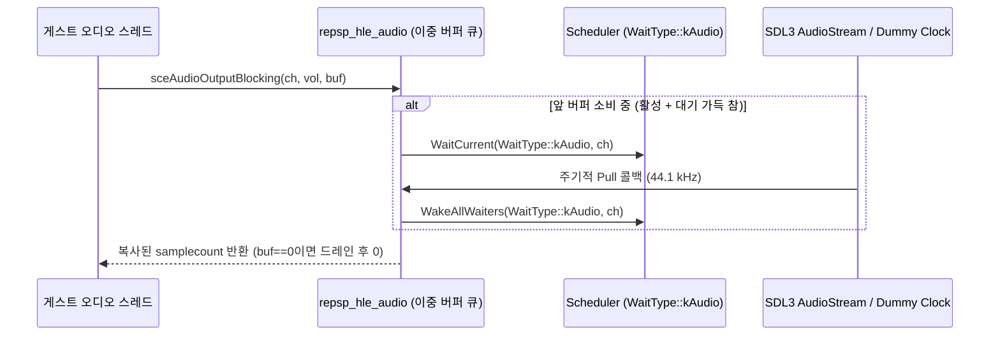

# PSP 오디오 출력과 믹싱 (`sceAudio`)

이 문서는 PSP의 하드웨어 오디오 출력 라이브러리 `sceAudio`의 채널 모델, 샘플 형식, 블로킹 대기 규약 및 끌어가기(pull) 기반 호스트 믹서 구조를 정리한다.

---

## 1. 채널 및 샘플 형식

* **출력 형식**: 44.1 kHz, 부호 있는 16비트 정수 PCM(`int16_t`, s16le).
  * Stereo (`PSP_AUDIO_FORMAT_STEREO = 0x00`, **추정** — 출처: PSPSDK `pspaudio.h`): 프레임당 2샘플(`L, R`).
  * Mono (`PSP_AUDIO_FORMAT_MONO = 0x10`, **추정** — 출처: PSPSDK `pspaudio.h`): 프레임당 1샘플. 믹싱 시 좌·우 패닝 볼륨(`left_vol`, `right_vol`)으로 스테레오 확장된다.
* **채널 수**: 최대 8개(`0..7`, **추정** — 출처: PSPSDK `pspaudio.h`). `sceAudioChReserve`에 `PSP_AUDIO_NEXT_CHANNEL (-1)`을 넘기면 빈 채널을 자동 할당한다.
* **샘플 개수 제약**: 프레임당 버퍼 길이 `samplecount`는 64의 배수이며 `64..65472` 범위여야 한다(**추정** — 출처: PSPSDK `pspaudio.h`).

---

## 2. 블로킹 출력과 오디오 시계

* **이중 버퍼 규약**(**추정**, 합성 `audio_probe` 검증): 각 채널은 재생 중인 앞 버퍼와 다음 대기 버퍼의 최대 2단 버퍼를 가진다. 큐가 비어 있으면 즉시 복사하고 복귀하며, 대기 슬롯이 이미 차 있으면 소비될 때까지 `WaitType::kAudio`로 대기한다.
* **`buf == 0` 드레인**(**추정**): `sceAudioOutputBlocking` / `sceAudioOutputPannedBlocking`에 널 버퍼 포인터(`0`)를 넘기면 새 샘플을 쓰지 않고 해당 채널의 남은 샘플이 모두 소비될 때까지 대기한 뒤 `0`을 반환한다.
* **호스트 오디오 시계**(**확인됨**, `platform_probe` 및 `audio_probe` 합성 검증):
  * 실제 장치가 열리면 `SDL_OpenAudioDeviceStream`의 pull 콜백이 오디오 장치 소비 속도에 맞춰 `MixPull()`을 호출한다.
  * 헤드리스(`dummy`) 장치에서는 별도 워커 스레드가 호스트 단조 시계(`std::chrono::steady_clock`)로 44.1 kHz에 맞춰 `MixPull()`을 호출해 게스트 오디오 스레드의 진행 속도를 유지한다.
  * 외부 스레드(오디오 콜백, VBlank 스레드)에서 `WakeAllWaiters`를 호출할 때는 TLS 기반 `t_current_thread_uid` 가드로 게스트 스레드가 아닌 호스트 스레드가 `YieldIfPreempted()`를 자기 자신에게 실행하지 않도록 보호한다.
* **포화 믹싱 및 Underrun**: 8개 채널 출력은 64비트 누적기에서 합산한 뒤 `[-32768, 32767]`로 포화(saturate)된다. 모든 채널이 비어 있을 때 pull이 발생하면 무음(0)을 출력하고 `underruns` 통계를 증가시킨다.

---

## 3. 확인 상태 요약

| 항목 | 상태 | 출처 및 비고 |
|---|---|---|
| 채널 8개, Stereo(`0x00`)/Mono(`0x10`), 볼륨 `0..0x8000`, `samplecount` 64의 배수(`64..65472`) | **추정** | PSPSDK `pspaudio.h` |
| `0x80260001..0x8026000B` 오류 코드 | **추정** | uOFW `audio` / `pspaudio.h` |
| `buf == 0` 드레인 대기 및 이중 버퍼 큐 깊이 | **추정** | 합성 `audio_probe` 검증 |
| Pull 콜백 · 헤드리스 단조 시계 페이싱 · 외부 스레드 선점 가드 | **확인됨** | `platform_probe`, `audio_probe` 검증 |

---

# PSP Audio Output and Mixing (`sceAudio`)

This document describes PSP's hardware audio output library (`sceAudio`), covering channel reservation, sample formats, blocking FIFO waits, and the pull-based host mixer.

## 1. Channels and Sample Formats

* **Output format**: 44.1 kHz, signed 16-bit PCM (`int16_t`, s16le).
  * Stereo (`PSP_AUDIO_FORMAT_STEREO = 0x00`, **Inferred** — source: PSPSDK `pspaudio.h`): 2 samples (`L, R`) per frame.
  * Mono (`PSP_AUDIO_FORMAT_MONO = 0x10`, **Inferred** — source: PSPSDK `pspaudio.h`): 1 sample per frame, expanded to stereo via per-channel left/right gain during mixing.
* **Channel count**: Up to 8 channels (`0..7`, **Inferred** — source: PSPSDK `pspaudio.h`). Passing `PSP_AUDIO_NEXT_CHANNEL (-1)` to `sceAudioChReserve` allocates the first free channel.
* **Sample count constraint**: `samplecount` must be a multiple of 64 within `64..65472` (**Inferred** — source: PSPSDK `pspaudio.h`).

## 2. Blocking Output and the Audio Clock

* **Double-buffered wait contract** (**Inferred**, tested by synthetic `audio_probe`): Each channel holds at most one active buffer and one queued buffer. If space is available, guest samples are copied immediately; otherwise the caller blocks on `WaitType::kAudio` until active samples drain.
* **Null buffer drain (`buf == 0`)** (**Inferred**): Calling `sceAudioOutput*Blocking` with guest pointer `0` blocks until all pending samples on the channel drain, then returns `0`.
* **Host pacing & preemption safety** (**Confirmed** via `platform_probe` and `audio_probe`): Real devices pace via SDL3's `SDL_OpenAudioDeviceStream` pull callback, while headless dummy mode paces on `std::chrono::steady_clock` at 44.1 kHz. `Wake*Wait*` checks thread-local guest UID (`t_current_thread_uid`) so external audio/VBlank host threads never call `YieldIfPreempted()` on themselves.
* **Saturation & underruns**: Active channels sum in 64-bit fixed point (`volume / 0x8000`) and clamp to `int16_t`. Pulling when no channel has buffered frames outputs zeros and increments `underruns`.
