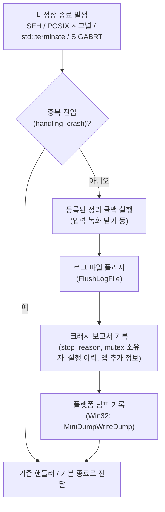

# 크래시 기록, 정지·풀기 규약 및 입력 녹화 형식

이 문서는 `repsp`가 비정상 종료를 기록하는 방식, `GuardedRun`/`RaiseStop`과 C++ 스택 풀기(unwinding)·뮤텍스 규약, 그리고 컨트롤러 입력 녹화 파일 형식을 정리한다.

---

## 1. 크래시 핸들러와 종료 경로 (**확인됨**)

`repsp::platform::InstallCrashHandler(const CrashConfig&)`는 프로세스 전역 비정상 종료 경로를 가로채 텍스트 보고서(`crash_report_*.txt`)와 플랫폼 덤프(Windows: `crash_dump_*.dmp` 미니덤프)를 기록한 뒤, 기존 종료 처리기로 제어를 넘긴다.

### 플랫폼별 포착 경로

* **Windows (`crash_handler_win32.cpp`)**:
  * `SetUnhandledExceptionFilter`: 처리되지 않은 Win32 SEH 예외(`0xC0000005` 접근 위반, `0xC00000FD` 스택 오버플로우, 미처리 MSVC C++ 예외 `0xE06D7363` 등)를 포착한다.
  * `std::set_terminate`: `noexcept` 경계 돌파, join되지 않은 `std::thread` 소멸, `std::system_error` 재던짐 실패 등 `std::terminate()` 호출을 포착한다. 활성 예외가 있으면 `std::rethrow_exception`으로 `what()` 문자열을 추출한다.
  * `std::signal(SIGABRT, ...)`: `std::abort()` 및 CRT abort를 포착한다.
  * `MiniDumpWriteDump` (`dbghelp.dll` 동적 로드): `MiniDumpWithDataSegs | MiniDumpWithHandleData | MiniDumpWithThreadInfo | MiniDumpWithUnloadedModules` 플래그로 미니덤프를 남긴다.
* **Linux (`crash_handler_posix.cpp`)**:
  * `sigaction`으로 `SIGSEGV`, `SIGABRT`, `SIGFPE`, `SIGILL`, `SIGBUS`를 포착하고, `std::set_terminate`를 함께 등록한다.
* **외부/게스트 메모리**: `SetCrashGuestMemoryRange`로 게스트 512 MiB 영역 정보를 등록할 수 있으며, `RegisterRuntimeCrashProvider`가 런타임 상태(`stop_reason`, `scheduler_mutex_owner_host_tid`/`guest_uid`, `vblank_count`, 스레드별 최근 게스트 진입 주소·HLE 호출 링 버퍼)를 보고서에 제공한다.

---

## 2. `GuardedRun` / `RaiseStop`과 스택 풀기·뮤텍스 규약 (**확인됨**)

* `repsp::platform::GuardedRun`은 Windows에서는 `__try`/`__except`로 커스텀 SEH 코드(`0xE0000001`)와 하드웨어 예외를 잡고, Linux에서는 스레드별 `siglongjmp`로 복귀한다.
* **핵심 제약**: Windows `/EHsc`(동기 C++ 예외 모델)에서 SEH 예외(`RaiseStop`이나 하드웨어 예외)가 스택을 풀면 **C++ 지역 변수의 소멸자(`std::lock_guard`, `std::unique_lock`, `std::string` 등)가 실행되지 않는다.**
* **뮤텍스 잠금 중 정지 위험과 대응('규칙 + 경계에서 회수')**: 만약 게스트 스레드 또는 호스트 코드가 `Scheduler::mutex_`를 쥔 채로 `GuardedRun` 내부에서 `RaiseStop` 또는 하드웨어 예외로 풀려 나오면 뮤텍스가 잠긴 채로 남는다. 이후 `Scheduler::ThreadEntry` 등 바깥 코드가 같은 스레드에서 `mutex_`를 다시 잠그려 하면 Windows MSVC는 `std::system_error(EDEADLK)`를 던지지만 Linux `pthread` 기본 뮤텍스는 교착으로 영원히 대기한다. 이를 양 플랫폼에서 동일하게 막기 위해 두 층을 함께 둔다.
  * **규칙**: `RaiseStop`을 호출하거나 게스트 코드로 진입하기 전에는 반드시 모든 뮤텍스 잠금을 해제한다(`Scheduler::Run`의 unknown entry 경로 등 위반 지점 수정). 또한 `GuardedRun`과 `RaiseStop` 사이의 프레임에는 소멸자가 필요한 C++ 객체를 두지 않는다.
  * **경계 회수(`AbortIfMutexHeldAfterGuardedRun`)**: 스택 넘침처럼 어디서나 발생할 수 있는 오류는 규칙만으로 막을 수 없으므로, `Scheduler`의 모든 `GuardedRun` 경계(`ThreadEntry`, `DeliverPendingInterruptsLocked`)에서 현재 스레드가 아직 `TrackedMutex`를 쥐고 있으면 즉시 풀고 `Stop/fault while holding scheduler lock: <원래 이유>`를 치명 정지로 보고·기록한 뒤 `std::abort()`로 종료한다(`crash_probe`의 `mutex_held_stop` 사례로 검증됨).
  * **재잠금 감지(`TrackedMutex::lock`)**: `TrackedMutex`가 소유 호스트 스레드 ID(`owner_host_tid`)를 추적해 같은 스레드의 재잠금 시도를 감지하면, 교착이나 `system_error` 대신 즉시 정지 사유를 기록하고 `std::abort()`로 크래시 보고서를 남긴다.

---

## 3. 입력 녹화 파일 형식 (**확인됨**)

`repsp::hle::ctrl::StartInputRecording(path)`는 `sceCtrl`의 VBlank 샘플링 시점마다 입력 상태를 기록한다.

* 첫 줄 헤더: `# repsp input recording (<vblank> <buttons>)`
* 이후 줄: 입력 비트마스크(`buttons`)가 직전 기록과 달라질 때만 `<vblank> <button_names>` 형식으로 한 줄씩 기록하고 즉시 `fflush`한다(`buttons == 0`이면 `NONE`).
* 이 형식은 `repsp::hle::ctrl::LoadInputScript` 및 앱의 `--input-script` 옵션과 1:1 호환되어 크래시 직전까지의 입력을 그대로 재생할 수 있다(`ctrl_probe`로 왕복 검증됨).

---

# Crash Capture, Stop/Unwinding Rules, and Input Recording Format (English)

This document describes how `repsp` captures abnormal terminations, the stack-unwinding and mutex rules around `GuardedRun`/`RaiseStop`, and the controller input recording file format.

## 1. Crash Handler and Termination Paths (**Confirmed**)

`repsp::platform::InstallCrashHandler(const CrashConfig&)` hooks process-wide abnormal termination paths to write a text crash report (`crash_report_*.txt`) and a platform dump (Windows: `crash_dump_*.dmp` minidump) before forwarding to the original termination behavior.

* **Windows (`crash_handler_win32.cpp`)**:
  * `SetUnhandledExceptionFilter`: Captures unhandled Win32 SEH exceptions (`0xC0000005` access violation, `0xC00000FD` stack overflow, unhandled MSVC C++ exceptions `0xE06D7363`, etc.).
  * `std::set_terminate`: Captures `std::terminate()` calls (`noexcept` violation, unjoined `std::thread` destruction, `std::system_error`, etc.) and extracts `std::exception::what()` when an active exception exists.
  * `std::signal(SIGABRT, ...)`: Captures `std::abort()` and CRT aborts.
  * `MiniDumpWriteDump` (dynamically loaded from `dbghelp.dll`): Writes a minidump with `MiniDumpWithDataSegs | MiniDumpWithHandleData | MiniDumpWithThreadInfo | MiniDumpWithUnloadedModules`.
* **Linux (`crash_handler_posix.cpp`)**:
  * Installs `sigaction` handlers for `SIGSEGV`, `SIGABRT`, `SIGFPE`, `SIGILL`, `SIGBUS`, plus `std::set_terminate`.
* **Runtime Provider**: `RegisterRuntimeCrashProvider()` attaches `stop_reason`, `scheduler_mutex_owner_host_tid`/`guest_uid`, `vblank_count`, and per-thread ring buffers of recent guest entries and HLE calls to the crash report.

## 2. `GuardedRun` / `RaiseStop` Unwinding and Mutex Rules (**Confirmed**)

* `GuardedRun` uses Win32 `__try`/`__except` (catching custom SEH code `0xE0000001` and hardware faults) on Windows and per-thread `siglongjmp` on Linux.
* **Key constraint**: Under MSVC `/EHsc`, SEH unwinding (`RaiseStop` or hardware faults) **does not invoke C++ destructors** (`std::lock_guard`, `std::unique_lock`, etc.).
* **Mutex-held stop hazard and mitigation (Discipline + Boundary Recovery)**: If a thread unwinds out of `GuardedRun` while holding `Scheduler::mutex_`, the mutex remains locked; re-locking it in an outer frame (such as `Scheduler::ThreadEntry`) throws `std::system_error(EDEADLK)` on Windows MSVC but deadlocks forever on Linux default `pthread` mutexes. Two layers prevent this identically on both platforms:
  * **Discipline**: Callers must release all mutexes before calling `RaiseStop` or entering guest code (e.g., `Scheduler::Run` unknown-entry path fixed), and keep frames between `GuardedRun` and `RaiseStop` free of non-trivial C++ destructors.
  * **Boundary recovery (`AbortIfMutexHeldAfterGuardedRun`)**: Because faults such as stack overflow can occur anywhere, every `Scheduler` `GuardedRun` boundary (`ThreadEntry`, `DeliverPendingInterruptsLocked`) checks whether the current thread still holds `TrackedMutex`; if so, it unlocks the mutex, records `Stop/fault while holding scheduler lock: <original reason>` as a fatal stop, flushes the log, and calls `std::abort()` so a crash report/dump is written on both Windows and Linux (verified by `crash_probe`'s `mutex_held_stop` case).
  * **Re-lock detection (`TrackedMutex::lock`)**: `TrackedMutex` tracks `owner_host_tid` and converts any same-thread re-lock attempt into an immediate fatal stop + `std::abort()` with crash capture rather than a hang or `system_error`.

## 3. Input Recording Format (**Confirmed**)

`repsp::hle::ctrl::StartInputRecording(path)` records `sceCtrl` state at VBlank sampling points:

* Header line: `# repsp input recording (<vblank> <buttons>)`
* Data lines: Written and flushed whenever the button bitmask changes, formatted as `<vblank> <button_names>` (`NONE` when no buttons are pressed).
* This format is directly compatible with `LoadInputScript` / `--input-script` for deterministic replay (`ctrl_probe` round-trip verified).
