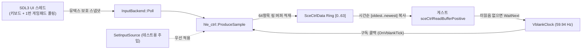
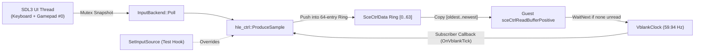

# PSP 컨트롤러 입력(`sceCtrl`)과 DMAC(`sceDmac`)

> 상태 구분: **확인됨**(합성 프로브 `vblank_probe`·`ctrl_probe`·`dmac_probe`로 검증), **추정**(PSPSDK `pspctrl.h`, uOFW 기준), **미확정**(하드웨어·원본 타이틀에서 미확인)

## 1. 개요

PSP의 사용자 입력은 `sceCtrl` 라이브러리가 VBlank(약 59.94 Hz) 주기에 맞추어 컨트롤러 상태를 64항목 링 버퍼에 기록하고, 애플리케이션이 `sceCtrlReadBufferPositive`로 이를 읽는 구조다. `repsp`에서는 공유 `runtime::VblankClock` 구독자가 매 VBlank 틱마다 입력을 수집하여 스레드 안전 스냅샷에서 `SceCtrlData`로 변환·적재하며, `sceDmacMemcpy`는 게스트 물리/비캐시(`0x40000000`) 별칭 주소를 포함한 DMA 메모리 복사를 제공한다.

## 2. `SceCtrlData` 구조체와 버튼 비트마스크

`SceCtrlData`는 PSPSDK `pspctrl.h` 기준 16바이트 구조체다(**추정**: PSPSDK `pspctrl.h`; **확인됨**: `ctrl_probe`).

| 오프셋 | 크기 | 필드 | 설명 |
| --- | --- | --- | --- |
| `0x00` | 4 | `time_stamp` | 샘플 기록 시각(마이크로초, 단조 증가) |
| `0x04` | 4 | `buttons` | 눌린 버튼 비트마스크 (`PSP_CTRL_*`) |
| `0x08` | 1 | `lx` | 아날로그 X축 (`0`..`255`, 중립 `128`) |
| `0x09` | 1 | `ly` | 아날로그 Y축 (`0`..`255`, 중립 `128`) |
| `0x0A` | 6 | `rsrv[6]` | 예약(0) |

버튼 비트마스크(PSPSDK `PspCtrlButtons`, **추정**: `pspctrl.h`; **확인됨**: `ctrl_probe`):

| 상수 | 비트 값 | 의미 |
| --- | --- | --- |
| `PSP_CTRL_SELECT` | `0x000001` | SELECT |
| `PSP_CTRL_START` | `0x000008` | START |
| `PSP_CTRL_UP` | `0x000010` | D-Pad Up |
| `PSP_CTRL_RIGHT` | `0x000020` | D-Pad Right |
| `PSP_CTRL_DOWN` | `0x000040` | D-Pad Down |
| `PSP_CTRL_LEFT` | `0x000080` | D-Pad Left |
| `PSP_CTRL_LTRIGGER` | `0x000100` | L Trigger |
| `PSP_CTRL_RTRIGGER` | `0x000200` | R Trigger |
| `PSP_CTRL_TRIANGLE` | `0x001000` | △ (Triangle) |
| `PSP_CTRL_CIRCLE` | `0x002000` | ○ (Circle) |
| `PSP_CTRL_CROSS` | `0x004000` | × (Cross) |
| `PSP_CTRL_SQUARE` | `0x008000` | □ (Square) |

## 3. 샘플링 흐름, VBlank 시계, 기본 입력 매핑

* **`sceCtrlSetSamplingCycle` (`0x6A2774F3`)**: 음수(`cycle < 0`)는 `SCE_ERROR_INVALID_VALUE`(`0x800001FE`)를 반환하고(**추정**: uOFW), `0` 이상의 값을 기록하며 이전 주기 값을 반환한다. **미확정**: `0`이 아닌 양의 `cycle` 값에 따른 비동기 타이머 주기 분기는 아직 구현하지 않았으며, 기록만 남기고 샘플링은 VBlank 주기에 맞춘다.
* **`sceCtrlSetSamplingMode` (`0x1F4011E6`)**: `0`(`DIGITAL`, `lx=128, ly=128` 고정)과 `1`(`ANALOG`, `[-1.0, 1.0]` → `[0, 255]` 변환, 중립 `128`)만 허용하며 이전 모드를 반환한다. 그 외 값은 `SCE_ERROR_INVALID_MODE`(`0x80000107`)를 반환한다(**추정**: PSPSDK·uOFW; **확인됨**: `ctrl_probe`).
* **`sceCtrlReadBufferPositive` (`0x1F803938`)**: `count`가 `1..64` 범위를 벗어나면 `SCE_ERROR_INVALID_SIZE`(`0x80000104`), 버퍼 주소가 0이거나 매핑되지 않으면 `SCE_ERROR_INVALID_POINTER`(`0x80000103`)를 반환한다. 미읽음 샘플이 없으면 스케줄러 스레드에서 `VblankClock::WaitNext`로 다음 틱까지 대기한 뒤 최대 `count`개의 미읽음 샘플을 시간순(`oldest`→`newest`)으로 기록하고 읽은 개수를 반환한다(**추정**: uOFW `ctrl`; **확인됨**: `ctrl_probe`).
* **기본 호스트 입력 매핑**(`sdl_platform.cpp`, headless/dummy 시 중립 상태만 반환):

| PSP 입력 | 키보드 | 게임패드 (SDL3) |
| --- | --- | --- |
| D-Pad (Up/Right/Down/Left) | 방향키 | D-Pad |
| Cross / Circle / Square / Triangle | `Z` / `X` / `A` / `S` | South / East / West / North |
| L / R Trigger | `Q` / `W` | Left / Right Shoulder |
| Start / Select | `Enter` / `Backspace` | Start / Back |
| Analog Stick (`lx`, `ly`) | `I` `J` `K` `L` | Left Stick X/Y |

## 4. `sceDmacMemcpy` (`0x617F3FE6`)

`sceDmacMemcpy(dst, src, size)`는 게스트 메모리를 복사한다(**추정**: uOFW — 성공 시 `0`, 크기 0은 `SCE_ERROR_INVALID_SIZE`(`0x80000104`), 널/비매핑 포인터는 `SCE_ERROR_INVALID_POINTER`(`0x80000103`); **확인됨**: `dmac_probe`). 비캐시 별칭(`0x44000000` VRAM 등)은 `GuestMemory::Translate`(`& 0x1FFFFFFF`)로 물리 주소에 fold된다. **미확정**: 원본 하드웨어의 겹치는(overlapping) DMA 범위 동작은 확인되지 않았으므로 안전을 위해 `memmove`와 동일하게 처리한다.

## 5. 출처

* PSPSDK `pspctrl.h` (MIT/BSD) — 구조체 레이아웃, `PSP_CTRL_*`·`PSP_CTRL_MODE_*` 상수
* uOFW (`github.com/uofw/uofw`) `ctrl` 문서 및 `include/common/errors.h` — 샘플링 동작 및 공통 오류 코드

---

# PSP Controller Input (`sceCtrl`) and DMAC (`sceDmac`)

> Status labels: **Confirmed** (verified by synthetic probes `vblank_probe`, `ctrl_probe`, `dmac_probe`), **Inferred** (PSPSDK `pspctrl.h`, uOFW), **Unconfirmed** (not yet verified against hardware or title behavior)

## 1. Overview

On PSP, `sceCtrl` samples controller state synchronized with VBlank (~59.94 Hz) into a 64-entry ring buffer consumed by `sceCtrlReadBufferPositive`. In `repsp`, a subscriber on the shared `runtime::VblankClock` polls a thread-safe input snapshot on every tick, converts it into `SceCtrlData`, and pushes it into the ring buffer. `sceDmacMemcpy` provides DMA copies across mapped guest RAM/VRAM including uncached aliases (`0x40000000`).

## 2. `SceCtrlData` Layout and Button Bitmasks

`SceCtrlData` is a 16-byte structure defined in PSPSDK `pspctrl.h` (**Inferred**: `pspctrl.h`; **Confirmed**: `ctrl_probe`):

| Offset | Size | Field | Description |
| --- | --- | --- | --- |
| `0x00` | 4 | `time_stamp` | Sample timestamp in microseconds (monotonic) |
| `0x04` | 4 | `buttons` | Active button bitmask (`PSP_CTRL_*`) |
| `0x08` | 1 | `lx` | Analog X axis (`0`..`255`, center `128`) |
| `0x09` | 1 | `ly` | Analog Y axis (`0`..`255`, center `128`) |
| `0x0A` | 6 | `rsrv[6]` | Reserved (zero) |

Button bitmasks (PSPSDK `PspCtrlButtons`, **Inferred**: `pspctrl.h`; **Confirmed**: `ctrl_probe`):

| Constant | Bit Value | Meaning |
| --- | --- | --- |
| `PSP_CTRL_SELECT` | `0x000001` | SELECT |
| `PSP_CTRL_START` | `0x000008` | START |
| `PSP_CTRL_UP` | `0x000010` | D-Pad Up |
| `PSP_CTRL_RIGHT` | `0x000020` | D-Pad Right |
| `PSP_CTRL_DOWN` | `0x000040` | D-Pad Down |
| `PSP_CTRL_LEFT` | `0x000080` | D-Pad Left |
| `PSP_CTRL_LTRIGGER` | `0x000100` | L Trigger |
| `PSP_CTRL_RTRIGGER` | `0x000200` | R Trigger |
| `PSP_CTRL_TRIANGLE` | `0x001000` | Triangle |
| `PSP_CTRL_CIRCLE` | `0x002000` | Circle |
| `PSP_CTRL_CROSS` | `0x004000` | Cross |
| `PSP_CTRL_SQUARE` | `0x008000` | Square |

## 3. Sampling Pipeline, VBlank Clock, and Default Input Mapping

* **`sceCtrlSetSamplingCycle` (`0x6A2774F3`)**: Negative values return `SCE_ERROR_INVALID_VALUE` (`0x800001FE`, **Inferred**: uOFW); non-negative values are recorded and the previous cycle is returned. **Unconfirmed**: Custom microsecond timer periods for non-zero values are not yet simulated—non-zero values are recorded while sampling continues on VBlank ticks.
* **`sceCtrlSetSamplingMode` (`0x1F4011E6`)**: Accepts `0` (`DIGITAL`, locking `lx=128, ly=128`) or `1` (`ANALOG`, mapping `[-1.0, 1.0]` to `[0, 255]` with center `128`) and returns the previous mode; invalid modes return `SCE_ERROR_INVALID_MODE` (`0x80000107`) (**Inferred**: PSPSDK, uOFW; **Confirmed**: `ctrl_probe`).
* **`sceCtrlReadBufferPositive` (`0x1F803938`)**: Rejects `count <= 0` or `count > 64` with `SCE_ERROR_INVALID_SIZE` (`0x80000104`), and null/unmapped buffers with `SCE_ERROR_INVALID_POINTER` (`0x80000103`). When no unread samples exist on a scheduled guest thread, it waits via `VblankClock::WaitNext`, then writes up to `count` unread samples oldest-first and returns the count written (**Inferred**: uOFW `ctrl`; **Confirmed**: `ctrl_probe`).
* **Default host input mapping** (`sdl_platform.cpp`; headless/dummy always returns neutral state):

| PSP Input | Keyboard | Gamepad (SDL3) |
| --- | --- | --- |
| D-Pad (Up/Right/Down/Left) | Arrow Keys | D-Pad |
| Cross / Circle / Square / Triangle | `Z` / `X` / `A` / `S` | South / East / West / North |
| L / R Trigger | `Q` / `W` | Left / Right Shoulder |
| Start / Select | `Enter` / `Backspace` | Start / Back |
| Analog Stick (`lx`, `ly`) | `I` `J` `K` `L` | Left Stick X/Y |

## 4. `sceDmacMemcpy` (`0x617F3FE6`)

`sceDmacMemcpy(dst, src, size)` copies guest memory (**Inferred**: uOFW — returns `0` on success, `SCE_ERROR_INVALID_SIZE` (`0x80000104`) on `size == 0`, `SCE_ERROR_INVALID_POINTER` (`0x80000103`) on null/unmapped pointers; **Confirmed**: `dmac_probe`). Uncached aliases (such as `0x44000000` VRAM) fold via `GuestMemory::Translate` (`& 0x1FFFFFFF`). **Unconfirmed**: Hardware behavior for overlapping DMA ranges is unconfirmed and is handled safely like `memmove`.

## 5. Sources

* PSPSDK `pspctrl.h` (MIT/BSD) — struct layout, `PSP_CTRL_*` and `PSP_CTRL_MODE_*` constants
* uOFW (`github.com/uofw/uofw`) `ctrl` docs & `include/common/errors.h` — sampling semantics and common error codes
