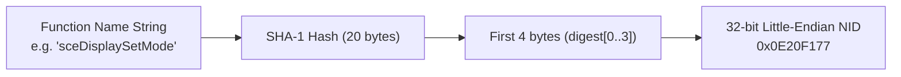

# PSP NID (Name ID)

## 1. 개요

PSP 펌웨어의 동적 모듈 링크 시스템(PRX)에서 함수 및 전역 변수 심볼은 문자열 이름 대신 32비트 정수인 **NID**(Name ID)로 식별된다.

* 상태:
  * NID 계산 알고리즘: **확인됨** (FIPS 180 표준 SHA-1 테스트 벡터 및 공개 펌웨어 NID `sceDisplaySetMode`, `sceCtrlReadBufferPositive`, `sceCtrlPeekBufferPositive`, `sceKernelExitGame` 대조 검증 완료)
  * 특정 커널 내부 난수화 NID 매핑: **추정**
* 출처: [PSP Developer Wiki - NIDs](https://www.psdevwiki.com/psp/NIDs), [uOFW Documentation](https://github.com/uOFW/uOFW)

## 2. NID 계산 알고리즘 (확인됨)

함수 이름 문자열(예: `"sceKernelExitGame"`)에 대해 표준 SHA-1 다이제스트(20바이트)를 생성한 뒤, 앞 4바이트(`digest[0..3]`)를 32비트 리틀엔디언 정수로 조합한다:

$$\text{NID} = \text{digest}[0] \mid (\text{digest}[1] \ll 8) \mid (\text{digest}[2] \ll 16) \mid (\text{digest}[3] \ll 24)$$

## 3. repsp에서의 NID 처리

* `repsp::runtime::ComputeNid(name)`: 함수 이름으로부터 NID를 계산.
* `repsp::runtime::NidRegistry`: NID와 HLE 핸들러를 맵핑.
* `repsp_recomp_hle_call(nid)`: 재컴파일된 코드의 임포트 스텁 호출 시 NID로 디스패치.
  * 미등록 NID 호출 시 최초 1회 경고 로그를 출력하고 `$v0`에 `0x80020002`(`SCE_KERNEL_ERROR_NOTIMPLEMENTED`)를 반환.

---

# PSP NID (Name ID) (English)

## 1. Overview
In the PSP module linking system (PRX), exported and imported functions and variables are identified by 32-bit integers called NIDs rather than string names.

* Status:
  * NID calculation algorithm: **Confirmed** (verified against FIPS 180 standard test vectors and published firmware NIDs in `nid_probe`)
  * Firmware-internal randomized NID tables: **Inferred**
* Sources: [PSP Developer Wiki - NIDs](https://www.psdevwiki.com/psp/NIDs), [uOFW Documentation](https://github.com/uOFW/uOFW)

## 2. Calculation Algorithm (Confirmed)
The NID is computed by hashing the function name with SHA-1 and reading the first four bytes in little-endian order.

## 3. Handling in repsp
`NidRegistry` registers and looks up handlers by NID. Unimplemented NIDs log a warning once, track invocation statistics, and return `0x80020002` (`SCE_KERNEL_ERROR_NOTIMPLEMENTED`).
