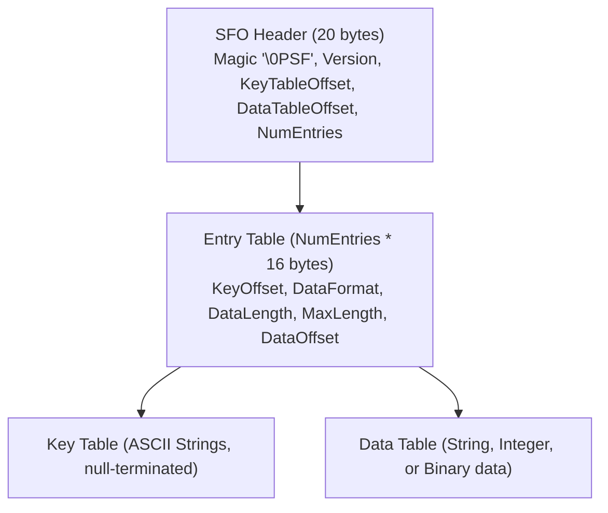

# PARAM.SFO 파일 형식 (PARAM.SFO Format)

## 1. 개요

`PARAM.SFO`(System File Object)는 PSP 및 PS3 타이틀에서 제목, 카테고리, 버전, 부모 제어 레벨 등의 메타데이터를 저장하는 표준 바이너리 파일 형식이다.

* 상태:
  * 바이너리 사양 및 포맷 코드: **추정** (외부 개발자 위키 문서에 기반함)
  * 파서 구현 동작: **확인됨** (손으로 작성한 합성 SFO 데이터를 통한 `module_probe` 검증 완료; 실제 디스크 덤프 검증은 reDMP1 issue #1에서 진행)
* 출처: [PSP Developer Wiki - PARAM.SFO](https://www.psdevwiki.com/psp/PARAM.SFO), [PS3 Developer Wiki - PARAM.SFO](https://www.psdevwiki.com/ps3/PARAM.SFO)

## 2. 파일 구조 (추정)

### 2.1. 헤더 (Header, 20 bytes)
* `0x00`: 매직 넘버 `0x46535000` (`\0PSF` 리틀엔디언)
* `0x04`: 버전 (`0x00000101`, Version 1.1)
* `0x08`: 키 테이블 오프셋 (uint32)
* `0x0C`: 데이터 테이블 오프셋 (uint32)
* `0x10`: 엔트리 개수 (uint32)

### 2.2. 엔트리 구조 (Entry, 16 bytes)
* `0x00`: 키 오프셋 (uint16, 키 테이블 시작점 기준)
* `0x02`: 데이터 포맷 (uint16)
  * `0x0204`: UTF-8 문자열 (null 종료)
  * `0x0004`: 특수 UTF-8 문자열
  * `0x0404`: 32비트 부호 없는 정수 (리틀엔디언)
* `0x04`: 실제 데이터 길이 (uint32)
* `0x08`: 최대 버퍼 길이 (uint32)
* `0x0C`: 데이터 오프셋 (uint32, 데이터 테이블 시작점 기준)

---

# PARAM.SFO Format (English)

## 1. Overview
`PARAM.SFO` (System File Object) is the standard metadata file format for PSP and PS3 applications containing title, category, version, and parent rating information.

* Status:
  * Binary layout specification and format codes: **Inferred** (derived from developer wiki documentation)
  * Parser implementation: **Confirmed** (verified against synthetic SFO fixtures in `module_probe`; verification with retail UMD dumps follows in reDMP1 issue #1)
* Sources: [PSP Developer Wiki - PARAM.SFO](https://www.psdevwiki.com/psp/PARAM.SFO), [PS3 Developer Wiki - PARAM.SFO](https://www.psdevwiki.com/ps3/PARAM.SFO)

## 2. Binary Layout (Inferred)
See the diagram and section descriptions above.
