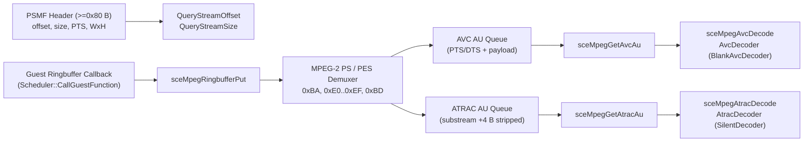

# PSMF 컨테이너, MPEG-2 PS 분리 및 `sceMpeg` HLE 계약

이 문서는 PSP `sceMpeg` 라이브러리가 다루는 PSMF(PlayStation Movie Format) 헤더, 2048바이트 MPEG-2 Program Stream 분리, 링 버퍼 게스트 콜백 호출, `SceMpegAu` 타임스탬프·구조체 배치 및 오류 코드를 정리한다. 각 항목은 **확인됨**, **추정**, **미확정**을 구분하고 출처를 적는다.

---

## 1. 전체 처리 흐름

---

## 2. PSMF 헤더 규격

출처: 공개 PSMF 문서(PSDevWiki `PMF`) — **추정**(표준 PSP PSMF 레이아웃 기반, `ParsePsmfHeader`는 합성 헤더로 검증):

| 오프셋 | 크기 | 엔디안 | 필드 | 설명 |
|---|---|---|---|---|
| `0x00` | 4 | ASCII | Magic | `"PSMF"` |
| `0x04` | 4 | ASCII | Version | `"0012"`, `"0013"`, `"0014"`, `"0015"` 지원 (`ParsePsmfHeader`) |
| `0x08` | 4 | Big | `stream_offset` | MPEG-2 PS 본문 시작 오프셋 (`sceMpegQueryStreamOffset` 반환) |
| `0x0C` | 4 | Big | `stream_size` | MPEG-2 PS 본문 크기 (`sceMpegQueryStreamSize` 반환) |
| `0x54` | 6 | Big | `first_pts` | 시작 PTS (90 kHz, 상위 48비트) |
| `0x5A` | 6 | Big | `last_pts` | 종료 PTS (90 kHz, 상위 48비트) |
| `0x80` | 2 | Big | `stream_count` | 스트림 테이블 항목 수 |
| `0x8E` | 1 | - | `width_mb` | 영상 가로 매크로블록 수 (`* 16` px, 기본 `480`) |
| `0x8F` | 1 | - | `height_mb` | 영상 세로 매크로블록 수 (`* 16` px, 기본 `272`) |

* 잘못된 매직 또는 지원하지 않는 버전은 `kSceMpegErrorBadVersion`(`0x80610002`)을 반환한다.

---

## 3. MPEG-2 Program Stream 및 PES 분리

출처: ISO/IEC 13818-1 공개 규격 및 PSDevWiki `PMF` (**추정**):

* 본문은 2048바이트(`kMpegPacketSize`) pack 단위의 MPEG-2 Program Stream이다.
* **`0xBA` Pack Header**: ISO 13818-1 MPEG-2 헤더(`(byte[4] & 0xC0) == 0x40`)는 `14 + (byte[13] & 0x07)` 바이트, MPEG-1 헤더는 `12` 바이트를 건너뛴다.
* **`0xBB` System / `0xBE` Padding / `0xBC` / `0xBF`**: 길이 헤더(`6 + length`)만큼 건너뛴다.
* **`0xE0..0xEF` Video PES (AVC)**:
  * PES 플래그의 PTS/DTS 비트가 설정된 경우 5바이트 인코딩된 33비트 타임스탬프(90 kHz)를 추출한다.
  * **AU 경계 (확인됨 — PSMF 실 스트림 및 `mpeg_probe`)**: 스트림에 H.264 Access Unit Delimiter(`00 00 00 01 09`)가 포함되면 PES 경계를 넘나드는 AUD 위치마다 프레임을 분할한다. PES 타임스탬프는 해당 PES 범위 안에서 시작하는 첫 AUD에 결합하고, PTS가 없는 후속 프레임은 90 kHz 기준 `+3003` 틱 간격으로 진행한다. AUD가 없는 합성 스트림은 `has_pts` PES 경계로 fallback한다.
* **`0xBD` Private Stream 1 (ATRAC3plus Audio)**:
  * PES 페이로드 앞 4바이트는 PSMF 하위 스트림 헤더이며, `payload[0] & 0x0F`가 스트림 번호(`stream_num`), `payload[2..3]`(big-endian)이 해당 PES 내 첫 완성 ATRAC 프레임까지의 바이트 오프셋, `payload + 4` 이후가 ATRAC3plus ES 데이터다.
  * **AU 경계 (확인됨 — PSMF 실 스트림 및 `mpeg_probe`)**: 프레임 헤더가 `0x0F 0xD0`으로 시작하면 프레임 길이 `8 + ((((b2 & 0x03) << 8) | b3) * 8 + 8)` 바이트(예: `0x0F 0xD0 0x28 0x5C` → `8 + 744 = 752`바이트)마다 AU를 분할한다. PES PTS는 `payload[2..3]`이 가리키는 AU에 결합하고 후속 AU는 `+4180` 틱(2048샘플 @ 44.1 kHz) 간격으로 진행한다. `0x0F 0xD0` 헤더가 없는 합성 스트림은 `has_pts` PES 경계로 fallback한다.
  * 스트림 종료(`MPEG_program_end_code` `0xB9` 또는 콜백 반환 `0`) 시 대기 중인 마지막 AU를 준비 큐로 비운다.
* 등록된 스트림(`sceMpegRegistStream(mpeg, type, num)`)별로 `stream_num` 키의 `avc_queues` / `atrac_queues`에 적재한다.

---

## 4. 링 버퍼(`SceMpegRingbuffer`)와 스레드 문맥 게스트 콜백

출처: PSPSDK `pspmpeg.h` (**추정**):

* `SceMpegRingbuffer` 구조체는 44바이트이며 `packets`, `read_packets`, `write_packets`, `free_packets`, `packet_size(2048)`, `data_addr`, `callback_addr`, `callback_data`, `data_upper_bound`, `sema_id`, `mpeg_addr` 필드로 구성된다.
* `sceMpegRingbufferQueryMemSize(packets)`: `packets * (2048 + 104)` 바이트를 반환한다(**추정** — PSPSDK `pspmpeg.h` 및 팩당 104바이트 내부 패킷 구조체 오버헤드 기반).
* `sceMpegRingbufferPut(ring, numPackets, available)`:
  * 게스트 콜백 `callback(data_addr, to_read, callback_data)`는 파일 읽기(`sceIoRead`)나 커널 대기(`sceKernelDelayThread`)를 수행하므로 **인터럽트 문맥이 아니라 호출 스레드의 일반 문맥**에서 실행되어야 한다.
  * `Scheduler::CallGuestFunction(entry, a0, a1, a2, a3)`가 호스트 CPU 컨텍스트(`repsp_guest_cpu_ops::save/restore`)를 보존한 채 게스트 함수를 호출하고 `$v0`를 반환한다. `hle_mpeg.cpp`는 콜백 호출 전 내부 뮤텍스를 해제한다.
  * 콜백이 `0`을 반환하면 스트림 EOF(`hit_eof = true`)로 처리하고 pending AU를 모두 준비 큐로 비운다.

---

## 5. `SceMpegAu`, 크기 상수 및 디코더 계약

* **`SceMpegAu` (24바이트)**:

| 오프셋 | 필드 | 설명 | 상태 |
|---|---|---|---|
| `+0x00` | `pts_msb` | PTS 상위 32비트 (`(pts >> 32)`) | **추정** |
| `+0x04` | `pts_lsb` | PTS 하위 32비트 (게스트 A/V 동기화가 이 오프셋을 90 kHz 워드로 참조) | **확인됨** |
| `+0x08` | `dts_msb` | DTS 상위 32비트 | **추정** |
| `+0x0C` | `dts_lsb` | DTS 하위 32비트 | **추정** |
| `+0x10` | `es_buffer` | ES 버퍼 포인터 또는 핸들 (`sceMpegInitAu` 설정) | **확인됨** |
| `+0x14` | `es_size` | 반환된 AU 페이로드 바이트 수 | **추정** |

* **메모리·ES 상수**:
  * `sceMpegQueryMemSize`: `0x10000` (64 KiB, **추정** — PSPSDK 기반).
  * `sceMpegQueryAtracEsSize`: `esSize = 2112` (`kMpegAtracEsSize`), `outSize = 8192` (`kMpegAtracOutSize`, 2048 stereo 16-bit 샘플, **추정** — PSPSDK `pspmpeg.h` 및 ATRAC3plus 프레임 크기).
* **디코더 계약 (`repsp_codec`)**:
  * `AvcDecoder` 기본 구현 `BlankAvcDecoder`는 픽셀 형식(`5650`→`0x0000`, `5551`→`0x8000`, `4444`→`0xF000`, 기본 `8888`→`0xFF000000`, 기본값 `8888`은 **추정**)에 맞추어 불투명 검은 프레임을 출력한다.
  * `sceMpegAvcDecode`의 `buf` 인자는 게스트 프레임버퍼 주소를 가리키는 포인터(`void**`)와 직접 버퍼 주소를 모두 허용하며 `*init = 1`을 기록한다.
  * `AtracDecoder` 기본 구현 `SilentDecoder`는 `8192`바이트 PCM 출력 버퍼를 `0`으로 채운다.
  * **시간**: HLE는 자체 지연을 두지 않고 실제 스트림에서 분리한 AU 수와 90 kHz PTS를 그대로 반환해 타이틀의 오디오·VBlank 루프가 원본 재생 길이를 유지하도록 한다.

---

## 6. 오류 코드 (`kernel_errors.h`)

| 상수 | 16진수 값 | 출처 및 상태 |
|---|---|---|
| `kSceMpegErrorBadVersion` | `0x80610002` | Sony/PSPSDK facility `0x8061` (**추정**) |
| `kSceMpegErrorNoMemory` | `0x80610022` | Sony/PSPSDK facility `0x8061` (**추정**) |
| `kSceMpegErrorInvalidAddr` | `0x80610103` | Sony/PSPSDK facility `0x8061` (**추정**) |
| `kSceMpegErrorInvalidValue` | `0x806101FE` | Sony/PSPSDK facility `0x8061` (**추정**) |
| `kSceMpegErrorNoData` | `0x80618001` | Sony/PSPSDK `SCE_MPEG_ERROR_NO_DATA` (**추정** — 게스트 루프 에러 검사 확인 가능 값) |
| `kSceMpegErrorAlreadyInit` | `0x80618005` | Sony/PSPSDK facility `0x8061` (**추정**) |

---

# PSMF Container, MPEG-2 PS Demuxing, and `sceMpeg` HLE Contract

This document describes the PSMF (PlayStation Movie Format) header, 2048-byte MPEG-2 Program Stream demultiplexing, ring-buffer guest callbacks, `SceMpegAu` layout/timestamps, and error codes handled by `repsp_hle_mpeg`. Statements are marked **Confirmed**, **Inferred**, or **Unresolved** with sources.

## 1. Pipeline Overview

See the Mermaid diagram above. `ParsePsmfHeader` supplies `stream_offset`, `stream_size`, PTS bounds, and macroblock dimensions; `sceMpegRingbufferPut` runs the guest reader callback via `Scheduler::CallGuestFunction` on the calling thread and feeds the returned packs to the PS/PES demuxer; per-stream AU queues feed `sceMpegGetAvcAu`/`sceMpegGetAtracAu` and the replaceable `repsp::codec::AvcDecoder` (`BlankAvcDecoder`) and `AtracDecoder` (`SilentDecoder`).

## 2. PSMF Header Layout

Source: public PSMF documentation (PSDevWiki `PMF`) — **Inferred**:
* Magic `"PSMF"` (`0x00`), versions `"0012"`–`"0015"` (`0x04`), big-endian `stream_offset` (`0x08`) and `stream_size` (`0x0C`), 48-bit 90 kHz `first_pts`/`last_pts` (`0x54`/`0x5A`), `stream_count` (`0x80`), macroblock width/height `* 16` (`0x8E`/`0x8F`, defaulting to `480x272`). Invalid headers return `kSceMpegErrorBadVersion` (`0x80610002`).

## 3. MPEG-2 Program Stream and PES Demuxing

Source: ISO/IEC 13818-1, PSDevWiki `PMF`, and real PSMF elementary-stream verification — **Confirmed / Inferred**:
* 2048-byte packs: skips `0xBA` pack headers (`14 + stuffing` for MPEG-2), skips `0xBB`/`0xBC`/`0xBE`/`0xBF`, extracts 33-bit 90 kHz PTS/DTS from `0xE0..0xEF` (AVC video) and `0xBD` Private Stream 1 (ATRAC3plus after stripping the 4-byte PSMF substream header where `payload[0] & 0x0F` selects `stream_num` and `payload[2..3]` holds the big-endian byte offset to the first complete frame in that PES).
* **AU boundaries (Confirmed for H.264 AUD and `0x0F 0xD0` ATRAC3+)**: Video streams carrying `00 00 00 01 09` H.264 Access Unit Delimiters split across PES boundaries on every AUD (`+3003` ticks per frame between PES PTS anchors); ATRAC3+ streams carrying `0x0F 0xD0` headers split on `8 + ((((b2 & 0x03) << 8) | b3) * 8 + 8)`-byte frame lengths (`+4180` ticks per frame between `payload[2..3]` PTS anchors). Streams without those markers fall back to `has_pts` PES boundaries. Program-end `0xB9` or `0` callback packets flush remaining pending AUs.

## 4. Ring Buffer (`SceMpegRingbuffer`) and Thread-Context Callback

Source: PSPSDK `pspmpeg.h` — **Inferred**:
* 44-byte `SceMpegRingbuffer` tracks total/read/write/free packs (`packet_size = 2048`). `sceMpegRingbufferQueryMemSize(packets)` returns `packets * (2048 + 104)` (including the 104-byte per-packet structure overhead).
* `sceMpegRingbufferPut` releases the module mutex and invokes `callback(data_addr, to_read, callback_data)` through `Scheduler::CallGuestFunction`, preserving callee-saved registers and allowing blocking kernel waits (`sceIoRead`, `sceKernelDelayThread`) on the calling thread. Returning `0` signals EOF and flushes pending AUs.

## 5. `SceMpegAu`, Constants, and Decoder Contract

* `SceMpegAu` (24 bytes): `pts_msb` (`+0x00`), `pts_lsb` (`+0x04`, **Confirmed** used for A/V sync), `dts_msb` (`+0x08`), `dts_lsb` (`+0x0C`), `es_buffer` (`+0x10`), `es_size` (`+0x14`).
* `sceMpegQueryMemSize` returns `0x10000`; `sceMpegQueryAtracEsSize` reports `2112` ES bytes and `8192` PCM output bytes (**Inferred**).
* `BlankAvcDecoder` fills opaque black pixels (`5650`=`0x0000`, `5551`=`0x8000`, `4444`=`0xF000`, default `8888`=`0xFF000000`; `8888` default **Inferred**); `sceMpegAvcDecode` accepts indirect `void**` or direct frame-buffer pointers and writes `*init = 1`. `SilentDecoder` outputs `8192` zero bytes. Timing is driven solely by real demuxed AU counts and PTS values.

## 6. Error Codes (`kernel_errors.h`)

Uses Sony/PSPSDK facility `0x8061`: `0x80610002` (`BadVersion`), `0x80610022` (`NoMemory`), `0x80610103` (`InvalidAddr`), `0x806101FE` (`InvalidValue`), `0x80618001` (`NoData`), `0x80618005` (`AlreadyInit`) — **Inferred** from PSPSDK `pspmpeg.h`.
