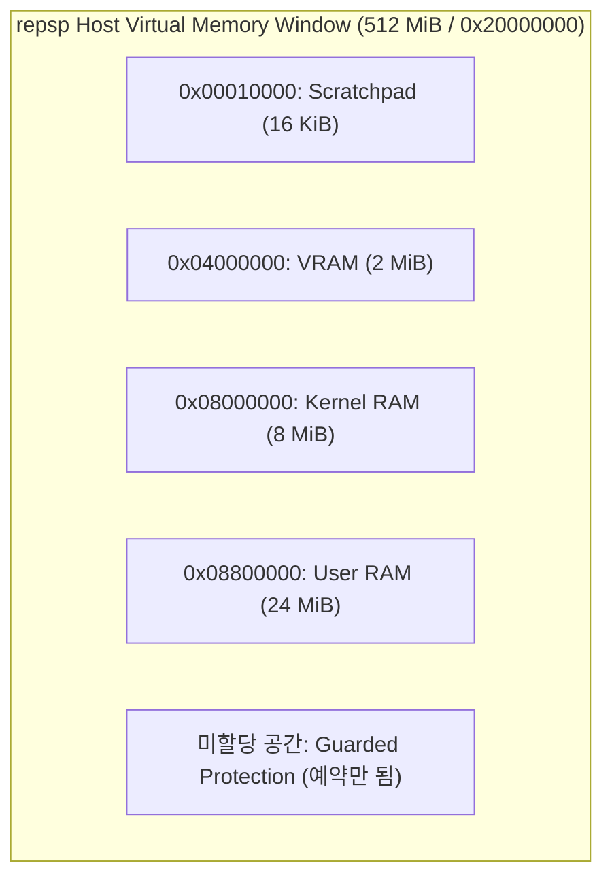

# PSP 메모리 맵 (PSP Memory Map)

## 1. 개요

PSP(PlayStation Portable) 시스템의 가상 메모리 공간과 물리 메모리 배치 구조를 정리한다.

* 상태: **추정** (물리 영역 주소 및 크기, 가상 주소 미러 동작은 외부 문서에 기반함; repsp의 512 MiB 창 예약 및 접기 구현 동작은 프로브로 확인됨)
* 출처: [PSP Developer Wiki - Memory Map](https://www.psdevwiki.com/psp/Memory_Map), psprecomp `docs/ARCHITECTURE.md`

## 2. 물리 메모리 배치 (PSP-1000 기준)

| 물리 주소 | 크기 | 용도 | 상태 |
|---|---|---|---|
| `0x00010000` | 16 KiB | Scratchpad RAM | **추정** (외부 문서 기준, repsp에서 commit) |
| `0x04000000` | 2 MiB | EDRAM / VRAM (프레임버퍼 및 텍스처) | **추정** (외부 문서 기준, repsp에서 commit) |
| `0x08000000` | 8 MiB | 커널 메인 RAM | **추정** (외부 문서 기준, repsp에서 commit) |
| `0x08800000` | 24 MiB | 사용자 메인 RAM (게임 코드 및 힙) | **추정** (외부 문서 기준, repsp에서 commit) |

## 3. 가상 주소 미러 접기 (Mirror Folding)

Allegrex CPU에서 가상 주소의 상위 3비트는 캐시 모드와 권한 마스크로 동작한다:
* `0x00000000`: 사용자 공간 캐시 영역 (User space cached)
* `0x40000000`: 사용자 공간 비캐시 미러 (User space uncached mirror)
* `0x80000000`: 커널 공간 캐시 영역 (Kernel space cached)
* `0xA0000000`: 커널 공간 비캐시 미러 (Kernel space uncached mirror)

repsp의 `GuestMemory::Translate`는 게스트 주소에 `0x1FFFFFFF` 마스크를 적용하여 모든 가상 미러를 512 MiB 예약 창 내의 단일 물리 오프셋으로 접는다:
`phys_addr = guest_addr & 0x1FFFFFFF;`
`host_ptr = base + phys_addr;`

---

# PSP Memory Map (English)

## 1. Overview
This document summarizes the virtual memory layout and physical memory map of the PSP system.

* Status: **Inferred** (physical region addresses and virtual mirror behavior are based on external documentation; repsp's 512 MiB reservation window and mirror folding are verified by probes)
* Sources: [PSP Developer Wiki - Memory Map](https://www.psdevwiki.com/psp/Memory_Map), psprecomp `docs/ARCHITECTURE.md`

## 2. Physical Memory Layout (PSP-1000)
See table and diagram above. The total 512 MiB window (`0x20000000`) is reserved on host, with scratchpad, VRAM, kernel RAM, and user RAM committed.

## 3. Virtual Address Mirror Folding
The upper 3 bits select caching and privilege modes (`0x40000000` uncached, `0x80000000` kernel, `0xA0000000` kernel uncached). repsp folds these into the 512 MiB window using `phys = guest_addr & 0x1FFFFFFF`.
