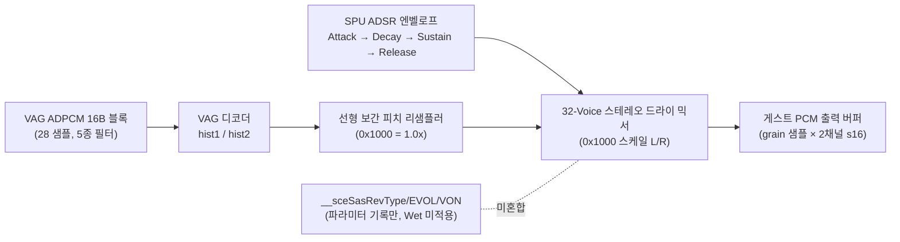

# PSP SAS 소프트웨어 신시사이저와 VAG ADPCM (`sceSasCore`)

이 문서는 PSP 소프트웨어 오디오 신시사이저 라이브러리 `sceSasCore`의 인스턴스·보이스 구조, Sony VAG 4비트 ADPCM 디코딩, ADSR 엔벨로프 및 리버브 처리 범위를 정리한다.

---

## 1. SAS Core 및 Voice 아키텍처

* **인스턴스 식별**: 게스트가 넘기는 `core` 구조체 포인터(64바이트 정렬 권장)를 키로 인스턴스를 관리한다.
* **Grain 및 Voice 수**: `__sceSasInit`은 `grain`(32의 배수, `32..2048`), `maxVoices`(`1..32`), `outMode`(0=인터리브 스테레오, 1=플래너 스테레오), `sampleRate`(44100/22050)를 검증한다(**추정** — 출처: PSDevWiki / 공개 SAS 문서).
* **호출 규약 주의**: `__sceSasSetVolume`은 6개 인자(`$a0..$a3, $t0, $t1`), `__sceSasSetADSR`은 7개 인자(`$a0..$a3, $t0..$t2`)를 사용한다(**확인됨**, `sas_probe` 및 소비자 바이너리 호출부 대조).
* **End Flag 비트마스크**: `__sceSasGetEndFlag(core)`는 비트 `v`가 `1`이면 보이스 `v`가 정지/종료 상태, `0`이면 재생 중임을 뜻한다. 초기화 직후에는 `0xFFFFFFFF`를 반환한다(**추정** — 출처: 공개 SAS 문서).

---

## 2. Sony VAG ADPCM 블록 형식

PS1/PS2/PSP SPU 계열 공용 VAG ADPCM 형식(**추정** — 출처: `psx-spx` / PSDevWiki):

* **헤더**: `"VAGp"` 48바이트 헤더가 앞에 붙을 수 있으며(선택적), 본체 데이터는 16바이트 블록 단위로 구성된다.
* **16바이트 블록 → 28개 s16 PCM 샘플**:
  * **Byte 0**: 상위 4비트 `predict_filter` (`0..4`), 하위 4비트 `shift_factor` (`0..12`, `>12`는 `9`로 클램프).
  * **Byte 1 (`flags`)**:
    * `0x04`: Loop Start 블록 위치 기록.
    * `0x01`: Stream End (`loop=0`이고 `0x02` 미설정 시 블록 종료 후 보이스 정지; `0x03` 또는 `loop=1`이면 Loop Start로 점프).
    * `0x07`: End + Mute (즉시 무음 정지).
  * **Bytes 2..15**: 28개의 부호 있는 4비트 니블(바이트당 하위 니블 먼저, 상위 니블 나중).
* **예측 계수 5종 (`K0, K1`, 분모 64)**: `(0, 0)`, `(60, 0)`, `(115, -52)`, `(98, -55)`, `(122, -60)`.
  $$s[n] = \mathrm{clamp}_{16}\!\left(\left(\frac{\mathrm{nib}_n \ll 12}{\text{sign}} \gg \text{shift}\right) + \frac{\text{hist}_1 \cdot K_0 + \text{hist}_2 \cdot K_1}{64}\right)$$

---

## 3. ADSR 엔벨로프 및 리버브

* **`__sceSasSetSimpleADSR(core, voice, env1, env2)`** (**추정** — 출처: `psx-spx` SPU ADSR 레지스터 규격):
  * `env1`: bits `0..3` Sustain Level, bits `4..7` Decay Shift, bits `8..9` Attack Step, bits `10..14` Attack Shift, bit `15` Attack Mode(Linear/Exp).
  * `env2`: bits `0..4` Release Shift, bit `5` Release Mode, bits `6..7` Sustain Step, bits `8..12` Sustain Shift, bit `14` Sustain Dir, bit `15` Sustain Mode.
  * `shift == 31`은 무한 유지(rate 0)에 해당한다.
* **`__sceSasSetADSR` 커브**: 정확한 PSP 펌웨어 내부 비선형 룩업 테이블은 **추정** 상태이며, `repsp_hle_sascore`는 30비트 선형/지수 근사 스텝으로 결정적 감쇠·상승을 구현한다.
* **리버브(`RevType`, `RevEVOL`, `RevVON`)**: 유효성(`RevType` `-1..9`, `-1`은 PSPSDK `PSP_SAS_EFFECT_TYPE_OFF`이며 실제 타이틀 호출에서 확인됨)과 설정 값만 기록하며, wet 리버브 믹싱은 현재 구현 범위 밖(Dry-only)이다. `FormatStats()`와 통계 필드에 `reverb=dry only (not mixed)`를 명시한다.

---

# PSP Software Synthesizer and VAG ADPCM (`sceSasCore`)

This document summarizes `sceSasCore` synthesis, Sony VAG 4-bit ADPCM decoding, ADSR envelopes, and dry-only reverb handling.

## 1. SAS Core and Voice Model

* **Instance keying**: Managed per 64-byte-aligned guest `core` address.
* **Grain and voices**: `__sceSasInit` validates `grain` (multiple of 32 in `32..2048`), `maxVoices` (`1..32`), `outMode` (`0` interleaved stereo, `1` planar stereo), and `sampleRate` (`44100` or `22050`) (**Inferred** — source: PSDevWiki / public SAS documentation).
* **Argument counts**: `__sceSasSetVolume` uses 6 registers (`$a0..$a3, $t0, $t1`) and `__sceSasSetADSR` uses 7 (`$a0..$a3, $t0..$t2`) (**Confirmed** via binary wrapper inspection and `sas_probe`).
* **End flag mask**: Bit `v == 1` means voice `v` is stopped/ended (`0xFFFFFFFF` right after init; **Inferred**).

## 2. Sony VAG ADPCM Format

* Optional 48-byte `"VAGp"` header followed by 16-byte blocks (**Inferred** — source: `psx-spx` SPU ADPCM spec).
* Each 16-byte block expands to 28 signed 16-bit samples using 5 filter coefficient pairs `(K0, K1) / 64`, shift `0..12`, and block flags (`0x04` loop start, `0x01` end, `0x03` loop end+repeat, `0x07` end+mute).

## 3. ADSR Envelope and Reverb Scope

* **`__sceSasSetSimpleADSR`**: Uses the 16-bit SPU `env1`/`env2` register bitfields (**Inferred** from `psx-spx`). Exact firmware lookup tables for `__sceSasSetADSR` rates are **inferred** (modeled deterministically in 30-bit fixed point).
* **Reverb (`RevType`/`RevEVOL`/`RevVON`)**: Parameters are validated (`-1..9`, where `-1` is PSPSDK `PSP_SAS_EFFECT_TYPE_OFF`, confirmed on real title calls) and recorded, while wet reverb is **not mixed** (dry-only). This is surfaced explicitly in `FormatStats()`.
