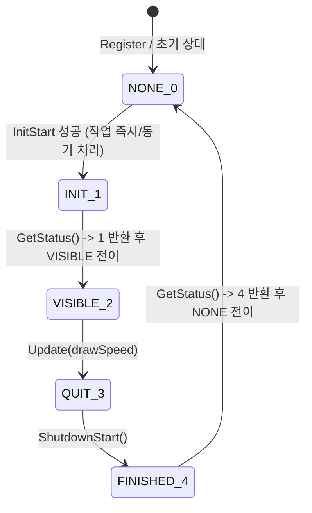

# `sceUtility` 세이브 데이터 및 메시지 다이얼로그 규격

이 문서는 PSP `sceUtility` 라이브러리 중 세이브 데이터(`sceUtilitySavedata*`)와 메시지 다이얼로그(`sceUtilityMsgDialog*`)의 단일 다이얼로그 상태 머신, 게스트 구조체 배치, 저장 디렉터리 및 `PARAM.SFO` 형식, `DialogPolicy` 호스트 정책 및 오류 코드를 정리한다. 각 항목은 **확인됨**, **추정**, **미확정**을 구분하고 출처를 적는다.

---

## 1. 단일 다이얼로그 상태 머신 (`PSP_UTILITY_DIALOG_*`)

PSP `sceUtility`는 한 번에 하나의 시스템 유틸리티 다이얼로그(`Savedata` 또는 `MsgDialog`)만 활성화하며, 이미 활성화된 상태에서 `InitStart`를 다시 호출하면 `kSceUtilityErrorInvalidStatus`(`0x80110001`)를 반환한다(**추정** — PSPSDK `psputility_sysparam.h`·`psputility_savedata.h` 및 `utility_probe` 검증).



* **확인됨 (타이틀 폴링 루프 기준)**: `InitStart` 시점에 게스트가 넘긴 구조체의 결과(`base.result`, `buttonPressed`, 출력 버퍼, 크기 정보)를 준비한 뒤 상태를 `1 (INIT)`으로 두고, 첫 `GetStatus()` 호출에서 `1`을 반환하며 `2 (VISIBLE)`로 전이한다. 이후 게스트가 `2`를 보고 `Update(n)`를 호출하면 `3 (QUIT)`으로, `3`을 보고 `ShutdownStart()`를 호출하면 `4 (FINISHED)`로, 마지막 `GetStatus()`가 `4`를 반환하고 `0 (NONE)`으로 복귀한다.

---

## 2. `pspUtilityDialogCommon` 및 구조체 배치

출처: PSPSDK `psputility_sysparam.h`·`psputility_savedata.h`·`psputility_msgdialog.h` (**추정**, 주요 오프셋은 소비자 타이틀의 실행 결과와 대조하여 **확인됨**):

### 2.1 `pspUtilityDialogCommon` (48바이트, `0x00..0x2F`)

| 오프셋 | 크기 | 필드 | 설명 | 상태 |
|---|---|---|---|---|
| `0x00` | 4 | `size` | 전체 파라미터 구조체 바이트 크기 | **확인됨** (`1500` / `580`) |
| `0x04` | 4 | `language` | 시스템 언어 코드 (`9` = 한국어) | **추정** (PSPSDK) |
| `0x08` | 4 | `buttonSwap` | 확인/취소 버튼 배치 (`0` = O 확인) | **추정** (PSPSDK) |
| `0x1C` | 4 | `result` | 완료 후 결과 코드 (`0` = 성공, `0x8011xxxx` = 오류) | **확인됨** |

### 2.2 `SceUtilitySavedataParam` (`size = 1480 / 1500+`바이트)

| 오프셋 | 크기 | 필드 | 설명 | 상태 |
|---|---|---|---|---|
| `0x30` | 4 | `mode` | 동작 모드 (`0..8` 등) | **확인됨** |
| `0x38` | 4 | `overwrite` | 덮어쓰기 허용 여부 (`LISTSAVE`/`SAVE` 등) | **추정** (PSPSDK) |
| `0x3C` | 13 | `gameName` | 게임 ID (예: `"GAME00000"`) | **확인됨** |
| `0x4C` | 20 | `saveName` | 슬롯 이름 (빈 문자열 또는 `"<>"` 가능) | **확인됨** |
| `0x60` | 4 | `saveNameList` | `char (*)[20]` 슬롯 목록 포인터 | **확인됨** (`0x0A` 등 `< 0x20` 문자로 종료 가능) |
| `0x64` | 13 | `fileName` | 주 세이브 파일명 (예: `"DATA.BIN"`) | **확인됨** |
| `0x74` | 4 | `dataBuf` | 게스트 데이터 버퍼 포인터 | **확인됨** |
| `0x78` | 4 | `dataBufSize` | 게스트 데이터 버퍼 용량(바이트) | **확인됨** |
| `0x7C` | 4 | `dataSize` | 실제 읽기/쓰기 바이트 수 | **확인됨** |
| `0x80` | 128 | `sfoParam.title` | `PARAM.SFO` `TITLE` | **추정** (PSPSDK) |
| `0x100` | 128 | `sfoParam.savedataTitle` | `PARAM.SFO` `SAVEDATA_TITLE` | **추정** (PSPSDK) |
| `0x180` | 1024 | `sfoParam.detail` | `PARAM.SFO` `SAVEDATA_DETAIL` | **추정** (PSPSDK) |
| `0x580` | 1 | `sfoParam.parentalLevel` | `PARAM.SFO` `PARENTAL_LEVEL` | **추정** (PSPSDK) |
| `0x584..0x5C3` | 16×4 | `icon0`/`icon1`/`pic1`/`snd0` `FileData` | `{buf, bufSize, size, unknown}` (각 16B) | **확인됨** (`icon0`, `pic1`) |
| `0x5D0` | 4 | `msFree` | `SceUtilitySavedataMsFreeInfo*` (`clusterSize`, `freeClusters`, `maxClusters`, `freeSizeKB`, `freeSizeStr[8]`) | **확인됨** |
| `0x5D4` | 4 | `msData` | `SceUtilitySavedataMsDataInfo*` (`gameName`, `saveName`, `info`) | **확인됨** |
| `0x5D8` | 4 | `utilityData` | `SceUtilitySavedataUsedDataInfo*` (`usedClusters`, `usedSizeKB`, `usedSizeStr[8]`, `usedSize32KB`, `usedSize32Str[8]`) | **확인됨** |

* **미지원 모드 처리**: 구현되지 않은 `mode`가 들어오면 추측으로 진행하지 않고 `platform::RaiseStop`으로 실행을 멈춘다.

### 2.3 `pspUtilityMsgDialogParams` (`size = 580`바이트)

| 오프셋 | 크기 | 필드 | 설명 | 상태 |
|---|---|---|---|---|
| `0x30` | 4 | `result` | 다이얼로그 결과 (`0` 기록) | **추정** (PSPSDK) |
| `0x34` | 4 | `mode` | `0` = error number, `1` = text message | **확인됨** |
| `0x38` | 4 | `errorValue` | `mode == 0`일 때 오류 코드 | **추정** (PSPSDK) |
| `0x3C` | 512 | `message` | UTF-8 다이얼로그 본문 (`mode == 1`) | **확인됨** |
| `0x23C` | 4 | `options` | 비트 `0x10` = Yes/No 선택 버튼 표시 | **확인됨** |
| `0x240` | 4 | `buttonPressed` | `0`=INVALID, `1`=YES, `2`=NO, `3`=BACK/Confirm | **확인됨** (`0/1`→YES, `2/3`→NO) |

---

## 3. 호스트 저장 디렉터리와 `PARAM.SFO`

```
<save_root>/
  <gameName><saveName>/         # 예: GAME00000/ 또는 GAME00000SLOT01/
    PARAM.SFO                   # SAVEDATA_DIRECTORY, SAVEDATA_FILE_LIST, SAVEDATA_PARAMS,
                                # TITLE, SAVEDATA_TITLE, SAVEDATA_DETAIL, PARENTAL_LEVEL
    <fileName>                  # 예: DATA.BIN (임시 파일 .tmp 쓰기 후 원자적 교체)
    ICON0.PNG / ICON1.PMF / PIC1.PNG / SND0.AT3   # FileData가 비어 있지 않을 때 기록/로드
```

* **경로 규칙**: `<save_root>`가 비어 있으면 `platform::GetUserDataDirectory("repsp") / "savedata"`를 사용한다. 경로 구분자(`/`, `\`)와 `..` 등 디렉터리 이탈 문자는 제거한다. `saveName`에 `"<>"` 또는 빈 문자열이 오면 `<gameName>` 단독 디렉터리를 기본 슬롯으로 사용한다.
* **암호화 (추정 — 평문 저장 설계 결정)**: 호스트에는 평문(게스트가 `dataBuf`에 넘긴 바이트 그대로)을 저장해 호스트에서 파일 검증과 이동이 쉽도록 한다. 타이틀 자체 암호화는 게스트 버퍼 내부에 보존된다.
* **원자적 쓰기**: 데이터 파일·보조 파일·`PARAM.SFO`는 같은 디렉터리의 `.tmp` 파일로 먼저 쓰고 rename으로 교체한다.
* **`PARAM.SFO` 포맷 (확인됨)**: `repsp::module::ParamSfo::Parse`가 요구하는 리틀엔디안 `\0PSF`(버전 `0x00000101`), UTF-8(`0x0204`)·INT32(`0x0404`) 인덱스 테이블과 정렬 규칙을 그대로 따른다.

---

## 4. 미드로우 다이얼로그 정책 (`DialogPolicy`) 및 통계

* 현재 `repsp_hle_utility`는 화면에 PSP 시스템 다이얼로그 UI를 직접 그리지 않으며(`dialog UI: not drawn`), `SetDialogPolicy` 콜백이 있으면 다이얼로그 종류(`kMsgDialog`/`kSavedata`), 텍스트, 선택지(`kNone`/`kYesNo`)를 넘겨 응답(`kConfirm`/`kYes`/`kNo`/`kCancel`)을 결정한다. 콜백이 없으면 기본값(`kYesNo` → `kYes`, `kNone` → `kConfirm`)을 반환한다.
* 모든 다이얼로그 텍스트·오류값·선택지·결정은 `Stats::dialog_records`에 누적되며 `FormatStats()`가 요약한다.

---

## 5. 오류 코드 (`kernel_errors.h`)

| 상수 | 16진수 값 | 의미 및 상태 |
|---|---|---|
| `kSceUtilityErrorInvalidStatus` | `0x80110001` | 다이얼로그 상태 불일치 (**추정** — PSPSDK `psputility_sysparam.h`) |
| `kSceUtilityErrorInvalidParam` | `0x80110004` | 잘못된 파라미터 포인터 (**추정** — PSPSDK) |
| `kSceUtilityErrorInvalidParamSize` | `0x80110005` | 지원하지 않는 파라미터 크기 (**추정** — PSPSDK) |
| `kSceUtilitySavedataErrorLoadNoMs` | `0x80110301` | Memory Stick 없음 — Load (**추정**) |
| `kSceUtilitySavedataErrorLoadNoData` | `0x80110307` | 세이브 데이터 없음 — Load/Delete (**확인됨** — 게스트 `AUTOLOAD` 분기) |
| `kSceUtilitySavedataErrorLoadParam` | `0x80110308` | 버퍼 크기 부족 또는 파라미터 오류 (**추정** — `utility_probe` 검증) |
| `kSceUtilitySavedataErrorSaveNoMs` | `0x80110381` | Memory Stick 없음 — Save (**확인됨** — 타이틀 분기 검사) |
| `kSceUtilitySavedataErrorSaveNoSpace` | `0x80110383` | 남은 용량 부족 — Save (**확인됨** — 타이틀 분기 검사) |
| `kSceUtilitySavedataErrorSaveParam` | `0x80110388` | Save 파라미터 오류 (**추정**) |
| `kSceUtilitySavedataErrorDeleteNoData` | `0x80110347` | 삭제할 세이브 데이터 없음 (**추정**) |
| `kSceUtilitySavedataErrorSizesNoData` | `0x801103C7` | 크기 조회 대상 세이브 없음 (**추정**) |

* 외부 참고 자료: [PSPSDK `psputility_savedata.h` / `psputility_msgdialog.h`](https://github.com/pspdev/pspsdk), [PSDevWiki `PARAM.SFO`](https://www.psdevwiki.com/ps3/PARAM.SFO)

---

# `sceUtility` Savedata and MsgDialog Specification

This document covers the `sceUtilitySavedata*` and `sceUtilityMsgDialog*` single-dialog state machine, guest parameter layouts, host save directory & `PARAM.SFO` layout, host `DialogPolicy`, and error codes in `repsp_hle_utility`. Statements are marked **Confirmed**, **Inferred**, or **Unresolved** with sources.

## 1. Single-Dialog State Machine

Only one utility dialog may be active at a time (`kSceUtilityErrorInvalidStatus` = `0x80110001` on concurrent `InitStart`, **Inferred** from PSPSDK and verified by `utility_probe`). The state diagram above shows the transitions confirmed against the guest polling loop: `InitStart` performs the operation and enters `INIT (1)`, `GetStatus()` returns `1` and advances to `VISIBLE (2)`, `Update()` advances to `QUIT (3)`, `ShutdownStart()` advances to `FINISHED (4)`, and `GetStatus()` returns `4` before returning to `NONE (0)`.

## 2. Parameter Struct Layouts

* **`pspUtilityDialogCommon` (48 B)**: `size` (`+0x00`), `language` (`+0x04`), `buttonSwap` (`+0x08`), `result` (`+0x1C`, **Confirmed**).
* **`SceUtilitySavedataParam` (1480 / 1500+ B)**: `mode` (`+0x30`, **Confirmed**), `overwrite` (`+0x38`), `gameName[13]` (`+0x3C`, **Confirmed**), `saveName[20]` (`+0x4C`, **Confirmed**), `saveNameList` (`+0x60`, terminated by any byte `< 0x20` such as `0x0A`, **Confirmed**), `fileName[13]` (`+0x64`, **Confirmed**), `dataBuf` (`+0x74`), `dataBufSize` (`+0x78`), `dataSize` (`+0x7C`), `sfoParam` (`title` `+0x80`, `savedataTitle` `+0x100`, `detail` `+0x180`, `parentalLevel` `+0x580`, **Inferred** from PSPSDK), `icon0`/`icon1`/`pic1`/`snd0` 16-byte `FileData` descriptors (`+0x584..+0x5C3`), and `msFree` (`+0x5D0`), `msData` (`+0x5D4`), `utilityData` (`+0x5D8`, **Confirmed**). Unimplemented modes stop cleanly via `platform::RaiseStop`.
* **`pspUtilityMsgDialogParams` (580 B)**: `result` (`+0x30`), `mode` (`+0x34`: `0`=error, `1`=text, **Confirmed**), `errorValue` (`+0x38`), `message[512]` (`+0x3C`, **Confirmed**), `options` (`+0x23C`: `0x10` selects Yes/No buttons, **Confirmed**), `buttonPressed` (`+0x240`: `0`=INVALID, `1`=YES, `2`=NO, `3`=BACK, **Confirmed** `0/1`→YES, `2/3`→NO).

## 3. Host Save Directory and `PARAM.SFO`

Slots map to `<save_root>/<gameName><saveName>/` (defaulting `<save_root>` to `GetUserDataDirectory("repsp") / "savedata"`). Payloads are written unencrypted in guest byte order using atomic `.tmp` + rename, alongside `PARAM.SFO` formatted for `ParamSfo::Parse` and optional auxiliary files (`ICON0.PNG`, `ICON1.PMF`, `PIC1.PNG`, `SND0.AT3`).

## 4. Undrawn Dialog Policy and Statistics

No PSP dialog overlay is rendered (`dialog UI: not drawn`). `SetDialogPolicy` lets the host answer prompts deterministically (defaulting `kYesNo` to `kYes` and `kNone` to `kConfirm`), and every prompt is recorded in `Stats::dialog_records`.

## 5. Error Codes (`kernel_errors.h`)

PSPSDK facility `0x8011` constants: `0x80110001`..`0x80110005` (utility common) and `0x80110301`..`0x801103C7` (savedata Load/Save/Delete/Sizes), including confirmed guest checks `0x80110307` (`LOAD_NO_DATA`), `0x80110381` (`SAVE_NO_MS`), and `0x80110383` (`SAVE_NO_SPACE`). External sources: [PSPSDK](https://github.com/pspdev/pspsdk), [PSDevWiki `PARAM.SFO`](https://www.psdevwiki.com/ps3/PARAM.SFO).
