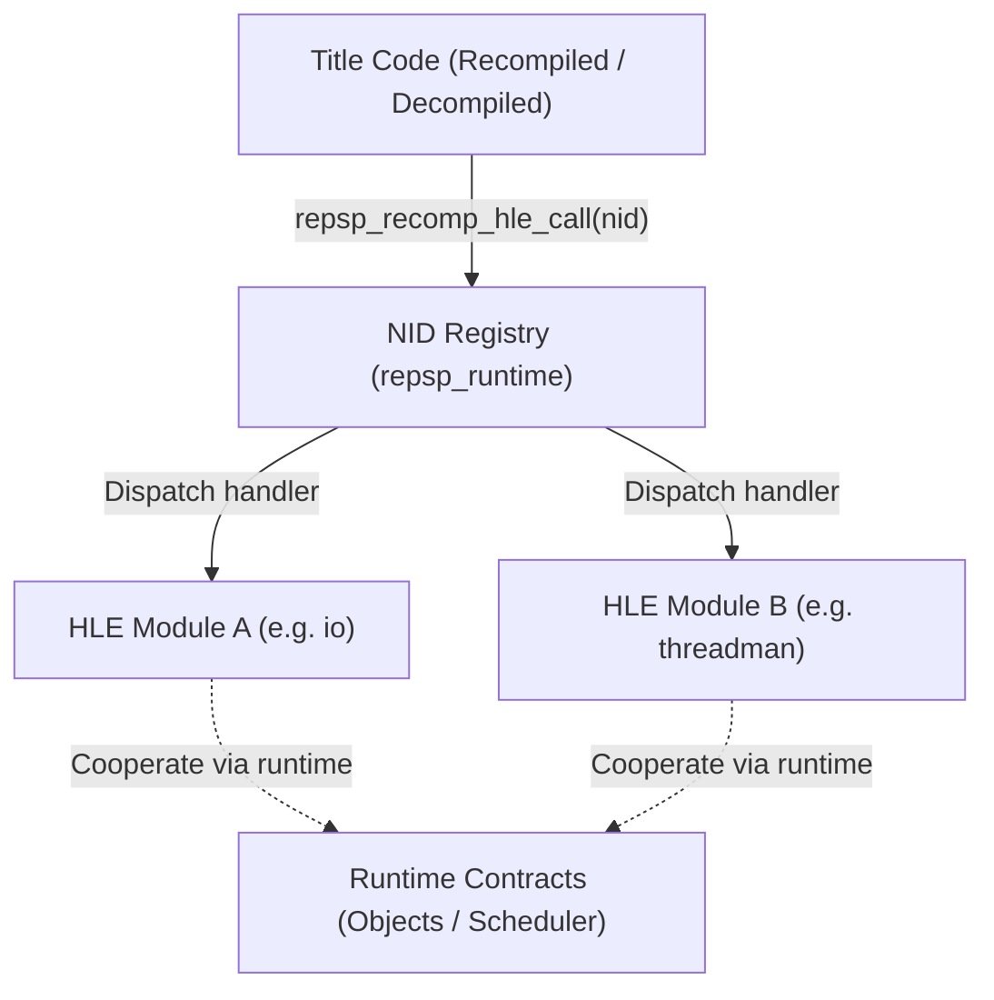

# HLE 모듈 원칙

이 디렉터리는 PSP 펌웨어 라이브러리의 High Level Emulation(HLE) 구현을 담는다.

## 1. 모듈 경계 및 의존 규칙

* HLE 모듈(`repsp_hle_<module>`)은 `repsp_runtime`(필요 시 `repsp_gpu` 또는 오디오 계약)만 링크한다.
* **다른 HLE 모듈을 직접 링크하거나 호출하지 않는다.** 모듈 간 협력은 런타임이 제공하는 공용 계약(스케줄러, 커널 객체 표, 이벤트 시스템)을 통해서만 이루어진다.
* 타이틀 코드(재컴파일 코드, 디컴파일 코드)는 HLE 모듈의 함수를 직접 부르지 않는다. HLE는 NID 레지스트리(`NidRegistry`)를 통해서만 호출된다.

---

# HLE Module Principles

This directory contains High Level Emulation (HLE) implementations of PSP firmware libraries.

## 1. Module Boundary and Dependency Rules

* An HLE module (`repsp_hle_<module>`) links `repsp_runtime` (and `repsp_gpu` or audio contracts when necessary) only.
* **Never link or call another HLE module directly.** Inter-module cooperation occurs solely through runtime contracts (the scheduler, kernel object table, event system).
* Title code (recompiled and decompiled code) never calls HLE modules directly; HLE is reached only through the NID registry (`NidRegistry`).
